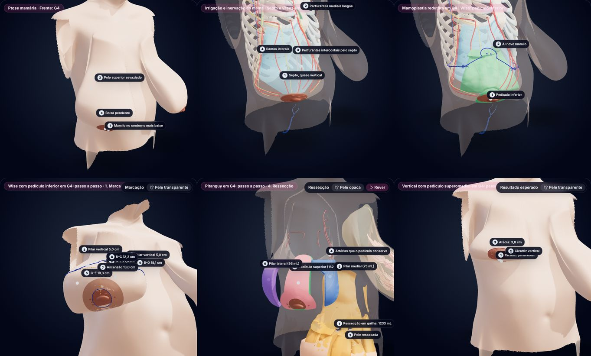
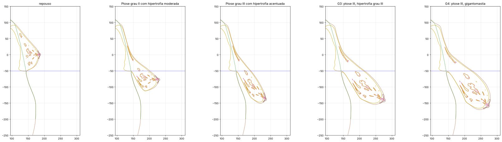

# Mamoplastia em mamas com ptose e hipertrofia G3 e G4

## Objetivo e situação

Levar tudo o que o app faz com a mama de ptose grau II (forma da mama, marcação, pedículos, ressecções, passo a passo animado, resultado esperado, vasos e nervos que acompanham o tecido) para duas mamas muito maiores e mais pendentes: **G3** e **G4**.

**Situação: implementado**, a partir do plano aprovado, com as recomendações do plano onde as decisões ficaram em aberto (lista em "Decisões tomadas"). Os números abaixo são os do app para as três técnicas da ptose II. Depois, com as técnicas por grau de ptose (`docs/plano-mamoplastia-tecnicas.md`), G3 e G4 ganharam o **Wise com pedículo superomedial** e G4 o **enxerto livre do complexo areolopapilar (Thorek)**, que tinha ficado pendente (fase E deste plano).

> **Leitura do pedido.** "Modelos de reconstrução" foi lido como a **remodelação da mama na mamoplastia redutora** (marcação → pedículo → ressecção → transposição → fechamento → resultado), replicada para as duas mamas novas. "G3 e G4" foi lido como os **graus III e IV de hipertrofia da classificação de Berrocal Revueltas**, com ptose grau III de Regnault.



*No app: G4 de frente; septo e vasos alongados; pedículo inferior com a fechadura; marcação do Wise com as medidas; ressecção do Pitanguy (quilha de 1.233 mL, pilares de 73 e 95 mL); resultado da vertical.*

## Definições

A classificação de Berrocal Revueltas gradua a hipertrofia pelo **peso ressecado por mama**: grau I até 500 g, II de 500 a 800 g, III de 800 a 1.000 g, IV (gigantomastia) 1.000 g ou mais. As ressecções da ptose II (100 a 171 g) são de grau I, e mesmo o estado "ptose III com hipertrofia acentuada" (866 mL) daria uma peça de grau I. Por isso G3 e G4 são estados novos da mama, não o grau III de ptose que já existia.

| Estado | Mamilo × sulco | Contorno inferior × sulco | Fúrcula–mamilo | Mamilo–sulco (pele) | Projeção | Mamilo–linha média | Volume | Regnault | Redução esperada |
|---|---|---|---|---|---|---|---|---|---|
| Sem ptose (o modelo) | 51 mm acima | 0 | 22,6 cm | 7,2 cm | 55 mm | 11,2 cm | 426 mL | — | — |
| Ptose II | 26 mm abaixo | 62 mm abaixo | 32,1 cm | 13,6 cm | 84 mm | 13,8 cm | 641 mL | grau II | a 500 mL: ≈ 130 g (I) |
| Ptose III | 89 mm abaixo | 101 mm abaixo | 37,3 cm | 14,9 cm | 66 mm | 14,1 cm | 866 mL | grau III | a 500 mL: ≈ 350 g (I) |
| **G3** | **93 mm abaixo** | **104 mm abaixo** | **41,8 cm** | **18,0 cm** | **107 mm** | **16,6 cm** | **1.684 mL (+295%)** | **grau III** | **a 700 mL: ≈ 930 g (III)** |
| **G4** | **111 mm abaixo** | **121 mm abaixo** | **44,2 cm** | **18,7 cm** | **102 mm** | **16,4 cm** | **2.105 mL (+394%)** | **grau III** | **a 850 mL: ≈ 1.190 g (IV)** |

Parâmetros (`scripts/hybrid/build_breast.py`, mm de descida do fluxo; inclinação; fatores de espessura, largura, comprimento abaixo do sulco e afinamento da bolsa):

| | Descida | Inclinação | Espessura | Largura | Comprimento | Bolsa | Volume final alvo |
|---|---|---|---|---|---|---|---|
| G3 | 80 | 1,3 | 2,40 | 1,85 | 1,30 | 0,50 | 700 mL |
| G4 | 84 | 1,4 | 2,90 | 2,00 | 1,40 | 0,60 | 850 mL |



*Perfil no meridiano da mama (lado operado; mm na carta, sulco em azul). O sulco não se move, o polo superior esvazia e a bolsa cresce e pende.*

No app: chips **G3** e **G4** no seletor **Forma da mama**, que mostra também o peso que a redução retiraria e o grau de Berrocal; perfis de G3 e G4, "Frente: G4" e "Corte sagital: G4" no pack **Ptose mamária**; e, na biblioteca, os grupos **Mamoplastia redutora: G3** e **Mamoplastia redutora: G4** (eram um grupo só, "Mamoplastia em G3 e G4"), cada um com o pack do plano e o passo a passo de cada técnica.

## Correções no modelo

1. **O crescimento passou a ser um fluxo.** O alargamento dobrava o tecido na borda lateral da ptose III (1,7% do monte, 7 mL em repouso). Agora o crescimento é um campo de velocidade integrado em 6 passos (RK4) no pipeline e no app (`breastMap.ts`), e um fluxo de campo suave não dobra. O pipeline confere o jacobiano em todo estado (mínimo aceito: 0,1; G4: 0,17). Efeito nos estados antigos: a ptose II passa de 647 para 641 mL e a III de 893 para 866 mL. As peças da ptose II mudam até 2 mL (quilha 182 → 180 mL; ferradura 111 → 109; inferior e lateral 107 → 105). Os resultados mudam 5 mL (465 → 460; 537 → 532; 541 → 535). `docs/plano-mamoplastia.md` foi atualizado.
2. **A quilha do Pitanguy não depende mais da janela da grade frontal.** Os lados da quilha iam até a borda de baixo da grade (−160 mm). Agora vão até uma altura fixa, a mesma de antes, e a grade cresce com a mama (em G4 desce a −194 mm).
3. **Raiz e quilha ancoradas no ponto A.** Na mama longa, o ápice da quilha passa a ficar 25 mm acima de A, a mesma relação da ptose II, e não 5 cm acima do mamilo, que em G4 fica 11 cm abaixo do sulco. Na ptose II nada muda.
4. **Inversão do mapa.** Onde a semente mais próxima leva o método de Newton para o lugar errado (tecido muito cisalhado de G4), ele recomeça das 12 sementes vizinhas. Todas as peças voltam ao repouso com erro abaixo de 0,001 mm.
5. **Vasos e nervos que furavam a pele.** Ver "Vasos e nervos".

## Volumes

### Como as peças das mamas grandes são desenhadas

As marcações seguem as mesmas regras da ptose II (ramos de 5 cm, 120° entre os ramos do T, aréola nova de 42 mm, colar de 10 mm, bases de 8 cm, pedículo superior de 25 mm). O que muda (`build_mammaplasty.py`, `design_for`):

- **Afinamento do pedículo:** o pedículo é afinado por trás até ficar com a fração do resultado que tem na ptose II (47% no Wise, 32% na vertical), nunca com menos de 20 mm sob a pele. Ele nunca é cortado abaixo da camada dos vasos em que se apoia (8 mm atrás deles) nem, no inferior, abaixo do plano do septo.
- **Retalhos de pele:** em volta do padrão, o tecido sob a pele é retirado até um retalho de 15 mm ou mais (10 mm mais grosso acima do ponto A), deixando 5 mm sobre a fáscia. A espessura é resolvida por bisseção até o volume final alvo. Fica fora um corredor de 12 mm em volta dos vasos e nervos de que cada pedículo depende, porque a base de um pedículo não é descolada.
- **Incisão no sulco:** termina a 5 mm de cada extremo do sulco (15 mm na ptose II).

O alvo de volume final do plano (500 e 525 mL) não é alcançável assim: com retalhos de 15 mm sobre um envelope de pele tão grande, e com pedículos que conservam seus vasos, sobram 700 a 1.100 mL. Por isso os alvos passaram a **700 mL (G3)** e **850 mL (G4)**. Para que as peças de G3 caíssem no grau III, G3 cresceu de 1.415 para 1.684 mL.

### Peças, peso e grau

| Caso | Técnica | Pedículo | Ressecção | Peso (0,95 g/mL) | % do monte | Grau da peça | Fica | Desenho |
|---|---|---|---|---|---|---|---|---|
| Ptose II (641 mL) | Pitanguy | 70 mL | 180 mL | 171 g | 28% | I | 460 mL | o aceito na revisão |
| | Wise | 251 mL | 109 mL | 103 g | 17% | I | 532 mL | |
| | Vertical | 175 mL | 105 mL | 100 g | 16% | I | 535 mL | |
| **G3 (1.684 mL)** | Pitanguy | 138 mL | 982 mL | **933 g** | 58% | **III** | 702 mL | retalhos de 15 mm |
| | Wise | 370 mL | 766 mL | **728 g** | 46% | II | 918 mL | pedículo afinado (limitado pelos vasos), retalhos de 15 mm |
| | Vertical | 224 mL | 927 mL | **881 g** | 55% | **III** | 757 mL | pedículo de 32 mm, retalhos de 15 mm |
| **G4 (2.105 mL)** | Pitanguy | 162 mL | 1.233 mL | **1.172 g** | 59% | **IV** | 871 mL | retalhos de 15 mm |
| | Wise | 435 mL | 969 mL | **921 g** | 46% | III | 1.136 mL | pedículo afinado (limitado pelos vasos), retalhos de 15 mm |
| | Vertical | 273 mL | 1.180 mL | **1.121 g** | 56% | **IV** | 924 mL | pedículo de 32 mm, retalhos de 15 mm |

O **pedículo inferior** é o limite: para conservar as perfurantes intercostais e o ramo da toracoacromial, que sobem pelo septo, ele mantém o tecido em volta dos vasos ao longo de toda a bolsa e fica com 370 e 435 mL. A peça fica um grau abaixo do caso e a mama que sobra é a maior das três. O app mostra isso nas vistas e nas fichas: é o pedículo de base larga que mais carrega tecido numa mama pendente.

Técnicas acrescentadas depois (`docs/plano-mamoplastia-tecnicas.md`): **Wise com pedículo superomedial** em G3 (pedículo de 224 mL afinado a 38,7 mm; peça de 913 mL, 867 g, grau III; fica 771 mL) e em G4 (272 mL a 40,4 mm; 1.152 mL, 1.095 g, grau IV; fica 952 mL), e **Thorek** em G4 (sem pedículo; retalhos de 46,5 mm; peça de 1.255 mL, 1.192 g, grau IV; fica 850 mL).

## Marcação

| Medida (pele em pé) | Ptose II | G3 | G4 |
|---|---|---|---|
| Fúrcula–ponto A | 27,2 cm | 28,1 cm | 28,9 cm |
| Ascensão do complexo areolopapilar | 3,6 cm | 11,2 cm | 13,0 cm |
| B–C em linha reta (T invertido) | 9,6 cm | 12,1 cm | 12,1 cm |
| Ramos horizontais B–D + C–E | 22,8 cm | 34,8 cm | 37,4 cm |
| Incisão no sulco D–E | 15,0 cm | 20,4 cm | 21,6 cm |
| Sobra a compensar no fechamento | 7,8 cm | 14,4 cm | 15,8 cm |
| Vertical: cúpula / ramos medial e lateral | 12,1 / 10,7 e 12,0 cm | 16,1 / 18,8 e 23,1 cm | 17,0 / 21,3 e 26,1 cm |
| Aréola do caso → areolótomo | 5,6 → 4,2 cm | 7,5 → 4,2 cm | 9,0 → 4,2 cm |

O ponto A segue a projeção do sulco no meridiano. Os ramos da vertical de 19 a 26 cm mostram por que essa técnica é pouco usada em reduções desse porte: no fechamento, os pilares e a pele são aproximados de muito longe.

## Pedículos e o que conservam

| Caso | Técnica | Artérias que chegam ao mamilo | Nervos |
|---|---|---|---|
| Ptose II | Pitanguy | torácica interna 2º e 3º | anterior do 3º; lateral do 3º |
| G3 | Pitanguy | **nenhuma** | anterior do 3º; lateral do 3º |
| G4 | Pitanguy | **nenhuma** | anterior do 3º |
| Ptose II | Wise | intercostais 4º–6º; toracoacromial | anterior do 3º; 4º profundo; lateral do 3º |
| G3 | Wise | intercostais 4º–6º; toracoacromial | anterior do 3º; lateral do 3º |
| G4 | Wise | intercostais 4º–6º; toracoacromial | anterior do 3º; 4º profundo |
| Ptose II | Vertical | torácica interna 2º–4º; intercostais 4º–6º; toracoacromial | anteriores do 3º ao 5º; 4º profundo; lateral do 3º |
| G3 | Vertical | torácica interna 2º e 3º | anterior do 3º; lateral do 3º |
| G4 | Vertical | torácica interna 2º | anteriores do 3º e do 5º |

- **Pitanguy:** o pedículo superior longo (subida de 11,2 e 13,0 cm) perde as perfurantes da torácica interna, que chegam ao complexo areolopapilar pela face medial e cruzam o padrão. A literatura descreve o pedículo superior longo como pouco confiável em mamas muito grandes, e as fichas e vistas dizem isso.
- **Wise:** o pedículo inferior, de 18 e 19 cm do sulco ao mamilo para uma base de 8 cm, conserva os vasos do septo. Há séries sem relação entre necrose e distância mamilo–sulco acima de 15 cm.
- **Vertical:** o pedículo superomedial afinado a 32 mm conserva as perfurantes altas da torácica interna.
- **G4:** fúrcula–mamilo de 44 cm, mamilo–sulco de 19 cm e peças acima de 1 kg, faixa em que muitos autores indicam o enxerto livre. Está nas fichas, e o enxerto livre (Thorek) agora está no app.
- **Wise com pedículo superomedial** (acrescentado depois): conserva as perfurantes da torácica interna do 2º e 3º espaços em G3 e a do 2º em G4, como a vertical, com a base na metade medial da fechadura e em todo o ramo vertical medial. **Thorek:** nenhum vaso ou nervo chega ao enxerto.

## Vasos e nervos: trajeto e tamanho

**Trajeto.** As regras de traçado não mudam: a forma da mama não altera o trajeto da inervação do complexo areolopapilar (Sarhadi et al., 1996), só o comprimento. O mapa leva as linhas de centro a cada estado. Onde a camada sob a pele afina, o pipeline empurra a linha de centro para dentro, de forma suave ao longo do ramo, até o tubo ficar a pelo menos 0,5 mm da pele. Isso vale para todos os estados e corrige também a ptose II e a III. Os deslocamentos vão em `breastAnatomy.json` (esparsos, 23 kB a mais) e o app os soma depois do mapa. Ramos empurrados: torácica lateral (superior e inferior), ramo cutâneo lateral do 5º e anterior do 3º (ptose II a G4); torácica interna do 2º e do 3º (ptose II e III); 4º intercostal superficial e lateral do 3º (G3 e G4); anteriores do 4º e do 5º (G4). Os ossos continuam a pelo menos 1,6 mm da linha de centro.

**Comprimento** (mm, da origem ao fim; nas fichas de cada ramo):

| Ramo | Ø de desenho | Repouso | Ptose II | Ptose III | G3 | G4 |
|---|---|---|---|---|---|---|
| Perfurante da torácica interna, 2º espaço | 2,5 → 1,2 mm | 151 | 241 | 284 | 322 | 343 |
| Perfurante da torácica interna, 3º | 2,2 → 1,2 | 130 | 218 | 262 | 296 | 316 |
| Perfurante da torácica interna, 4º | 2,0 → 1,2 | 120 | 207 | 251 | 287 | 307 |
| Ramo mamário lateral superior | 2,4 → 1,2 | 126 | 211 | 251 | 291 | 305 |
| Ramo mamário lateral inferior | 2,0 → 1,2 | 116 | 200 | 236 | 273 | 284 |
| Perfurante intercostal, 4º | 2,0 → 1,2 | 86 | 176 | 211 | 242 | 256 |
| Perfurante intercostal, 5º | 2,2 → 1,2 | 68 | 150 | 183 | 211 | 224 |
| Perfurante intercostal, 6º | 2,0 → 1,2 | 84 | 153 | 186 | 215 | 228 |
| Ramo mamário da toracoacromial | 2,2 → 1,2 | 121 | 208 | 244 | 273 | 287 |
| 4º intercostal, ramo profundo | 1,8 → 1,1 | 181 | 263 | 297 | 324 | 336 |
| 4º intercostal, ramo superficial | 1,6 → 1,0 | 153 | 238 | 283 | 323 | 338 |
| Ramo cutâneo lateral do 3º | 1,6 → 1,0 | 137 | 215 | 242 | 267 | 283 |
| Ramo cutâneo lateral do 5º | 1,6 → 1,0 | 142 | 225 | 255 | 274 | 282 |
| Ramo cutâneo anterior do 3º | 1,6 → 1,0 | 82 | 162 | 183 | 195 | 205 |
| Ramo cutâneo anterior do 4º | 1,6 → 1,0 | 104 | 193 | 237 | 273 | 293 |
| Ramo cutâneo anterior do 5º | 1,6 → 1,0 | 78 | 155 | 177 | 186 | 197 |

**Calibre:** mantido em todos os estados, com o afilamento traçado e exibido 1,35× maior para que o ramo possa ser visto e tocado. Não há estudo que mostre vasos mais calibrosos na hipertrofia; a perfurante dominante mede 1,8 ± 0,8 mm em séries de reconstrução. A queda da sensibilidade do complexo areolopapilar com o tamanho e a ptose (Tairych et al., 1998) está na vista "Septo e vasos em G3/G4" do pack Irrigação e inervação.

**Nos passos:** os ramos seguem o tecido como na ptose II (o que está na peça sai com ela, o que está no pedículo se dobra e é sepultado), já com o deslocamento de cada estado.

## Passo a passo e resultado

As mesmas etapas da ptose II (11, 10 e 9 vistas), com a aréola do caso, a peça afastada mais longe (proporcional à raiz cúbica do volume) e a câmera mais distante (a mesma razão, em relação à ptose II). A saia de pele em volta da área operada tem 25 mm (15 mm na ptose II), porque o contorno muda até 16 mm. O tronco abre o recorte de cada caso.

| | Ptose II (3 técnicas) | G3: Pitanguy · Wise · vertical | G4: Pitanguy · Wise · vertical |
|---|---|---|---|
| Mamilo × sulco | 1,5 cm acima | 1,5 cm acima | 1,5 cm acima |
| Fúrcula–mamilo | 25,6 · 26,2 · 26,2 cm | 27,7 · 29,5 · 28,1 cm | 29,1 · 31,4 · 29,6 cm |
| Mamilo–sulco (pele) | 7,1 · 7,5 · 7,5 cm | 8,6 · 10,1 · 9,0 cm | 9,8 · 11,5 · 10,1 cm |
| Pilar vertical (cicatriz) | 5,1 · 5,6 · 4,8 cm | 6,8 · 8,4 · 6,6 cm | 8,1 · 10,0 · 7,8 cm |
| Projeção | 6,4 · 7,1 · 7,2 cm | 8,8 · 10,7 · 9,3 cm | 10,3 · 12,4 · 10,7 cm |
| Volume | 460 · 532 · 535 mL | 702 · 918 · 756 mL | 871 · 1.136 · 924 mL |
| Pilares ou retalhos (medial / lateral) | 33/46 · 21/31 · 22/37 mL | 64/76 · 44/75 · 26/41 mL | 73/95 · 57/94 · 30/42 mL |
| Aréola no resultado | 4,1 cm | 3,7 a 3,8 cm | 3,7 a 3,8 cm |

O pilar vertical fica acima dos 5 cm pretendidos. Com mamas de 0,7 a 1,1 L, o polo inferior já está no mínimo que o modelo permite (12% do comprimento do mapa) e a distância mamilo–sulco do resultado é de 8,6 a 11,5 cm.

## No app

| Item | Antes | Agora |
|---|---|---|
| Estados da mama | 3 | 5; mapa no aparelho em ≈ 2,8 s no desktop e ≈ 1,0 s no celular (medido em Node; eram 1,9 e 0,7 s com 3 estados) |
| Pele refinada | só no celular, uniforme | uniforme no celular e, nos dois modelos, mais um nível onde o estado maior estica a aresta além de 12 mm. No celular, a aresta p95 em G4 cai de 30 para 10,5 mm (de 36 mil para 112 mil triângulos na pele) |
| Planos (marcação e peças) | `mammaplasty.json` + `.bin` (177 kB) | um par por caso: G3 310 kB, G4 335 kB de peças, com hash no endereço |
| Passo a passo | 3 binários (0,66–0,91 MB) | 9; os de G3 e G4 têm 0,71 a 0,97 MB e só são baixados quando a técnica abre |
| Dados no pacote do app | primeira carga de 509 kB | 567 kB (os metadados de G3 e G4 entram no pacote; os binários, não) |
| Service worker | cache v6 | v7 |

Arquivos: `src/data/planCases.ts` junta os casos; `mammaplasty.ts` gera vistas, fichas e packs por caso; `mammaplastySteps.ts` e `breastAnatomy.ts` leem todos os casos; `HybridModel.tsx` recorta a pele do tronco pelo contorno do caso aberto.

Depois desta rodada (`docs/plano-mamoplastia-tecnicas.md`): cinco casos (ptose I a III, G3, G4), um grupo da biblioteca por grau, peças dos planos baixadas por caso quando ficam visíveis, primeira carga de 645 kB e cache v9.

## Decisões tomadas

As decisões que ficaram em aberto no plano seguiram as recomendações dele:

| Decisão | Adotado |
|---|---|
| Leitura do pedido | Mamoplastia redutora em G3 e G4 |
| G3 e G4 | Graus III e IV de Berrocal Revueltas, com ptose grau III |
| Volume final | 700 e 850 mL (o plano propunha 500 e 525 mL; ver "Volumes") |
| Técnicas | As três em cada caso, como réplica; Pitanguy mantido como ensino do pedículo superior longo; vertical mantida |
| Ponto A | Projeção do sulco |
| Calibre | Mantido |
| Crescimento como fluxo | Para todos os estados (a ptose II foi regenerada) |
| Biblioteca | Um pack por técnica e por caso, num grupo próprio |
| Aréola de ensino | 7,5 e 9,0 cm, areolótomo de 4,2 cm |

## Pendências e decisões que dependem de você

1. ~~**Enxerto livre do complexo areolopapilar (Thorek) em G4.**~~ Feito, com a sequência proposta no plano (coleta do disco de 4,2 cm, amputação, fechamento em T, leito receptor, enxerto com curativo de Brown): `docs/plano-mamoplastia-tecnicas.md`.
2. **Pedículo inferior volumoso.** Mantido assim para conservar os vasos do septo. Se preferir chegar ao grau do caso, a alternativa é afinar além da camada dos vasos (o app então mostraria esses vasos cortados).
3. **Vertical em G4.** Mantida como réplica, e o Wise com pedículo superomedial (Orlando e Guthrie) foi acrescentado ao lado dela em G3 e G4. A vertical pode ser retirada dessas mamas se você preferir.
4. **Volumes finais de 700 e 850 mL.** Para chegar mais perto de 500 mL seria preciso um padrão de pele maior (ramos horizontais estendidos para a axila, ângulo do T mais aberto).
5. Os nomes dos estados antigos ("hipertrofia leve, moderada, acentuada") ficaram; o seletor agora mostra ao lado o grau de Berrocal que a redução daria.

## Limitações

- **Arquétipos geométricos.** G3 e G4 são a mesma mama do modelo (adiposa, 426 mL, de uma mulher de 59 anos) crescida por um mapa. A proporção entre glândula e gordura não muda, e o corpo não engorda junto.
- **A bolsa não encosta no abdome**, como na ptose III.
- **Peças retas, de frente para trás**, na mama em pé, como na ptose II. O afinamento dos retalhos e do pedículo é por camadas a partir da pele, não por dissecção.
- **Grau de Berrocal estimado** pelo volume da peça × 0,95 g/mL.
- **Resultado esperado, não previsão:** o fechamento é resolvido na pele, sem tensão nem orelhas, e a forma é a da mama logo depois da cirurgia.
- **Literatura** conferida por título, resumo e citações secundárias. A fonte primária de Berrocal Revueltas não foi localizada; as faixas vêm de artigos brasileiros que a citam.

## Reprodução

```bash
node scripts/hybrid/decode_model.mjs
python3 scripts/hybrid/build_breast.py                 # 5 estados, jacobiano, Berrocal esperado
npm run check:breast                                   # mapa do app × pipeline (≤ 0,001 mm)
python3 scripts/hybrid/build_breast_anatomy.py         # trajetos, folga sob a pele e comprimentos por estado
python3 scripts/hybrid/build_mammaplasty.py            # [--case g3] desenho, marcação e peças de cada caso
python3 scripts/hybrid/build_mammaplasty_steps.py      # [--case g3] passo a passo de cada caso (≈ 3 min por caso)
```

## Referências

- Regnault P. Breast ptosis: definition and treatment. *Clin Plast Surg* 1976;3(2):193–203.
- Classificação de Berrocal Revueltas (hipertrofia mamária pelo peso ressecado: I até 500 g; II 500–800 g; III 800–1.000 g; IV ≥ 1.000 g), citada em artigos da *Revista Brasileira de Cirurgia Plástica* e de periódicos brasileiros; fonte primária a conferir.
- Dancey A, Khan M, Dawson J, Peart F. Gigantomastia – a classification and review of the literature. *J Plast Reconstr Aesthet Surg* 2008;61(5):493–502.
- Dafydd H, Roehl KR, Phillips LG, Dancey A, Peart F, Shokrollahi K. Redefining gigantomastia. *J Plast Reconstr Aesthet Surg* 2011;64(2):160–163.
- Inferior pedicle breast reduction and long nipple-to-inframammary fold distance: how long is safe? *J Plast Reconstr Aesthet Surg* 2021 (PMID 33127349).
- Surgical outcomes of gigantomastia breast reduction superomedial pedicle technique: a 12-year retrospective study (PMID 23542843).
- Double-unit superomedio-central (DUS) pedicle inverted-T reduction mammaplasty for gigantomastia. *Aesthetic Plast Surg* 2021 (doi:10.1007/s00266-021-02351-y): enxerto livre considerado a partir de 40 cm de fúrcula–mamilo; os autores, a partir de 45 cm.
- Orlando JC, Guthrie RH. The superomedial dermal pedicle for nipple transposition. *Br J Plast Surg* 1975;28(1):42–45.
- Thorek M. Possibilities in the reconstruction of the human form. *N Y Med J* 1922;116:572–575.
- Casas LA, Byun MY, Depoli PA. Maximizing breast projection after free-nipple-graft reduction mammaplasty. *Plast Reconstr Surg* 2001;107(4):955–960.
- Free nipple graft: current indications and applications of a centenary breast surgery technique – an integrative review. *Mastology* 2022.
- Sarhadi NS, Shaw Dunn J, Lee FD, Soutar DS. An anatomical study of the nerve supply of the breast, including the nipple and areola. *Br J Plast Surg* 1996;49(3):156–164.
- Schlenz I, Kuzbari R, Gruber H, Holle J. The sensitivity of the nipple-areola complex: an anatomic study. *Plast Reconstr Surg* 2000;105(3):905–909.
- Tairych GV, Kuzbari R, Rigel S, Todoroff BP, Schneider B, Deutinger M. Normal cutaneous sensibility of the breast. *Plast Reconstr Surg* 1998;102(3):701–704.
- Angiotomografia das artérias mamárias no planejamento da mamoplastia redutora, 60 pacientes. *Egypt J Radiol Nucl Med* 2023 (doi:10.1186/s43055-023-01170-2).
- Estudo radioanatômico das perfurantes da torácica interna (2014; perfurante dominante de 1,8 ± 0,8 mm em 197 pacientes); referência completa a conferir.
- von Funck W, Theisel H, Seidel H-P. Vector field based shape deformations. *ACM Trans Graph* 2006;25(3):1118–1125.
- Demais referências das técnicas em `docs/plano-mamoplastia.md`.
