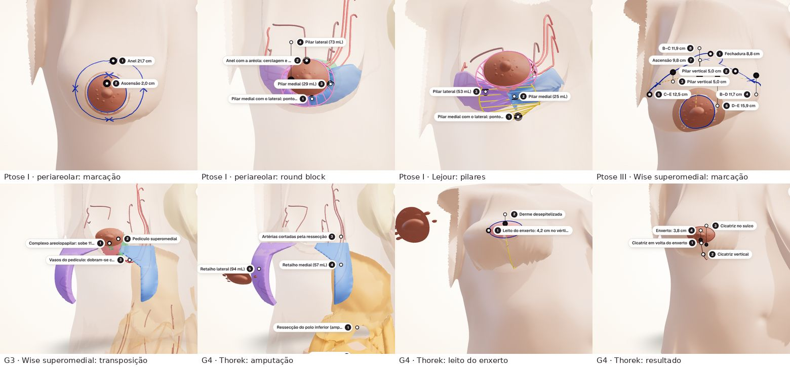
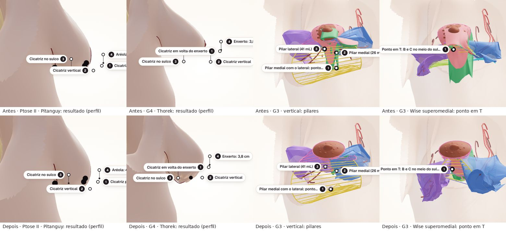
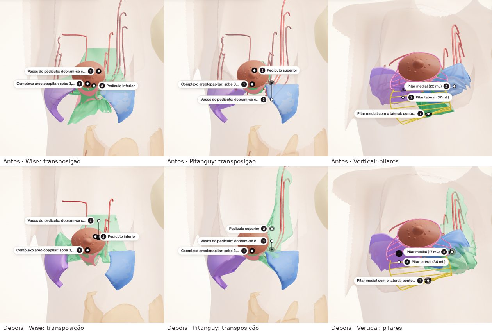

# Mamoplastia redutora: técnicas por grau de ptose

## Objetivo e situação

Ter no app, para cada grau de ptose, as técnicas de mamoplastia redutora que esse grau pede, cada uma com tudo o que as três primeiras já tinham na ptose II: marcação na pele em pé, pedículo e ressecção como volumes, o que a técnica conserva e secciona, o passo a passo animado e o resultado esperado.

**Situação: implementado e revisado.** São 19 sequências em cinco mamas, com sete técnicas. Os números abaixo são os do app. A revisão (seção "Revisão: menus, forma do resultado, aréola e transições") reorganizou os menus do celular por grau e por técnica, arredondou o polo inferior do resultado, tirou o tecido que cobria a aréola e suavizou as transições, em todas as técnicas. A segunda revisão (seção "Segunda revisão") mostra o pedículo inteiro, da entrada das suas artérias na parede torácica até o complexo areolopapilar, com a base presa à parede em todos os passos; aumenta a cúpula da aréola para 14 cm; deixa legíveis as vistas com a pele transparente; e tira os planejamentos, que repetiam o passo a passo.

> **Leitura do pedido.** "Incluir as diferentes técnicas de mamoplastia com diferentes graus de ptose" foi lido como uma **matriz técnica × grau**: cada mama do atlas (ptose graus I, II e III de Regnault, e as hipertrofias G3 e G4) recebe as técnicas indicadas para ela, e entram as técnicas que faltavam para cobrir os extremos: a **periareolar** e a **vertical de Lejour** nas ptoses leves, o **Wise com pedículo superomedial** nas mamas longas e o **enxerto livre do complexo areolopapilar (Thorek)** na gigantomastia. As duas últimas estavam como pendência em `docs/plano-mamoplastia-g3-g4.md`.

| Mama | Monte | Subida do complexo areolopapilar | Técnicas |
|---|---|---|---|
| Ptose grau I, hipertrofia leve | 527 mL | 2,0 cm | periareolar de Benelli (round block); Lejour |
| Ptose grau II, hipertrofia moderada | 641 mL | 3,6 cm | Pitanguy; Wise com pedículo inferior; vertical com pedículo superomedial; Lejour |
| Ptose grau III, hipertrofia acentuada | 866 mL | 9,8 cm | Pitanguy; Wise com pedículo inferior; vertical com pedículo superomedial; Wise com pedículo superomedial |
| G3 (ptose III, hipertrofia grau III) | 1.684 mL | 11,2 cm | as quatro da ptose III |
| G4 (ptose III, gigantomastia) | 2.105 mL | 13,0 cm | as quatro da ptose III e Thorek (enxerto livre) |



*No app: na ptose I, a marcação periareolar (anel de 21,7 cm), o round block com os pilares e a cerclagem, e os pilares do Lejour; o Wise com pedículo superomedial na ptose III (marcação) e em G3 (transposição); em G4, a amputação do Thorek com o enxerto ao lado, o leito no vértice do cone e o resultado.*

## Uma técnica em três partes

O pipeline passou a tratar uma técnica como a combinação de **padrão de pele**, **pedículo** e **ressecção**. O Lejour e o Wise com pedículo superomedial combinam partes que já existiam; a periareolar trouxe um padrão de pele novo (o anel) e o pedículo central; o Thorek é o T invertido sem pedículo, com o enxerto livre.

| Técnica | Padrão de pele | Pedículo | Ressecção | Cicatriz |
|---|---|---|---|---|
| Pitanguy | T invertido, sem fechadura | superior dermoglandular (25 mm) | em quilha | periareolar, vertical, sulco |
| Wise com pedículo inferior | Wise (fechadura) | inferior, espessura total | em ferradura | periareolar, vertical, sulco |
| Vertical com pedículo superomedial | cúpula e dois ramos | superomedial, espessura total | inferior e lateral | periareolar, vertical |
| **Lejour** | cúpula e dois ramos | superior dermoglandular (25 mm) | central inferior, com quilha sob o pedículo | periareolar, vertical |
| **Wise com pedículo superomedial** (Orlando e Guthrie) | Wise (fechadura) | superomedial, espessura total | inferior e lateral, com as cunhas | periareolar, vertical, sulco |
| **Periareolar de Benelli** | anel excêntrico em volta da aréola | central (a aréola não é transposta) | cunha central inferior | periareolar |
| **Thorek** | T invertido, sem fechadura | nenhum: enxerto livre | amputação do polo inferior | em volta do enxerto, vertical, sulco |

Por que cada técnica está onde está:

- **Periareolar só na ptose I.** O anel só comporta subidas curtas e reduções pequenas: o perímetro do anel não deve passar de cerca de duas vezes o da aréola.
- **Lejour nas ptoses I e II.** O pedículo superior se dobra para subir; na ptose III a subida de quase 10 cm o dobraria demais. O Pitanguy foi mantido nas mamas longas para mostrar exatamente isso (no modelo, nenhuma artéria chega ao mamilo por ele a partir da ptose III).
- **Wise com pedículo superomedial a partir da ptose III.** É a alternativa ao pedículo inferior longo: o complexo areolopapilar gira até a fechadura em vez de subir do sulco.
- **Thorek só em G4.** Fúrcula–mamilo de 44 cm e peça acima de 1 kg: a faixa em que muitos autores indicam a amputação com enxerto livre.

## Regras novas do pipeline

1. **Ponto A nunca a menos de 2 cm do mamilo.** Na ptose I o mamilo já está na altura do sulco (1 mm acima), e a regra "A = projeção do sulco no meridiano" não daria subida nenhuma: a fechadura e a cúpula coincidiriam com a aréola. Agora, quando a projeção do sulco fica a menos de 20 mm de pele acima do mamilo, A é posto 20 mm acima dele (`MIN_RISE`, `pilot_mammaplasty.Standing`). Nas outras mamas nada muda.
2. **Marcação periareolar (`ring`).** Dois traços: o do areolótomo (4,2 cm) e um anel oval excêntrico. O topo do anel é a borda superior da nova aréola; abaixo e dos lados ele passa 10 e 12 mm por fora do areolótomo. Na ptose I o anel tem 21,7 cm de perímetro para uma aréola de 13,2 cm (razão 1,6) e tira 2,0 cm de pele acima da aréola. Pontos nomeados: A, S, I, M e L.
3. **Pedículo central e cunha.** A coluna de glândula sob o anel é o pedículo: espessura total fora da cunha e uma camada dermoglandular de 20 mm sobre ela. A cunha começa 25 mm acima do mamilo, com 40 mm de largura, e se abre até 100 mm embaixo; sob a pele do polo inferior fica um retalho de 15 mm. A derme do anel só é incisada abaixo do mamilo (é por onde se chega à glândula), então os ramos superficiais que chegam por cima e pelos lados são conservados.
4. **Lejour.** Padrão da vertical. O pedículo é a lâmina dermoglandular de 25 mm entre a cúpula e o complexo areolopapilar, e toda a cúpula, só desepitelizada, é a sua base. Sai o polo inferior entre os ramos, em espessura total, e uma quilha sob o pedículo.
5. **Wise com pedículo superomedial.** Padrão do Wise. A base do pedículo é a metade medial da fechadura e **todo** o ramo vertical medial: 9,4 cm de base sobre a pele (12 cm desde a segunda revisão, com a fechadura de 14 cm). Com a base de 8 cm da técnica vertical, as perfurantes da torácica interna do 2º e 3º espaços cruzavam o ramo vertical medial logo abaixo do fim da base, em G3 e G4, e contavam como seccionadas; na mama longa elas chegam baixo, e a base tem de incluí-las. Com a base inteira, o Wise superomedial passou a conservar TI 2 e 3 em G3 e TI 2 em G4 (antes, nenhuma), e TI 4 na ptose III.
6. **Thorek.** Padrão do Pitanguy, sem pedículo. O complexo areolopapilar sai como enxerto de pele total antes da ressecção e o que fica dentro do padrão é amputado. Os retalhos em volta do padrão ficam com a espessura que leva a mama ao volume-alvo (46,5 mm em G4, para 850 mL). O leito do enxerto é um disco de 4,2 cm no vértice do cone, marcado e desepitelizado com a mama já fechada.
7. **Teste do que é seccionado.** Um ramo cruza a incisão no ponto exato em que o seu trajeto corta o contorno do padrão (antes era o ponto médio entre as duas amostras do trajeto de cada lado do contorno, que podia cair fora da base do pedículo quando o ramo a cruzava perto da borda). Nenhum resultado das técnicas antigas mudou; a regra passou a ser exata.

## Peças e o que cada técnica conserva

Volumes medidos na mama em pé; peso a 0,95 g/mL; o pedículo inclui a haste até a entrada das suas artérias (segunda revisão). Em G3 e G4 os pedículos são afinados e os retalhos ficam com 15 mm ou mais para a mama chegar a 700 e 850 mL (`docs/plano-mamoplastia-g3-g4.md`); nas ptoses I a III as dimensões são as aceitas na revisão, sem alvo de volume. TI: perfurante da torácica interna (2º a 4º espaço); IC: perfurante intercostal (4º a 6º); TA: ramo da toracoacromial; ML: ramo mamário lateral; CA e CL: ramos cutâneos anteriores e laterais; "4º prof" e "4º sup": ramos profundo e superficial do 4º intercostal.

| Mama | Técnica | Subida do CAP | Pedículo | Peça | % do monte | Fica | Artérias que chegam ao mamilo | Nervos conservados |
|---|---|---|---|---|---|---|---|---|
| Ptose I (527 mL) | Periareolar de Benelli (round block) | 2,0 cm | 232 mL | 77 mL ≈ 73 g | 15% | 450 mL | TI 2, TI 3, TI 4, ML sup | CA 3, CA 4, CA 5, 4º sup, CL 3, CL 5 |
| Ptose I (527 mL) | Lejour (vertical com pedículo superior) | 2,0 cm | 131 mL | 74 mL ≈ 70 g | 14% | 453 mL | TI 2, TI 3, TI 4, ML sup, ML inf | CA 3, CA 4, CA 5, 4º sup, CL 3 |
| Ptose II (641 mL) | Pitanguy | 3,6 cm | 152 mL | 180 mL ≈ 171 g | 28% | 460 mL | TI 2, TI 3 | CA 3, CL 3 |
| Ptose II (641 mL) | Wise com pedículo inferior | 3,6 cm | 250 mL | 88 mL ≈ 84 g | 14% | 552 mL | IC 4, IC 5, IC 6, TA | CA 3, 4º prof, CL 3 |
| Ptose II (641 mL) | Vertical com pedículo superomedial | 3,6 cm | 275 mL | 99 mL ≈ 94 g | 15% | 542 mL | IC 4, IC 5, IC 6, TI 2, TI 3, TI 4, TA | CA 3, CA 4, 4º prof, CL 3 |
| Ptose II (641 mL) | Lejour (vertical com pedículo superior) | 3,6 cm | 140 mL | 134 mL ≈ 127 g | 21% | 507 mL | TI 2, TI 3, TI 4, ML sup | CA 3, CA 4, 4º sup, CL 3 |
| Ptose III (866 mL) | Pitanguy | 9,8 cm | 130 mL | 315 mL ≈ 299 g | 36% | 551 mL | nenhuma | CA 3, CA 5, CL 3 |
| Ptose III (866 mL) | Wise com pedículo inferior | 9,8 cm | 285 mL | 199 mL ≈ 189 g | 23% | 668 mL | IC 4, IC 5, IC 6, TA | CA 3, CA 5, CL 3 |
| Ptose III (866 mL) | Vertical com pedículo superomedial | 9,8 cm | 340 mL | 206 mL ≈ 196 g | 24% | 660 mL | IC 4, IC 5, IC 6, TI 2, TI 3, TI 4 | CA 3, 4º prof, CL 3 |
| Ptose III (866 mL) | Wise com pedículo superomedial | 9,8 cm | 349 mL | 193 mL ≈ 183 g | 22% | 674 mL | IC 4, IC 5, IC 6, TI 2, TI 3, TI 4 | CA 3, CA 4, CA 5, CL 3 |
| G3 (1684 mL) | Pitanguy | 11,2 cm | 138 mL | 982 mL ≈ 933 g, III | 58% | 702 mL | nenhuma | CA 3, CL 3 |
| G3 (1684 mL) | Wise com pedículo inferior | 11,2 cm | 370 mL (afinado a 20,0 mm) | 726 mL ≈ 690 g, II | 43% | 958 mL | IC 4, IC 5, IC 6, TA | CA 3, CL 3 |
| G3 (1684 mL) | Vertical com pedículo superomedial | 11,2 cm | 333 mL (afinado a 33,5 mm) | 905 mL ≈ 860 g, III | 54% | 779 mL | TI 2, TI 3 | CA 3, CL 3 |
| G3 (1684 mL) | Wise com pedículo superomedial | 11,2 cm | 334 mL (afinado a 35,7 mm) | 897 mL ≈ 852 g, III | 53% | 787 mL | TI 2, TI 3 | CA 3, CA 4, CL 3 |
| G4 (2105 mL) | Pitanguy | 13,0 cm | 162 mL | 1.233 mL ≈ 1.172 g, IV | 59% | 871 mL | nenhuma | CA 3 |
| G4 (2105 mL) | Wise com pedículo inferior | 13,0 cm | 435 mL (afinado a 20,0 mm) | 916 mL ≈ 870 g, III | 44% | 1.189 mL | IC 4, IC 5, IC 6, TA | CA 3, 4º prof |
| G4 (2105 mL) | Vertical com pedículo superomedial | 13,0 cm | 271 mL (afinado a 35,2 mm) | 1.151 mL ≈ 1.093 g, IV | 55% | 954 mL | nenhuma | CA 3 |
| G4 (2105 mL) | Wise com pedículo superomedial | 13,0 cm | 366 mL (afinado a 37,4 mm) | 1.137 mL ≈ 1.080 g, IV | 54% | 968 mL | TI 2, TI 3 | CA 3 |
| G4 (2105 mL) | Thorek (enxerto livre do complexo areolopapilar) | 13,0 cm | sem pedículo | 1.255 mL ≈ 1.192 g, IV | 60% | 850 mL | nenhuma | nenhum |

O que os números mostram:

- **Ptose I.** As duas técnicas tiram cerca de 15% do monte (cerca de 75 g) e conservam as perfurantes da torácica interna e o ramo mamário lateral superior, que chegam por cima e pelos lados. Nenhuma das duas conserva as perfurantes intercostais, que sobem pelo septo: na periareolar elas atravessam a cunha.
- **Ptose II.** O Lejour tira mais que a vertical superomedial (o polo inferior sai em espessura total e não há pedículo espesso a preservar), mas conserva menos: só as perfurantes do 2º e 3º espaços.
- **Ptose III.** O pedículo superior de Pitanguy não conserva nenhuma artéria da camada esquemática. O Wise superomedial, como a vertical superomedial, conserva tanto as perfurantes da torácica interna quanto as intercostais, e tira um pouco mais (216 g contra 199 g).
- **G3 e G4.** O Wise superomedial fica igual à vertical superomedial no que conserva (TI 2 e 3 em G3; só TI 2 em G4) e tira quase o mesmo peso. O Thorek é o que mais tira (1.192 g) e leva a mama aos 850 mL do alvo, ao custo de todos os vasos e nervos do complexo areolopapilar.

## Passo a passo e resultado

Os quadros de cada técnica estão em `SCHEDULES` (`build_mammaplasty_steps.py`). O Lejour usa os da vertical e o Wise superomedial os do Wise. Os dois novos:

- **Periareolar:** marcação; desepitelização do anel; ressecção da cunha; montagem da glândula (o complexo areolopapilar sobe com o cone, sem pedículo a dobrar); pilares e round block (pontos profundos entre os pilares e cerclagem da pele em volta da aréola); sutura da aréola.
- **Thorek:** marcação; coleta do enxerto e incisão; amputação do polo inferior; ponto em T; sutura vertical; sutura no sulco (pele fechada); leito do enxerto (marcado no vértice do cone e desepitelizado); enxertia. Não há quadro de transposição: o enxerto fica ao lado da mama desde a coleta e só volta no último quadro.

Em todas as sequências o fechamento deixou **0 vértices sem condição**, e o mamilo fica 15 mm acima do sulco no resultado.

Medidas no modelo, antes → depois (mamilo × sulco, fúrcula–mamilo e mamilo–sulco sobre a pele, projeção, volume e aréola), com a forma do resultado da revisão:

| Mama | Técnica | Quadros | Mamilo × sulco | Fúrcula–mamilo | Mamilo–sulco (pele) | Projeção | Volume | Cicatriz vertical | Aréola |
|---|---|---|---|---|---|---|---|---|---|
| Ptose I | Periareolar | 6 | 1 mm acima → 15 mm acima | 28,4 → 25,4 cm | 10,5 → 7,5 cm | 68 → 62 mm | 530 → 450 mL | — | 5,0 → 4,2 cm |
| Ptose I | Lejour | 7 | 1 mm acima → 15 mm acima | 28,4 → 25,4 cm | 10,5 → 7,6 cm | 68 → 62 mm | 530 → 450 mL | 4,0 cm | 5,0 → 4,2 cm |
| Ptose II | Pitanguy | 9 | 26 mm abaixo → 15 mm acima | 32,1 → 25,5 cm | 13,6 → 7,6 cm | 84 → 63 mm | 640 → 460 mL | 5,6 cm | 5,6 → 4,1 cm |
| Ptose II | Wise | 8 | 26 mm abaixo → 15 mm acima | 32,1 → 26,1 cm | 13,6 → 8,7 cm | 84 → 70 mm | 640 → 550 mL | 6,7 cm | 5,6 → 4,1 cm |
| Ptose II | Vertical | 7 | 26 mm abaixo → 15 mm acima | 32,1 → 26,0 cm | 13,6 → 8,6 cm | 84 → 70 mm | 640 → 540 mL | 5,4 cm | 5,6 → 4,1 cm |
| Ptose II | Lejour | 7 | 26 mm abaixo → 15 mm acima | 32,1 → 25,8 cm | 13,6 → 8,2 cm | 84 → 67 mm | 640 → 510 mL | 5,1 cm | 5,6 → 4,1 cm |
| Ptose III | Pitanguy | 9 | 89 mm abaixo → 15 mm acima | 37,3 → 26,1 cm | 14,9 → 8,7 cm | 66 → 70 mm | 870 → 550 mL | 6,7 cm | 6,5 → 4,1 cm |
| Ptose III | Wise | 8 | 89 mm abaixo → 15 mm acima | 37,3 → 26,8 cm | 14,9 → 9,9 cm | 66 → 79 mm | 870 → 670 mL | 7,9 cm | 6,5 → 4,0 cm |
| Ptose III | Vertical | 7 | 89 mm abaixo → 15 mm acima | 37,3 → 26,8 cm | 14,9 → 9,8 cm | 66 → 78 mm | 870 → 660 mL | 6,7 cm | 6,5 → 4,0 cm |
| Ptose III | Wise superomedial | 8 | 89 mm abaixo → 15 mm acima | 37,3 → 26,9 cm | 14,9 → 9,9 cm | 66 → 79 mm | 870 → 670 mL | 8,0 cm | 6,5 → 4,0 cm |
| G3 | Pitanguy | 9 | 93 mm abaixo → 15 mm acima | 41,8 → 27,0 cm | 18,0 → 10,2 cm | 107 → 81 mm | 1.680 → 700 mL | 8,3 cm | 7,5 → 3,9 cm |
| G3 | Wise | 8 | 93 mm abaixo → 15 mm acima | 41,8 → 28,6 cm | 18,0 → 12,2 cm | 107 → 98 mm | 1.680 → 960 mL | 10,6 cm | 7,5 → 3,7 cm |
| G3 | Vertical | 7 | 93 mm abaixo → 15 mm acima | 41,8 → 27,5 cm | 18,0 → 10,9 cm | 107 → 86 mm | 1.680 → 780 mL | 8,0 cm | 7,5 → 3,9 cm |
| G3 | Wise superomedial | 8 | 93 mm abaixo → 15 mm acima | 41,8 → 27,6 cm | 18,0 → 11,0 cm | 107 → 87 mm | 1.680 → 790 mL | 9,1 cm | 7,5 → 3,9 cm |
| G4 | Pitanguy | 9 | 111 mm abaixo → 15 mm acima | 44,2 → 28,1 cm | 18,7 → 11,7 cm | 102 → 92 mm | 2.100 → 870 mL | 9,9 cm | 9,0 → 3,8 cm |
| G4 | Wise | 8 | 111 mm abaixo → 15 mm acima | 44,2 → 30,3 cm | 18,7 → 13,2 cm | 102 → 113 mm | 2.100 → 1.190 mL | 11,7 cm | 9,0 → 3,7 cm |
| G4 | Vertical | 7 | 111 mm abaixo → 15 mm acima | 44,2 → 28,6 cm | 18,7 → 12,2 cm | 102 → 97 mm | 2.100 → 950 mL | 9,5 cm | 9,0 → 3,8 cm |
| G4 | Wise superomedial | 8 | 111 mm abaixo → 15 mm acima | 44,2 → 28,7 cm | 18,7 → 12,3 cm | 102 → 98 mm | 2.100 → 970 mL | 10,6 cm | 9,0 → 3,8 cm |
| G4 | Thorek | 8 | 111 mm abaixo → 15 mm acima | 44,2 → 27,9 cm | 18,7 → 11,5 cm | 102 → 91 mm | 2.100 → 850 mL | 9,8 cm | 9,0 → 3,8 cm |

## Revisão: menus, forma do resultado, aréola e transições

Pedido da revisão: menus do celular com as técnicas como subpastas de cada grau; transições mais fluidas; polo inferior do resultado sem o aspecto de corte horizontal na linha do sulco; e nenhuma sobreposição da aréola com o tecido que deveria ficar atrás dela.



*No app, antes e depois da revisão. À esquerda, o resultado de perfil: o polo inferior deixa de terminar numa base reta na altura do sulco e desce redondo. À direita, os passos do fechamento em G3: o pedículo (verde) e a derme (rosa) deixam de cobrir a aréola.*

### Menus do celular

A biblioteca e a tela inicial do celular mostram a mamoplastia como uma pasta, **Mamoplastia redutora**, com uma subpasta por grau (ptose grau I, II e III, G3, G4). Cada grau lista as suas técnicas; cada técnica é uma subpasta com o seu **Passo a passo** (da marcação ao resultado), com o que já foi visto e um botão para começar ou continuar. (Até a segunda revisão havia também uma lista **Planejamento**, com marcação, pedículo e ressecção, e o pack que comparava as técnicas do grau: saíram, ver "Segunda revisão".) Endereços: `#/biblioteca/mamoplastia`, `#/biblioteca/mamoplastia-ptose-2`, `#/biblioteca/mamoplastia-ptose-2/pitanguy`. O desktop continua com os grupos por grau como filtros da biblioteca.

### Forma do resultado

O polo inferior parecia cortado na horizontal na altura do sulco, em todas as técnicas e mais nas mamas grandes. A causa: o resultado encurtava o polo inferior até o pilar vertical medir 5 cm, comprimindo na vertical o tecido abaixo do sulco (até 12% do comprimento nas mamas G3 e G4). Numa mama de 6 a 11 cm de projeção, o caminho mais curto do mamilo ao sulco é uma base reta: a compressão só achatava o polo inferior numa prateleira, quase sem encurtar o pilar (em G4, de 11 para 10 cm).

Agora o comprimento do polo inferior é escolhido pela forma: a altura do polo inferior (do mamilo ao ponto mais baixo da mama, no meridiano) é 0,72 da sua projeção (do mamilo à parede, no sulco). É uma curva redonda que desce um pouco abaixo do sulco e volta à parede, como na mama em repouso do modelo (onde essa razão é 0,93). O pilar vertical passa a ser o que essa forma dá.

Antes → depois, medidas no modelo (o volume não muda: é o que a peça deixa):

| Mama | Técnica | Polo inferior (fator) | Mamilo–sulco na pele | Pilar vertical | Projeção | Volume |
|---|---|---|---|---|---|---|
| Ptose I | Periareolar | 1,00 → 0,69 | 8,5 → 7,5 cm | — | 6,1 → 6,2 cm | 450 → 450 mL |
| Ptose I | Lejour | 0,53 → 0,68 | 7,1 → 7,5 cm | 3,8 → 3,9 cm | 6,3 → 6,2 cm | 450 → 450 mL |
| Ptose II | Pitanguy | 0,46 → 0,70 | 7,1 → 7,6 cm | 5,1 → 5,6 cm | 6,4 → 6,3 cm | 460 → 460 mL |
| Ptose II | Wise | 0,40 → 0,84 | 7,5 → 8,5 cm | 5,6 → 6,5 cm | 7,1 → 6,9 cm | 530 → 530 mL |
| Ptose II | Vertical | 0,40 → 0,84 | 7,5 → 8,5 cm | 4,8 → 5,3 cm | 7,2 → 6,9 cm | 540 → 540 mL |
| Ptose II | Lejour | 0,40 → 0,77 | 7,3 → 8,1 cm | 4,5 → 5,0 cm | 6,8 → 6,6 cm | 500 → 500 mL |
| Ptose III | Pitanguy | 0,15 → 0,87 | 7,5 → 8,7 cm | 5,6 → 6,7 cm | 7,4 → 7,0 cm | 550 → 550 mL |
| Ptose III | Wise | 0,15 → 1,04 | 8,2 → 9,7 cm | 6,5 → 7,8 cm | 8,4 → 7,8 cm | 660 → 660 mL |
| Ptose III | Vertical | 0,15 → 1,04 | 8,2 → 9,7 cm | 5,8 → 6,7 cm | 8,4 → 7,8 cm | 660 → 660 mL |
| Ptose III | Wise superomedial | 0,15 → 1,01 | 8,1 → 9,5 cm | 6,3 → 7,6 cm | 8,2 → 7,7 cm | 640 → 640 mL |
| G3 | Pitanguy | 0,12 → 1,11 | 8,6 → 10,2 cm | 6,8 → 8,3 cm | 8,8 → 8,1 cm | 700 → 700 mL |
| G3 | Wise | 0,12 → 1,40 | 10,1 → 12,0 cm | 8,4 → 10,3 cm | 10,7 → 9,5 cm | 920 → 920 mL |
| G3 | Vertical | 0,12 → 1,20 | 9,0 → 10,7 cm | 6,6 → 7,8 cm | 9,3 → 8,5 cm | 760 → 760 mL |
| G3 | Wise superomedial | 0,12 → 1,21 | 9,1 → 10,8 cm | 7,3 → 9,0 cm | 9,4 → 8,6 cm | 770 → 770 mL |
| G4 | Pitanguy | 0,12 → 1,35 | 9,8 → 11,7 cm | 8,1 → 9,9 cm | 10,3 → 9,2 cm | 870 → 870 mL |
| G4 | Wise | 0,12 → 1,40 | 11,5 → 13,0 cm | 10,0 → 11,4 cm | 12,4 → 11,0 cm | 1.140 → 1.140 mL |
| G4 | Vertical | 0,12 → 1,40 | 10,1 → 12,1 cm | 7,8 → 9,3 cm | 10,7 → 9,5 cm | 920 → 920 mL |
| G4 | Wise superomedial | 0,12 → 1,40 | 10,3 → 12,2 cm | 8,7 → 10,5 cm | 11,0 → 9,7 cm | 950 → 950 mL |
| G4 | Thorek | 0,12 → 1,32 | 9,6 → 11,5 cm | 7,9 → 9,8 cm | 10,1 → 9,1 cm | 850 → 850 mL |

Na ptose II o pilar fica entre 5,0 e 6,5 cm, perto da faixa de 4,5 a 6 cm definida para o resultado. Em G3 e G4 ele fica entre 7,8 e 11,4 cm, porque a mama que fica é grande (0,7 a 1,1 L) e projeta 8 a 11 cm: o caminho do mamilo ao sulco, contornando um polo inferior redondo, é longo. No Wise de G3 e no Wise, na vertical e no Wise superomedial de G4, o fator do polo inferior chega ao teto de 1,4; a razão fica em 0,70 a 0,72, menos no Wise de G4 (0,61), em que o polo inferior sai um pouco mais raso que o alvo.

### Aréola sobre o tecido

Uma varredura percorreu todas as 19 sequências, nos quadros e no meio de cada transição. Ela lança raios da aréola para fora e procura pedículo, derme, pilares, anel da aréola ou pele à frente dela. Antes da revisão, da transposição em diante, pedículo e derme cobriam a aréola em quase todas as técnicas: até 21 mm à frente e quase mil pontos no Pitanguy de G3 e G4 (14 mm no da ptose III), 10 a 14 mm na vertical de G3 e G4, 7 a 10 mm no Wise superomedial de G3 e G4, 4 a 5 mm na vertical e no Wise superomedial da ptose III e na vertical da ptose II; no resultado ainda sobravam 0,7 a 1,2 mm nas ptoses e até 3,4 mm em G3 e G4.

A causa era a transposição: só a aréola chegava inteira ao lugar novo, e o tecido logo em volta dela ficava a meio caminho entre a posição antiga e a nova. Nas mamas grandes, em que a aréola sobe 10 a 13 cm, ele se dobrava por cima dela (sobretudo vista de baixo, que é como se veem os passos do fechamento). Correções (`build_mammaplasty_steps.py`):

1. **Colar.** Um colar de pedículo em volta da aréola vai com ela: 12 mm, ou 22% do caminho do mamilo quando ele é longo (cerca de 2,5 cm na ptose III e 3 cm em G4). Com um colar fixo de 12 mm, o tecido logo fora dele ainda se amontoava sobre a aréola no meio da transposição das mamas G4.
2. **Arco.** O pedículo gira sobre a base em vez de cortar caminho em linha reta, e os pilares também (ver "Transições").
3. **Trava.** Em todos os quadros, pedículo, derme, anel da aréola, pilares, vasos e nervos ficam pelo menos 0,6 mm atrás da aréola. Quem estiver na frente é empurrado para trás ao longo da normal dela, de forma suave até 10 mm além da borda. A trava move vértices: um triângulo longo, com os cantos ao lado da aréola, ainda podia cruzar a frente dela junto à borda (os pilares das mamas grandes têm arestas de vários centímetros; na vertical de G4, o pilar medial ficava até 1,7 mm à frente). Por isso, depois dela, raios lançados da aréola para fora procuram o que ainda está à frente, até 25 mm, e os cantos desses triângulos vão para trás ao longo do raio (`clear_front`). O deslocamento fica abaixo de 3 mm, menos no Pitanguy de G3 e G4: até 4 mm no pilar medial, num quadro intermediário do fechamento, e 6 mm num ramo arterial que passava à frente da aréola na transposição.
4. **Aréola um pouco mais alta.** A aréola foi erguida de 0,3 para 0,4 mm sobre a pele.

Pontos da aréola à mostra na marcação (cerca de 1.100 em cada técnica) com tecido à frente; no Pitanguy não conta a pele dos retalhos, que se fecha por cima de propósito:

| Técnica | Antes: pior quadro | Depois: pior quadro | No resultado: antes → depois |
|---|---|---|---|
| Ptose I · periareolar | 46 (até 0,8 mm) | nenhum | 36 (até 0,8 mm) → nenhum |
| Ptose I · Lejour | 40 (até 0,6 mm) | nenhum | 40 (até 0,6 mm) → nenhum |
| Ptose II · Pitanguy | 349 (até 8,4 mm) | 1 (até 0,2 mm) | 39 (até 0,8 mm) → nenhum |
| Ptose II · Wise | 62 (até 1,3 mm) | 1 (até 0,2 mm) | 38 (até 0,7 mm) → nenhum |
| Ptose II · vertical | 67 (até 0,7 mm) | nenhum | 67 (até 0,7 mm) → nenhum |
| Ptose II · Lejour | 49 (até 0,6 mm) | nenhum | 49 (até 0,6 mm) → nenhum |
| Ptose III · Pitanguy | 896 (até 12,6 mm) | 8 (até 1,6 mm) | 247 (até 1,0 mm) → nenhum |
| Ptose III · Wise | 49 (até 0,7 mm) | nenhum | 42 (até 0,9 mm) → nenhum |
| Ptose III · vertical | 135 (até 0,9 mm) | nenhum | 135 (até 0,9 mm) → nenhum |
| Ptose III · Wise superomedial | 288 (até 4,0 mm) | nenhum | 248 (até 1,1 mm) → nenhum |
| G3 · Pitanguy | 1080 (até 14,1 mm) | 2 (até 2,3 mm) | 205 (até 1,3 mm) → nenhum |
| G3 · Wise | 250 (até 1,1 mm) | nenhum | 250 (até 1,1 mm) → nenhum |
| G3 · vertical | 505 (até 8,2 mm) | nenhum | 126 (até 0,9 mm) → nenhum |
| G3 · Wise superomedial | 543 (até 9,8 mm) | nenhum | 174 (até 1,4 mm) → nenhum |
| G4 · Pitanguy | 1072 (até 15,0 mm) | 2 (até 1,4 mm) | 307 (até 1,4 mm) → nenhum |
| G4 · Wise | 323 (até 3,8 mm) | nenhum | 210 (até 1,1 mm) → nenhum |
| G4 · vertical | 455 (até 8,4 mm) | nenhum | 172 (até 1,2 mm) → nenhum |
| G4 · Wise superomedial | 409 (até 4,8 mm) | nenhum | 259 (até 1,4 mm) → nenhum |
| G4 · Thorek | 10 (até 0,3 mm) | nenhum | 10 (até 0,3 mm) → nenhum |

Em nenhum quadro sobra tecido à frente da aréola (no Wise da ptose II, um ponto da pele, a 0,2 mm, num quadro intermediário da transposição). Os pontos que restam no Pitanguy estão no meio de uma animação, entre dois quadros: os pilares, que andam muito para se encontrar sob a aréola, passam por um instante junto à borda dela (até 8 pontos, até 2,3 mm).

No Pitanguy, a pele dos retalhos continua passando por cima da aréola no fechamento, como na técnica: a pele se fecha inteira, a nova aréola é marcada no vértice do cone e o complexo areolopapilar é exteriorizado no fim.

### Transições

O app interpola linearmente de um quadro-chave ao seguinte. Uma rotação feita assim corta caminho pela corda: o pedículo encolhia no meio da transposição (até 78% do volume, no Pitanguy e no Wise superomedial em G3) e a derme se amassava (a 59–82% da área, em todas as técnicas). No primeiro passo do fechamento, os pilares atravessavam a mama em linha reta e mudavam de volume no meio do caminho (de 78% a 173%). Agora:

- a transposição tem dois quadros intermediários num arco em torno da base do pedículo (a distância de cada ponto à base é mantida no caminho);
- o primeiro passo do fechamento tem um quadro intermediário, e os pilares giram sobre a própria base;
- o enxerto do Thorek volta ao leito passando 4 cm à frente dele, em vez de atravessar a mama em linha reta;
- no app, os quadros intermediários não são vistas: a transposição leva 3 s e o primeiro passo do fechamento 2,3 s, e o botão **Rever** recomeça do passo anterior.

Antes → depois, no pior trecho (100% = sem mudança de tamanho no meio do caminho):

| Mama | Técnica | Pedículo no meio da transposição (volume) | Derme no meio da transposição (área) | Pilares no meio do 1º passo do fechamento (volume) |
|---|---|---|---|---|
| Ptose I | Periareolar | 97% → 99% | 82% → 64% | 102% → 100% |
| Ptose I | Lejour | 99% → 99% | 68% → 87% | 109% → 97% |
| Ptose II | Pitanguy | 92% → 96% | 59% → 88% | 88% → 95% |
| Ptose II | Wise | 98% → 99% | 79% → 95% | 97% → 98% |
| Ptose II | Vertical | 97% → 98% | 67% → 91% | 114% → 97% |
| Ptose II | Lejour | 99% → 95% | 63% → 93% | 105% → 97% |
| Ptose III | Pitanguy | 90% → 92% | 67% → 90% | 95% → 89% |
| Ptose III | Wise | 100% → 97% | 81% → 98% | 111% → 101% |
| Ptose III | Vertical | 98% → 97% | 66% → 92% | 134% → 106% |
| Ptose III | Wise superomedial | 98% → 95% | 65% → 91% | 110% → 101% |
| G3 | Pitanguy | 78% → 94% | 68% → 93% | 78% → 87% |
| G3 | Wise | 89% → 96% | 76% → 97% | 103% → 98% |
| G3 | Vertical | 81% → 92% | 69% → 91% | 152% → 105% |
| G3 | Wise superomedial | 78% → 89% | 63% → 91% | 94% → 98% |
| G4 | Pitanguy | 83% → 93% | 68% → 93% | 81% → 87% |
| G4 | Wise | 87% → 96% | 82% → 98% | 103% → 97% |
| G4 | Vertical | 82% → 91% | 72% → 91% | 173% → 107% |
| G4 | Wise superomedial | 81% → 88% | 63% → 93% | 95% → 97% |
| G4 | Thorek | — | — | 93% → 97% |

Na periareolar, a derme do anel diminui no meio da montagem: ao subir, a aréola se apoia sobre a parte de cima do anel desepitelizado, que se recolhe sob ela (a trava a mantém atrás). Os pedículos longos, do Pitanguy e do Wise superomedial nas mamas grandes, ainda encolhem um pouco no meio da transposição (88 a 94%), porque se dobram para subir; os pilares do Pitanguy ficam em 87 a 95% no primeiro passo do fechamento.

## Segunda revisão: pedículo inteiro e preso à parede, cúpula de 14 cm, pele transparente, sem planejamentos

Pedido: os pedículos ficavam "livres" (o inferior, que deveria estar fixo embaixo, mudava com a forma da mama e não parecia preso à parede torácica), e o pedículo devia aparecer inteiro, da inserção dos vasos até o complexo areolopapilar, e não só sob a pele desepitelizada; a cúpula da aréola do padrão de Wise costuma ser maior; as vistas com pele transparente e pedículo ficavam confusas e perdiam informação; e os planejamentos das técnicas, redundantes e simplificados frente ao passo a passo, deviam sair.



*No app, ptose II, pele transparente, antes e depois. No Wise, o pedículo inferior deixa de aparecer dobrado em lâminas: fica a raiz presa à parede, acima da aréola, e o resto do pedículo junto da aréola. No Pitanguy e na vertical, a haste leva o pedículo até a entrada das perfurantes da torácica interna, que aparecem dentro dela. A pele é um contorno, os pilares são opacos, e depois da ressecção só ficam na vista as artérias que chegam ao mamilo.*

### Pedículo inteiro

Até aqui o pedículo era só o tecido atrás da pele desepitelizada (no superior, uma lâmina de 25 mm sob a derme) e acabava na borda dela, enquanto as artérias que o nutrem atravessam a parede torácica bem além. Agora cada pedículo tem uma **haste**: o tecido em volta das suas artérias de origem, de onde elas saem da parede até a parte desepitelizada (`PEDICLE_SOURCES`, `Planner.stalk`). A haste tem espessura total sobre a parede, fica sob 5 mm de gordura e pele e vai de 12 mm de cada lado das artérias, na parede, a 28 mm junto ao pedículo.

| Pedículo | Técnicas | Artérias de origem |
|---|---|---|
| Superior | Pitanguy, Lejour | perfurantes da torácica interna do 2º e do 3º espaço |
| Superomedial | vertical, Wise superomedial | perfurantes da torácica interna do 2º ao 4º espaço |
| Inferior | Wise | perfurantes intercostais do 5º e do 6º espaço: entram na raiz presa à parede acima do sulco, que já é a base do pedículo (sem haste) |
| Central | periareolar | perfurantes da torácica interna do 2º ao 4º espaço e ramo mamário lateral (as intercostais do 4º e 5º espaço, também fontes, são cortadas pela cunha); braços estreitos, só o corredor |

A haste segue só as artérias de origem que a técnica conserva até o mamilo (o mesmo teste de "conserva × secciona"): uma artéria cortada não nutre o pedículo. Quando a técnica corta todas, o pedículo fica sem haste: é o caso do Pitanguy na ptose III, em G3 e em G4, e da vertical em G4, em que nenhuma artéria da camada esquemática chega ao mamilo. Nas mamas grandes, a haste é o tecido que o desenho já deixava em volta dessas artérias quando afina os retalhos; o afinamento do pedículo para chegar ao volume-alvo considera só o pedículo propriamente dito. Volumes no modelo (o pedículo inteiro e, entre parênteses, a haste):

| Mama | Técnica | Pedículo antes | Pedículo agora (haste) |
|---|---|---|---|
| Ptose I | Periareolar | 102 mL | 232 mL (130 mL) |
| Ptose I | Lejour | 64 mL | 131 mL (67 mL) |
| Ptose II | Pitanguy | 70 mL | 152 mL (82 mL) |
| Ptose II | Wise | 251 mL | 250 mL (sem haste) |
| Ptose II | Vertical | 175 mL | 275 mL (96 mL) |
| Ptose II | Lejour | 70 mL | 140 mL (71 mL) |
| Ptose III | Pitanguy | 130 mL | 130 mL (sem haste) |
| Ptose III | Wise | 285 mL | 285 mL (sem haste) |
| Ptose III | Vertical | 252 mL | 340 mL (92 mL) |
| Ptose III | Wise superomedial | 227 mL | 349 mL (108 mL) |
| G3 | Pitanguy | 138 mL | 138 mL (sem haste) |
| G3 | Wise | 370 mL | 370 mL (sem haste) |
| G3 | Vertical | 224 mL | 333 mL (109 mL) |
| G3 | Wise superomedial | 224 mL | 334 mL (110 mL) |
| G4 | Pitanguy | 162 mL | 162 mL (sem haste) |
| G4 | Wise | 435 mL | 435 mL (sem haste) |
| G4 | Vertical | 273 mL | 271 mL (sem haste) |
| G4 | Wise superomedial | 272 mL | 366 mL (94 mL) |

O pedículo inferior do Wise não ganhou haste: as suas artérias de origem entram na raiz, que já estava presa à parede acima do sulco. Sem haste também o Pitanguy da ptose III, de G3 e de G4 e a vertical de G4, em que a técnica corta as artérias de origem.

### Preso à parede

Antes, o fechamento da pele carregava o pedículo inteiro, inclusive a base sobre a parede, que deslizava: a raiz do pedículo inferior subia com o fechamento do padrão, e o mapa da mama, que deixa o tecido profundo escorregar sobre a fáscia (é assim que o modelo faz a ptose), a movia ainda mais. Agora (`Technique.anchor_of`) ficam presos a haste e a raiz do pedículo inferior, e o tecido junto deles até 25 mm; o pedículo central, que não é descolado da parede, prende também toda a camada profunda. Nunca ficam presos a derme sobre o pedículo, que fecha com a pele em volta, nem o colar de tecido em volta da aréola. O que está preso não desliza com o fechamento, não gira na transposição e não escorrega com a mama: fica onde está na mama em pé, e o tecido sobre ele acompanha a forma da mama tanto mais quanto mais superficial. O resto do pedículo, livre, chega inteiro à posição já na transposição (antes só uma parte ia, e o meio se dobrava em lâminas).

Vértices do pedículo presos (`anchor_of` ≥ 0,95) e quanto se movem, da marcação ao resultado, os que estão sobre a parede (até 3 mm dela); a mediana de todos os presos é 0 mm, menos no Wise, cuja raiz é espessa nas mamas grandes e acompanha a forma da mama acima da camada profunda (mediana de 17 a 35 mm em G3 e G4). Nos pedículos sem haste (Pitanguy da ptose III, de G3 e de G4; vertical de G4) nada fica preso além do que já não se movia:

| Mama | Técnica | Vértices presos | Sobre a parede | Movimento dos que estão sobre a parede |
|---|---|---|---|---|
| Ptose I | Periareolar | 1149 de 1950 | 806 | até 0,6 mm |
| Ptose I | Lejour | 660 de 1129 | 498 | até 0,5 mm |
| Ptose II | Pitanguy | 1237 de 2088 | 914 | até 2,0 mm |
| Ptose II | Wise | 1346 de 2265 | 740 | até 0,8 mm |
| Ptose II | Vertical | 1449 de 2511 | 1005 | até 2,1 mm |
| Ptose II | Lejour | 1223 de 2054 | 891 | até 1,6 mm |
| Ptose III | Wise | 1110 de 1655 | 414 | até 0,9 mm |
| Ptose III | Vertical | 751 de 1778 | 532 | até 2,0 mm |
| Ptose III | Wise superomedial | 938 de 2007 | 529 | até 1,8 mm |
| G3 | Wise | 962 de 1449 | 364 | até 1,6 mm |
| G3 | Vertical | 546 de 1430 | 386 | até 3,5 mm |
| G3 | Wise superomedial | 565 de 1387 | 400 | até 2,9 mm |
| G4 | Wise | 1084 de 1574 | 344 | até 0,9 mm |
| G4 | Wise superomedial | 606 de 1426 | 366 | até 3,3 mm |

### Cúpula de 14 cm

A abertura para a aréola (a fechadura do Wise e a cúpula da vertical) tinha 8,8 cm no Wise, um círculo de 4,2 cm sem os 120° entre os ramos. Na vertical, desenhada com medidas fixas na carta da pele, ia de 11,8 cm na ptose I a 17,0 cm em G4, porque a carta não guarda os comprimentos longe de A. Com a aréola de 4,2 cm (13,2 cm de perímetro), a pele em volta ficava esticada 50% no Wise. A literatura usa 14 a 16 cm de cúpula para aréolas de 4 a 5 cm (Lejour; Matryoshka). Agora as duas medem 14 cm sobre a pele em pé, em todas as mamas (`DOME_ARC`). No Wise, a fechadura é um círculo de 3,3 cm de raio, com o topo na borda superior da nova aréola (2,1 cm acima de A) e os ramos saindo dele. Na vertical, a cúpula mantém o topo 2,1 cm acima de A e é ajustada, em largura e profundidade, até medir 14 cm em cada mama. O Pitanguy e o Thorek não têm cúpula: a aréola é marcada no vértice do cone, no fim.

A cúpula muda também o que chega ao mamilo, porque a base dos pedículos superomediais corre pela sua borda. Na vertical de G4 a cúpula encolhe (17 → 14 cm) e a perfurante da torácica interna do 2º espaço passa a cruzar a incisão fora da base: conta como cortada, e nenhuma artéria da camada esquemática chega ao mamilo, como no Pitanguy de G3 e G4. No Wise superomedial de G4 a fechadura cresce e a base alcança também a perfurante do 3º espaço.

Antes → depois, nas técnicas com cúpula (a peça e o que fica mudam com o padrão; o Wise tira menos porque as cunhas sob os retalhos encolhem com os ramos mais afastados):

| Mama | Técnica | Cúpula | Peça | Fica | Cicatriz vertical |
|---|---|---|---|---|---|
| Ptose I | Lejour | 11,8 → 14,0 cm | 81 → 74 mL | 446 → 453 mL | 3,9 → 4,0 cm |
| Ptose II | Wise | 8,8 → 13,8 cm | 109 → 88 mL | 532 → 552 mL | 6,5 → 6,7 cm |
| Ptose II | Vertical | 12,1 → 14,0 cm | 105 → 99 mL | 535 → 542 mL | 5,3 → 5,4 cm |
| Ptose II | Lejour | 12,1 → 14,0 cm | 143 → 134 mL | 497 → 507 mL | 5,0 → 5,1 cm |
| Ptose III | Wise | 8,8 → 14,0 cm | 211 → 199 mL | 655 → 668 mL | 7,8 → 7,9 cm |
| Ptose III | Vertical | 13,7 → 14,0 cm | 209 → 206 mL | 657 → 660 mL | 6,7 → 6,7 cm |
| Ptose III | Wise superomedial | 8,8 → 14,0 cm | 227 → 193 mL | 639 → 674 mL | 7,6 → 8,0 cm |
| G3 | Wise | 8,8 → 14,0 cm | 766 → 726 mL | 918 → 958 mL | 10,3 → 10,6 cm |
| G3 | Vertical | 16,1 → 14,0 cm | 927 → 905 mL | 757 → 779 mL | 7,8 → 8,0 cm |
| G3 | Wise superomedial | 8,8 → 14,0 cm | 913 → 897 mL | 771 → 787 mL | 9,0 → 9,1 cm |
| G4 | Wise | 8,8 → 14,0 cm | 969 → 916 mL | 1.136 → 1.189 mL | 11,4 → 11,7 cm |
| G4 | Vertical | 17,0 → 14,0 cm | 1.180 → 1.151 mL | 924 → 954 mL | 9,3 → 9,5 cm |
| G4 | Wise superomedial | 8,8 → 14,0 cm | 1.152 → 1.137 mL | 952 → 968 mL | 10,5 → 10,6 cm |

### Pele transparente

Nas vistas com a pele transparente:

- **Pele fantasma.** A pele da mama operada é quase invisível de frente e densa na borda (efeito Fresnel, `HybridModel.ghostly`): o contorno da mama continua legível e as peças por dentro ficam com as suas cores, sem o véu esbranquiçado de antes.
- **Peças opacas.** Pilares, retalhos e a peça ressecada são opacos (eram 90% opacos e se misturavam uns com os outros); o pedículo é translúcido (62%), e as artérias que ele conserva aparecem dentro dele.
- **Só as artérias que chegam ao mamilo.** Artérias e nervos têm agora duas estruturas cada: os que chegam ao mamilo e os cortados. Os cortados aparecem até a ressecção, que mostra o que se corta; depois saem da vista e continuam no menu de estruturas e no botão Vasos.
- **Pedículo sem lâminas.** Com a base presa e o resto do pedículo chegando inteiro à posição, a transposição deixa de mostrar o pedículo dobrado em lâminas finas.

Com o pedículo preso e inteiro, a varredura da aréola (seção "Aréola sobre o tecido") continua sem tecido à frente dela em quadro algum e nos resultados. No meio de uma animação, entre dois quadros, sobram toques curtos: os pilares do Pitanguy, como antes (até 8 pontos, até 2,3 mm), e o pedículo do Wise na transposição de G4 (12 pontos, até 2,6 mm) e de G3 (3 pontos, até 0,4 mm).

### Planejamentos removidos

Saíram os packs de plano de cada grau (marcação, pedículo e ressecção de cada técnica) e, no celular, a lista **Planejamento** de cada técnica e o pack que comparava as técnicas do grau. O passo a passo já mostra a marcação com as medidas, a incisão, a ressecção com o pedículo e o resultado. O pack **Mamoplastia redutora: técnica por grau de ptose**, no grupo Mama, continua: compara as técnicas de cada grau. O plano continua sendo calculado (`build_mammaplasty.py`), porque é dele que o passo a passo tira as peças.

## No app

- **Biblioteca por grau.** Cinco grupos, "Mamoplastia redutora: ptose grau I", "grau II", "grau III", "G3" e "G4". Cada um tem um pack de passo a passo por técnica (os packs do plano, com marcação, pedículo e ressecção de cada técnica, saíram na segunda revisão). Os endereços dos packs de passo a passo não mudaram. No celular, os cinco grupos ficam dentro da pasta **Mamoplastia redutora**, e cada técnica é uma subpasta do seu grau (ver "Menus do celular"). No grupo Mama, o pack novo **Mamoplastia redutora: técnica por grau de ptose** tem uma vista por mama, com o que cada técnica tira, deixa e conserva.
- **Vistas guiadas pelos quadros.** As vistas do passo a passo são geradas a partir dos quadros de cada técnica (`mammaplasty.ts`): a periareolar não tem pele ressecada, o Thorek não tem pedículo nem transposição e ganha as vistas do leito e do enxerto.
- **Peças carregadas por caso.** Os binários dos planos (1,4 MB nos cinco casos) eram baixados com o modelo, e as peças de todos os casos recebiam os estados da mama na abertura. Agora o binário de um caso só é baixado, e suas peças só recebem os estados da mama, quando uma peça desse caso fica visível (`breastAnatomy.loadPlan`, `HybridModel.preparePlans`); enquanto isso os rótulos esperam, como durante uma animação. A abertura do app deixa de depender do número de casos. Conferido no navegador: uma vista de ptose não baixa nenhum binário de plano, uma vista do pedículo na ptose II baixa só o da ptose II, e voltar a um caso já aberto não baixa de novo.
- **Lista de camadas.** As estruturas dos planos aparecem na lista só nas vistas de um plano, e só as do caso dessa vista (eram 61, de todos os casos, em qualquer vista).
- **Pacote do app.** A primeira carga passou de 587 para 645 kB: os metadados dos planos e dos passos dos cinco casos (cerca de 120 kB comprimidos) entram no pacote; os binários, não. As pastas do celular, na revisão, levaram a 648 kB; na segunda revisão, as estruturas novas dos passos (artérias e nervos cortados à parte, a haste dos pedículos), a 658 kB.
- **Capas:** cada pack novo tem a sua, capturada no próprio app (`public/covers`, 480 × 415 px), e as vistas da visão geral usam a capa do plano de cada grau. Na revisão, as capas dos 19 passo a passo (a vista da transposição) foram capturadas de novo, com a aréola por cima do tecido, inclusive as três da ptose II que vieram com a interface. Na segunda revisão foram capturadas de novo, com o pedículo inteiro, e as vistas do pack de visão geral ganharam capas próprias, da marcação de cada grau.
- **Service worker:** cache v11.

Arquivos: `src/data/planCases.ts` (os cinco casos), `src/data/mammaplasty.ts` (textos das técnicas, vistas, fichas, grupos), `src/data/packs.ts` e `src/lib/catalog.ts` (grupos e pastas da biblioteca), `src/components/app/mobile/MobileScreens.tsx` e `src/components/app/router.ts` (pastas do celular), `src/lib/breastAnatomy.ts` e `src/components/viewer/HybridModel.tsx` (peças por caso).

## Decisões tomadas

Não houve perguntas em aberto respondidas antes da implementação; estas escolhas são minhas e podem ser revistas:

| Decisão | Adotado |
|---|---|
| Leitura do pedido | Matriz técnica × grau de ptose, com as técnicas que faltavam nos extremos |
| Técnicas novas | Periareolar de Benelli, Lejour, Wise com pedículo superomedial, Thorek |
| Onde cada uma entra | Tabela do início; nenhuma técnica antiga foi retirada |
| Ponto A na ptose I | 2 cm acima do mamilo |
| Dimensões das técnicas novas | As mesmas das antigas (aréola de 4,2 cm, ramos de 5 cm, pedículo superior de 25 mm, 5 mm sobre a fáscia); anel de 20, 10 e 12 mm; camada central de 20 mm. Aparecem no app como "propostas, a confirmar na revisão" |
| Base do pedículo superomedial no Wise | Metade medial da fechadura e todo o ramo vertical medial (12 cm, com a fechadura de 14 cm) |
| Cúpula da aréola (segunda revisão) | 14 cm sobre a pele em pé, no Wise e na vertical, em todas as mamas |
| Pedículo inteiro (segunda revisão) | Haste em volta das artérias de origem, da parede até a parte desepitelizada; base presa à parede em todos os passos |
| Pele transparente nos passos (segunda revisão) | Pele fantasma (Fresnel), peças opacas, pedículo translúcido, artérias cortadas só até a ressecção |
| Planejamentos (segunda revisão) | Removidos do app; o plano continua calculado para o passo a passo |
| Volume-alvo | Só em G3 e G4 (700 e 850 mL), como antes |
| Biblioteca | Um grupo por grau; pack de visão geral no grupo Mama |
| Menus do celular (revisão) | Pasta Mamoplastia redutora → grau → técnica (passo a passo); o desktop fica como estava |
| Forma do resultado (revisão) | Altura do polo inferior = 0,72 da projeção; fator do comprimento entre 0,5 e 1,4; o pilar vertical sai dessa forma |
| Aréola na transposição (revisão) | Colar de 12 mm ou 22% do caminho do mamilo; tecido pelo menos 0,6 mm atrás da aréola em todos os quadros |
| Transições (revisão) | Dois quadros intermediários em arco na transposição, um no primeiro passo do fechamento; o Rever recomeça do passo anterior |

## Limitações

- **Lejour sem lipoaspiração nem descolamento da pele do polo inferior.** Só a ressecção em bloco é mostrada.
- **Periareolar simplificada.** Não há plicatura nem cruzamento de retalhos glandulares, que fazem parte da técnica de Benelli: os pilares são aproximados com pontos profundos. O franzido da pele em volta da aréola não é simulado.
- **Thorek.** A pega do enxerto não é simulada. Os retalhos finos de G4 aparecem amarrotados nos quadros do fechamento, como nas outras técnicas em T dessa mama, e o vértice do cone, onde as três suturas se encontram, fica com um pequeno pregueado antes de receber o enxerto.
- **Quadros intermediários.** O app continua a interpolar em linha reta entre um quadro e o seguinte; o arco da transposição é aproximado por três trechos retos. Na periareolar, a derme do anel desce a 64% da área no meio da montagem (ver "Transições").
- **Forma do resultado.** No Wise de G4 o fator do polo inferior bate no teto de 1,4 e a razão fica em 0,61, abaixo do alvo de 0,72. No Pitanguy, no meio da animação dos pilares (entre dois quadros), até 8 pontos da borda da aréola ficam por um instante com o pilar até 2,3 mm à frente.
- **Haste do pedículo.** É um corredor em volta das artérias de origem da camada esquemática, não a base de uma paciente; no pedículo inferior, a raiz já cobre as perfurantes do 5º e 6º espaços, e a do 4º, que no modelo entra 8 cm acima do sulco, ficou de fora. A haste é translúcida e passa por baixo da pele intacta do polo superior, onde nada é cortado.
- **Base presa.** O que está preso fica na posição da mama em pé; o tecido sobre a base acompanha a nova forma da mama, mais quanto mais superficial. A base não acompanha o deslizamento do tecido profundo sobre a fáscia que o modelo usa para a ptose.
- **Indicações.** A matriz reúne indicações usuais; a escolha da técnica em uma paciente depende de mais do que o grau de ptose.
- **Vasos e nervos** são os da camada esquemática (trajetos típicos da literatura). "Conserva" e "secciona" descrevem a geometria do modelo, não a perfusão.
- Valem as limitações de `docs/plano-mamoplastia.md` e `docs/plano-mamoplastia-g3-g4.md`: modelo geométrico em pé, peças retas de frente para trás, resultado esperado e não previsão.
- **Literatura** conferida por título e por citações secundárias; páginas e anos das referências clássicas a conferir.

## Reprodução

```bash
node scripts/hybrid/decode_model.mjs
python3 scripts/hybrid/build_breast_anatomy.py
python3 scripts/hybrid/build_mammaplasty.py            # [--case ptose-1] os cinco casos (≈ 2 a 4 min cada)
python3 scripts/hybrid/build_mammaplasty_steps.py      # [--case ptose-1] 19 sequências (≈ 5 min por caso)
npm run check:breast && npm run lint && npm run build
```

As técnicas de cada caso estão em `CASES[caso]["techniques"]` e a descrição de cada técnica em `TECHNIQUES` (`build_mammaplasty.py`).

## Referências

- Benelli L. A new periareolar mammaplasty: the "round block" technique. *Aesthetic Plast Surg* 1990;14(2):93–100.
- Lejour M. Vertical mammaplasty and liposuction of the breast. *Plast Reconstr Surg* 1994;94(1):100–114.
- Hall-Findlay EJ. A simplified vertical reduction mammaplasty: shortening the learning curve. *Plast Reconstr Surg* 1999;104(3):748–759.
- Orlando JC, Guthrie RH. The superomedial dermal pedicle for nipple transposition. *Br J Plast Surg* 1975;28(1):42–45.
- Thorek M. Possibilities in the reconstruction of the human form. *N Y Med J* 1922;116:572–575.
- Wise RJ. A preliminary report on a method of planning the mammaplasty. *Plast Reconstr Surg* 1956;17(5):367–375.
- Pitanguy I. Surgical treatment of breast hypertrophy. *Br J Plast Surg* 1967;20(1):78–85.
- Regnault P. Breast ptosis: definition and treatment. *Clin Plast Surg* 1976;3(2):193–203.
- Simplified planning and marking of mastopexy and reduction mammoplasty: the circumvertical "Matryoshka" pattern. *Rev Bras Cir Plást* 2023 (fechadura de Wise com aréola de 4 a 5 cm).
- Demais referências em `docs/plano-mamoplastia.md` e `docs/plano-mamoplastia-g3-g4.md`.
