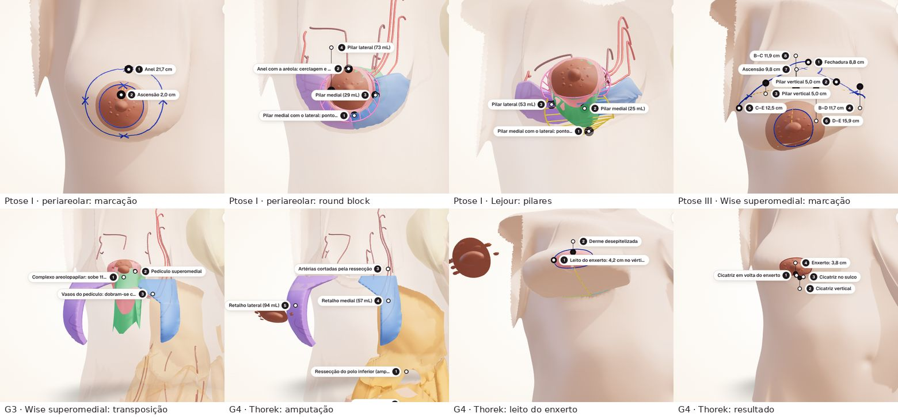

# Mamoplastia redutora: técnicas por grau de ptose

## Objetivo e situação

Ter no app, para cada grau de ptose, as técnicas de mamoplastia redutora que esse grau pede, cada uma com tudo o que as três primeiras já tinham na ptose II: marcação na pele em pé, pedículo e ressecção como volumes, o que a técnica conserva e secciona, o passo a passo animado e o resultado esperado.

**Situação: implementado.** São 19 sequências em cinco mamas, com sete técnicas. Os números abaixo são os do app.

> **Leitura do pedido.** "Incluir as diferentes técnicas de mamoplastia com diferentes graus de ptose" foi lido como uma **matriz técnica × grau**: cada mama do atlas (ptose graus I, II e III de Regnault, e as hipertrofias G3 e G4) recebe as técnicas indicadas para ela, e entram as técnicas que faltavam para cobrir os extremos: a **periareolar** e a **vertical de Lejour** nas ptoses leves, o **Wise com pedículo superomedial** nas mamas longas e o **enxerto livre do complexo areolopapilar (Thorek)** na gigantomastia. As duas últimas estavam como pendência em `docs/plano-mamoplastia-g3-g4.md`.

| Mama | Monte | Subida do complexo areolopapilar | Técnicas |
|---|---|---|---|
| Ptose grau I, hipertrofia leve | 527 mL | 2,0 cm | periareolar de Benelli (round block); Lejour |
| Ptose grau II, hipertrofia moderada | 641 mL | 3,6 cm | Pitanguy; Wise com pedículo inferior; vertical com pedículo superomedial; Lejour |
| Ptose grau III, hipertrofia acentuada | 866 mL | 9,8 cm | Pitanguy; Wise com pedículo inferior; vertical com pedículo superomedial; Wise com pedículo superomedial |
| G3 (ptose III, hipertrofia grau III) | 1.684 mL | 11,2 cm | as quatro da ptose III |
| G4 (ptose III, gigantomastia) | 2.105 mL | 13,0 cm | as quatro da ptose III e Thorek (enxerto livre) |



*No app: na ptose I, a marcação periareolar (anel de 21,7 cm), o round block com os pilares e a cerclagem, e os pilares do Lejour; o Wise com pedículo superomedial na ptose III (marcação) e em G3 (transposição); em G4, a amputação do Thorek com o enxerto ao lado, o leito no vértice do cone e o resultado.*

## Uma técnica em três partes

O pipeline passou a tratar uma técnica como a combinação de **padrão de pele**, **pedículo** e **ressecção**. O Lejour e o Wise com pedículo superomedial combinam partes que já existiam; a periareolar trouxe um padrão de pele novo (o anel) e o pedículo central; o Thorek é o T invertido sem pedículo, com o enxerto livre.

| Técnica | Padrão de pele | Pedículo | Ressecção | Cicatriz |
|---|---|---|---|---|
| Pitanguy | T invertido, sem fechadura | superior dermoglandular (25 mm) | em quilha | periareolar, vertical, sulco |
| Wise com pedículo inferior | Wise (fechadura) | inferior, espessura total | em ferradura | periareolar, vertical, sulco |
| Vertical com pedículo superomedial | cúpula e dois ramos | superomedial, espessura total | inferior e lateral | periareolar, vertical |
| **Lejour** | cúpula e dois ramos | superior dermoglandular (25 mm) | central inferior, com quilha sob o pedículo | periareolar, vertical |
| **Wise com pedículo superomedial** (Orlando e Guthrie) | Wise (fechadura) | superomedial, espessura total | inferior e lateral, com as cunhas | periareolar, vertical, sulco |
| **Periareolar de Benelli** | anel excêntrico em volta da aréola | central (a aréola não é transposta) | cunha central inferior | periareolar |
| **Thorek** | T invertido, sem fechadura | nenhum: enxerto livre | amputação do polo inferior | em volta do enxerto, vertical, sulco |

Por que cada técnica está onde está:

- **Periareolar só na ptose I.** O anel só comporta subidas curtas e reduções pequenas: o perímetro do anel não deve passar de cerca de duas vezes o da aréola.
- **Lejour nas ptoses I e II.** O pedículo superior se dobra para subir; na ptose III a subida de quase 10 cm o dobraria demais. O Pitanguy foi mantido nas mamas longas para mostrar exatamente isso (no modelo, nenhuma artéria chega ao mamilo por ele a partir da ptose III).
- **Wise com pedículo superomedial a partir da ptose III.** É a alternativa ao pedículo inferior longo: o complexo areolopapilar gira até a fechadura em vez de subir do sulco.
- **Thorek só em G4.** Fúrcula–mamilo de 44 cm e peça acima de 1 kg: a faixa em que muitos autores indicam a amputação com enxerto livre.

## Regras novas do pipeline

1. **Ponto A nunca a menos de 2 cm do mamilo.** Na ptose I o mamilo já está na altura do sulco (1 mm acima), e a regra "A = projeção do sulco no meridiano" não daria subida nenhuma: a fechadura e a cúpula coincidiriam com a aréola. Agora, quando a projeção do sulco fica a menos de 20 mm de pele acima do mamilo, A é posto 20 mm acima dele (`MIN_RISE`, `pilot_mammaplasty.Standing`). Nas outras mamas nada muda.
2. **Marcação periareolar (`ring`).** Dois traços: o do areolótomo (4,2 cm) e um anel oval excêntrico. O topo do anel é a borda superior da nova aréola; abaixo e dos lados ele passa 10 e 12 mm por fora do areolótomo. Na ptose I o anel tem 21,7 cm de perímetro para uma aréola de 13,2 cm (razão 1,6) e tira 2,0 cm de pele acima da aréola. Pontos nomeados: A, S, I, M e L.
3. **Pedículo central e cunha.** A coluna de glândula sob o anel é o pedículo: espessura total fora da cunha e uma camada dermoglandular de 20 mm sobre ela. A cunha começa 25 mm acima do mamilo, com 40 mm de largura, e se abre até 100 mm embaixo; sob a pele do polo inferior fica um retalho de 15 mm. A derme do anel só é incisada abaixo do mamilo (é por onde se chega à glândula), então os ramos superficiais que chegam por cima e pelos lados são conservados.
4. **Lejour.** Padrão da vertical. O pedículo é a lâmina dermoglandular de 25 mm entre a cúpula e o complexo areolopapilar, e toda a cúpula, só desepitelizada, é a sua base. Sai o polo inferior entre os ramos, em espessura total, e uma quilha sob o pedículo.
5. **Wise com pedículo superomedial.** Padrão do Wise. A base do pedículo é a metade medial da fechadura e **todo** o ramo vertical medial: 9,4 cm de base sobre a pele. Com a base de 8 cm da técnica vertical, as perfurantes da torácica interna do 2º e 3º espaços cruzavam o ramo vertical medial logo abaixo do fim da base, em G3 e G4, e contavam como seccionadas; na mama longa elas chegam baixo, e a base tem de incluí-las. Com a base inteira, o Wise superomedial passou a conservar TI 2 e 3 em G3 e TI 2 em G4 (antes, nenhuma), e TI 4 na ptose III.
6. **Thorek.** Padrão do Pitanguy, sem pedículo. O complexo areolopapilar sai como enxerto de pele total antes da ressecção e o que fica dentro do padrão é amputado. Os retalhos em volta do padrão ficam com a espessura que leva a mama ao volume-alvo (46,5 mm em G4, para 850 mL). O leito do enxerto é um disco de 4,2 cm no vértice do cone, marcado e desepitelizado com a mama já fechada.
7. **Teste do que é seccionado.** Um ramo cruza a incisão no ponto exato em que o seu trajeto corta o contorno do padrão (antes era o ponto médio entre as duas amostras do trajeto de cada lado do contorno, que podia cair fora da base do pedículo quando o ramo a cruzava perto da borda). Nenhum resultado das técnicas antigas mudou; a regra passou a ser exata.

## Peças e o que cada técnica conserva

Volumes medidos na mama em pé; peso a 0,95 g/mL. Em G3 e G4 os pedículos são afinados e os retalhos ficam com 15 mm ou mais para a mama chegar a 700 e 850 mL (`docs/plano-mamoplastia-g3-g4.md`); nas ptoses I a III as dimensões são as aceitas na revisão, sem alvo de volume. TI: perfurante da torácica interna (2º a 4º espaço); IC: perfurante intercostal (4º a 6º); TA: ramo da toracoacromial; ML: ramo mamário lateral; CA e CL: ramos cutâneos anteriores e laterais; "4º prof" e "4º sup": ramos profundo e superficial do 4º intercostal.

| Mama | Técnica | Subida do CAP | Pedículo | Peça | % do monte | Fica | Artérias que chegam ao mamilo | Nervos conservados |
|---|---|---|---|---|---|---|---|---|
| Ptose I (527 mL) | Periareolar de Benelli (round block) | 2,0 cm | 102 mL | 77 mL ≈ 73 g | 15% | 450 mL | TI 2, TI 3, TI 4, ML sup | CA 3, CA 4, CA 5, 4º sup, CL 3, CL 5 |
| Ptose I (527 mL) | Lejour (vertical com pedículo superior) | 2,0 cm | 64 mL | 81 mL ≈ 77 g | 15% | 446 mL | TI 2, TI 3, TI 4, ML sup | CA 3, CA 4, CA 5, 4º sup, CL 3 |
| Ptose II (641 mL) | Pitanguy | 3,6 cm | 70 mL | 180 mL ≈ 171 g | 28% | 460 mL | TI 2, TI 3 | CA 3, CL 3 |
| Ptose II (641 mL) | Wise com pedículo inferior | 3,6 cm | 251 mL | 109 mL ≈ 103 g | 17% | 532 mL | IC 4, IC 5, IC 6, TA | CA 3, 4º prof, CL 3 |
| Ptose II (641 mL) | Vertical com pedículo superomedial | 3,6 cm | 175 mL | 105 mL ≈ 100 g | 16% | 535 mL | IC 4, IC 5, IC 6, TI 2, TI 3, TI 4, TA | CA 3, CA 4, CA 5, 4º prof, CL 3 |
| Ptose II (641 mL) | Lejour (vertical com pedículo superior) | 3,6 cm | 70 mL | 143 mL ≈ 136 g | 22% | 497 mL | TI 2, TI 3 | CA 3, CA 5, CL 3 |
| Ptose III (866 mL) | Pitanguy | 9,8 cm | 130 mL | 315 mL ≈ 299 g | 36% | 551 mL | nenhuma | CA 3, CA 5, CL 3 |
| Ptose III (866 mL) | Wise com pedículo inferior | 9,8 cm | 285 mL | 211 mL ≈ 201 g | 24% | 655 mL | IC 4, IC 5, IC 6, TA | CA 3, CA 5, CL 3 |
| Ptose III (866 mL) | Vertical com pedículo superomedial | 9,8 cm | 252 mL | 209 mL ≈ 199 g | 24% | 657 mL | IC 4, IC 5, IC 6, TI 2, TI 3, TI 4 | CA 3, CA 4, 4º prof, CL 3 |
| Ptose III (866 mL) | Wise com pedículo superomedial | 9,8 cm | 227 mL | 227 mL ≈ 216 g | 26% | 639 mL | IC 4, IC 5, IC 6, TI 2, TI 3, TI 4 | CA 3, CA 4, CA 5, CL 3 |
| G3 (1684 mL) | Pitanguy | 11,2 cm | 138 mL | 982 mL ≈ 933 g, III | 58% | 702 mL | nenhuma | CA 3, CL 3 |
| G3 (1684 mL) | Wise com pedículo inferior | 11,2 cm | 370 mL (afinado a 20,0 mm) | 766 mL ≈ 728 g, II | 46% | 918 mL | IC 4, IC 5, IC 6, TA | CA 3, CL 3 |
| G3 (1684 mL) | Vertical com pedículo superomedial | 11,2 cm | 224 mL (afinado a 31,6 mm) | 927 mL ≈ 881 g, III | 55% | 757 mL | TI 2, TI 3 | CA 3, CL 3 |
| G3 (1684 mL) | Wise com pedículo superomedial | 11,2 cm | 224 mL (afinado a 38,7 mm) | 913 mL ≈ 867 g, III | 54% | 771 mL | TI 2, TI 3 | CA 3, CL 3 |
| G4 (2105 mL) | Pitanguy | 13,0 cm | 162 mL | 1.233 mL ≈ 1.172 g, IV | 59% | 871 mL | nenhuma | CA 3 |
| G4 (2105 mL) | Wise com pedículo inferior | 13,0 cm | 435 mL (afinado a 20,0 mm) | 969 mL ≈ 921 g, III | 46% | 1.136 mL | IC 4, IC 5, IC 6, TA | CA 3, 4º prof |
| G4 (2105 mL) | Vertical com pedículo superomedial | 13,0 cm | 273 mL (afinado a 32,2 mm) | 1.180 mL ≈ 1.121 g, IV | 56% | 924 mL | TI 2 | CA 3, CA 5 |
| G4 (2105 mL) | Wise com pedículo superomedial | 13,0 cm | 272 mL (afinado a 40,4 mm) | 1.152 mL ≈ 1.095 g, IV | 55% | 952 mL | TI 2 | CA 3 |
| G4 (2105 mL) | Thorek (enxerto livre do complexo areolopapilar) | 13,0 cm | sem pedículo | 1.255 mL ≈ 1.192 g, IV | 60% | 850 mL | nenhuma | nenhum |

O que os números mostram:

- **Ptose I.** As duas técnicas tiram cerca de 15% do monte (cerca de 75 g) e conservam as perfurantes da torácica interna e o ramo mamário lateral superior, que chegam por cima e pelos lados. Nenhuma das duas conserva as perfurantes intercostais, que sobem pelo septo: na periareolar elas atravessam a cunha.
- **Ptose II.** O Lejour tira mais que a vertical superomedial (o polo inferior sai em espessura total e não há pedículo espesso a preservar), mas conserva menos: só as perfurantes do 2º e 3º espaços.
- **Ptose III.** O pedículo superior de Pitanguy não conserva nenhuma artéria da camada esquemática. O Wise superomedial, como a vertical superomedial, conserva tanto as perfurantes da torácica interna quanto as intercostais, e tira um pouco mais (216 g contra 199 g).
- **G3 e G4.** O Wise superomedial fica igual à vertical superomedial no que conserva (TI 2 e 3 em G3; só TI 2 em G4) e tira quase o mesmo peso. O Thorek é o que mais tira (1.192 g) e leva a mama aos 850 mL do alvo, ao custo de todos os vasos e nervos do complexo areolopapilar.

## Passo a passo e resultado

Os quadros de cada técnica estão em `SCHEDULES` (`build_mammaplasty_steps.py`). O Lejour usa os da vertical e o Wise superomedial os do Wise. Os dois novos:

- **Periareolar:** marcação; desepitelização do anel; ressecção da cunha; montagem da glândula (o complexo areolopapilar sobe com o cone, sem pedículo a dobrar); pilares e round block (pontos profundos entre os pilares e cerclagem da pele em volta da aréola); sutura da aréola.
- **Thorek:** marcação; coleta do enxerto e incisão; amputação do polo inferior; ponto em T; sutura vertical; sutura no sulco (pele fechada); leito do enxerto (marcado no vértice do cone e desepitelizado); enxertia. Não há quadro de transposição: o enxerto fica ao lado da mama desde a coleta e só volta no último quadro.

Em todas as sequências o fechamento deixou **0 vértices sem condição**, e o mamilo fica 15 mm acima do sulco no resultado.

Medidas no modelo, antes → depois (mamilo × sulco, fúrcula–mamilo e mamilo–sulco sobre a pele, projeção, volume e aréola):

| Mama | Técnica | Quadros | Mamilo × sulco | Fúrcula–mamilo | Mamilo–sulco (pele) | Projeção | Volume | Cicatriz vertical | Aréola |
|---|---|---|---|---|---|---|---|---|---|
| Ptose I | Periareolar | 6 | 1 mm acima → 15 mm acima | 28,4 → 25,3 cm | 10,5 → 8,5 cm | 68 → 61 mm | 530 → 450 mL | — | 5,0 → 4,2 cm |
| Ptose I | Lejour | 7 | 1 mm acima → 15 mm acima | 28,4 → 25,5 cm | 10,5 → 7,1 cm | 68 → 63 mm | 530 → 450 mL | 3,8 cm | 5,0 → 4,2 cm |
| Ptose II | Pitanguy | 9 | 26 mm abaixo → 15 mm acima | 32,1 → 25,6 cm | 13,6 → 7,1 cm | 84 → 64 mm | 640 → 460 mL | 5,1 cm | 5,6 → 4,1 cm |
| Ptose II | Wise | 8 | 26 mm abaixo → 15 mm acima | 32,1 → 26,2 cm | 13,6 → 7,5 cm | 84 → 71 mm | 640 → 530 mL | 5,6 cm | 5,6 → 4,1 cm |
| Ptose II | Vertical | 7 | 26 mm abaixo → 15 mm acima | 32,1 → 26,2 cm | 13,6 → 7,5 cm | 84 → 72 mm | 640 → 540 mL | 4,8 cm | 5,6 → 4,1 cm |
| Ptose II | Lejour | 7 | 26 mm abaixo → 15 mm acima | 32,1 → 25,9 cm | 13,6 → 7,3 cm | 84 → 68 mm | 640 → 500 mL | 4,5 cm | 5,6 → 4,1 cm |
| Ptose III | Pitanguy | 9 | 89 mm abaixo → 15 mm acima | 37,3 → 26,4 cm | 14,9 → 7,5 cm | 66 → 74 mm | 870 → 550 mL | 5,6 cm | 6,5 → 4,0 cm |
| Ptose III | Wise | 8 | 89 mm abaixo → 15 mm acima | 37,3 → 27,3 cm | 14,9 → 8,2 cm | 66 → 84 mm | 870 → 660 mL | 6,5 cm | 6,5 → 4,0 cm |
| Ptose III | Vertical | 7 | 89 mm abaixo → 15 mm acima | 37,3 → 27,3 cm | 14,9 → 8,2 cm | 66 → 84 mm | 870 → 660 mL | 5,8 cm | 6,5 → 4,0 cm |
| Ptose III | Wise superomedial | 8 | 89 mm abaixo → 15 mm acima | 37,3 → 27,1 cm | 14,9 → 8,1 cm | 66 → 82 mm | 870 → 640 mL | 6,3 cm | 6,5 → 4,0 cm |
| G3 | Pitanguy | 9 | 93 mm abaixo → 15 mm acima | 41,8 → 27,7 cm | 18,0 → 8,6 cm | 107 → 88 mm | 1.680 → 700 mL | 6,8 cm | 7,5 → 3,8 cm |
| G3 | Wise | 8 | 93 mm abaixo → 15 mm acima | 41,8 → 29,5 cm | 18,0 → 10,1 cm | 107 → 107 mm | 1.680 → 920 mL | 8,4 cm | 7,5 → 3,7 cm |
| G3 | Vertical | 7 | 93 mm abaixo → 15 mm acima | 41,8 → 28,1 cm | 18,0 → 9,0 cm | 107 → 93 mm | 1.680 → 760 mL | 6,6 cm | 7,5 → 3,8 cm |
| G3 | Wise superomedial | 8 | 93 mm abaixo → 15 mm acima | 41,8 → 28,2 cm | 18,0 → 9,1 cm | 107 → 94 mm | 1.680 → 770 mL | 7,3 cm | 7,5 → 3,8 cm |
| G4 | Pitanguy | 9 | 111 mm abaixo → 15 mm acima | 44,2 → 29,1 cm | 18,7 → 9,8 cm | 102 → 103 mm | 2.100 → 870 mL | 8,1 cm | 9,0 → 3,8 cm |
| G4 | Wise | 8 | 111 mm abaixo → 15 mm acima | 44,2 → 31,4 cm | 18,7 → 11,5 cm | 102 → 124 mm | 2.100 → 1.140 mL | 10,0 cm | 9,0 → 3,7 cm |
| G4 | Vertical | 7 | 111 mm abaixo → 15 mm acima | 44,2 → 29,6 cm | 18,7 → 10,1 cm | 102 → 107 mm | 2.100 → 920 mL | 7,8 cm | 9,0 → 3,8 cm |
| G4 | Wise superomedial | 8 | 111 mm abaixo → 15 mm acima | 44,2 → 29,8 cm | 18,7 → 10,3 cm | 102 → 110 mm | 2.100 → 950 mL | 8,7 cm | 9,0 → 3,7 cm |
| G4 | Thorek | 8 | 111 mm abaixo → 15 mm acima | 44,2 → 28,9 cm | 18,7 → 9,6 cm | 102 → 101 mm | 2.100 → 850 mL | 7,9 cm | 9,0 → 3,8 cm |

## No app

- **Biblioteca por grau.** Cinco grupos, "Mamoplastia redutora: ptose grau I", "grau II", "grau III", "G3" e "G4". Cada um tem o pack do plano (marcação, pedículo e ressecção de cada técnica) e um pack de passo a passo por técnica. Os endereços dos packs antigos não mudaram. No grupo Mama, o pack novo **Mamoplastia redutora: técnica por grau de ptose** tem uma vista por mama, com o que cada técnica tira, deixa e conserva.
- **Vistas guiadas pelos quadros.** As vistas do passo a passo são geradas a partir dos quadros de cada técnica (`mammaplasty.ts`): a periareolar não tem pele ressecada, o Thorek não tem pedículo nem transposição e ganha as vistas do leito e do enxerto.
- **Peças carregadas por caso.** Os binários dos planos (1,4 MB nos cinco casos) eram baixados com o modelo, e as peças de todos os casos recebiam os estados da mama na abertura. Agora o binário de um caso só é baixado, e suas peças só recebem os estados da mama, quando uma peça desse caso fica visível (`breastAnatomy.loadPlan`, `HybridModel.preparePlans`); enquanto isso os rótulos esperam, como durante uma animação. A abertura do app deixa de depender do número de casos. Conferido no navegador: uma vista de ptose não baixa nenhum binário de plano, uma vista do pedículo na ptose II baixa só o da ptose II, e voltar a um caso já aberto não baixa de novo.
- **Lista de camadas.** As estruturas dos planos aparecem na lista só nas vistas de um plano, e só as do caso dessa vista (eram 61, de todos os casos, em qualquer vista).
- **Pacote do app.** A primeira carga passou de 587 para 645 kB: os metadados dos planos e dos passos dos cinco casos (cerca de 120 kB comprimidos) entram no pacote; os binários, não.
- **Capas:** cada pack novo tem a sua, capturada no próprio app (`public/covers`, 480 × 415 px), e as vistas da visão geral usam a capa do plano de cada grau.
- **Service worker:** cache v9.

Arquivos: `src/data/planCases.ts` (os cinco casos), `src/data/mammaplasty.ts` (textos das técnicas, vistas, fichas, grupos), `src/data/packs.ts` e `src/lib/catalog.ts` (grupos da biblioteca), `src/lib/breastAnatomy.ts` e `src/components/viewer/HybridModel.tsx` (peças por caso).

## Decisões tomadas

Não houve perguntas em aberto respondidas antes da implementação; estas escolhas são minhas e podem ser revistas:

| Decisão | Adotado |
|---|---|
| Leitura do pedido | Matriz técnica × grau de ptose, com as técnicas que faltavam nos extremos |
| Técnicas novas | Periareolar de Benelli, Lejour, Wise com pedículo superomedial, Thorek |
| Onde cada uma entra | Tabela do início; nenhuma técnica antiga foi retirada |
| Ponto A na ptose I | 2 cm acima do mamilo |
| Dimensões das técnicas novas | As mesmas das antigas (aréola de 4,2 cm, ramos de 5 cm, pedículo superior de 25 mm, 5 mm sobre a fáscia); anel de 20, 10 e 12 mm; camada central de 20 mm. Aparecem no app como "propostas, a confirmar na revisão" |
| Base do pedículo superomedial no Wise | Metade medial da fechadura e todo o ramo vertical medial (9,4 cm) |
| Volume-alvo | Só em G3 e G4 (700 e 850 mL), como antes |
| Biblioteca | Um grupo por grau; pack de visão geral no grupo Mama |

## Limitações

- **Lejour sem lipoaspiração nem descolamento da pele do polo inferior.** Só a ressecção em bloco é mostrada.
- **Periareolar simplificada.** Não há plicatura nem cruzamento de retalhos glandulares, que fazem parte da técnica de Benelli: os pilares são aproximados com pontos profundos. O franzido da pele em volta da aréola não é simulado.
- **Thorek.** A pega do enxerto não é simulada. Os retalhos finos de G4 aparecem amarrotados nos quadros do fechamento, como nas outras técnicas em T dessa mama, e o vértice do cone, onde as três suturas se encontram, fica com um pequeno pregueado antes de receber o enxerto.
- **Indicações.** A matriz reúne indicações usuais; a escolha da técnica em uma paciente depende de mais do que o grau de ptose.
- **Vasos e nervos** são os da camada esquemática (trajetos típicos da literatura). "Conserva" e "secciona" descrevem a geometria do modelo, não a perfusão.
- Valem as limitações de `docs/plano-mamoplastia.md` e `docs/plano-mamoplastia-g3-g4.md`: modelo geométrico em pé, peças retas de frente para trás, resultado esperado e não previsão.
- **Literatura** conferida por título e por citações secundárias; páginas e anos das referências clássicas a conferir.

## Reprodução

```bash
node scripts/hybrid/decode_model.mjs
python3 scripts/hybrid/build_breast_anatomy.py
python3 scripts/hybrid/build_mammaplasty.py            # [--case ptose-1] os cinco casos (≈ 2 a 4 min cada)
python3 scripts/hybrid/build_mammaplasty_steps.py      # [--case ptose-1] 19 sequências (≈ 5 min por caso)
npm run check:breast && npm run lint && npm run build
```

As técnicas de cada caso estão em `CASES[caso]["techniques"]` e a descrição de cada técnica em `TECHNIQUES` (`build_mammaplasty.py`).

## Referências

- Benelli L. A new periareolar mammaplasty: the "round block" technique. *Aesthetic Plast Surg* 1990;14(2):93–100.
- Lejour M. Vertical mammaplasty and liposuction of the breast. *Plast Reconstr Surg* 1994;94(1):100–114.
- Hall-Findlay EJ. A simplified vertical reduction mammaplasty: shortening the learning curve. *Plast Reconstr Surg* 1999;104(3):748–759.
- Orlando JC, Guthrie RH. The superomedial dermal pedicle for nipple transposition. *Br J Plast Surg* 1975;28(1):42–45.
- Thorek M. Possibilities in the reconstruction of the human form. *N Y Med J* 1922;116:572–575.
- Wise RJ. A preliminary report on a method of planning the mammaplasty. *Plast Reconstr Surg* 1956;17(5):367–375.
- Pitanguy I. Surgical treatment of breast hypertrophy. *Br J Plast Surg* 1967;20(1):78–85.
- Regnault P. Breast ptosis: definition and treatment. *Clin Plast Surg* 1976;3(2):193–203.
- Demais referências em `docs/plano-mamoplastia.md` e `docs/plano-mamoplastia-g3-g4.md`.
