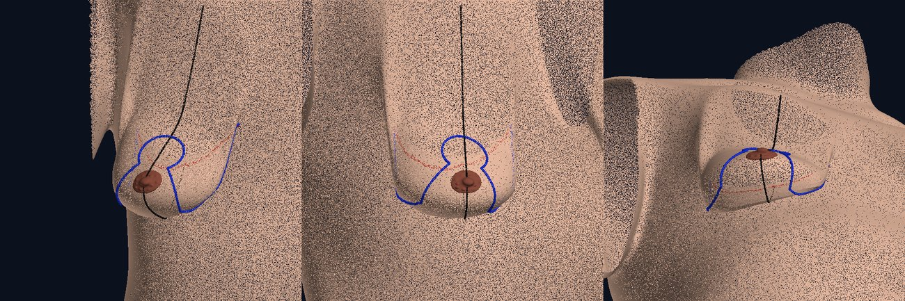
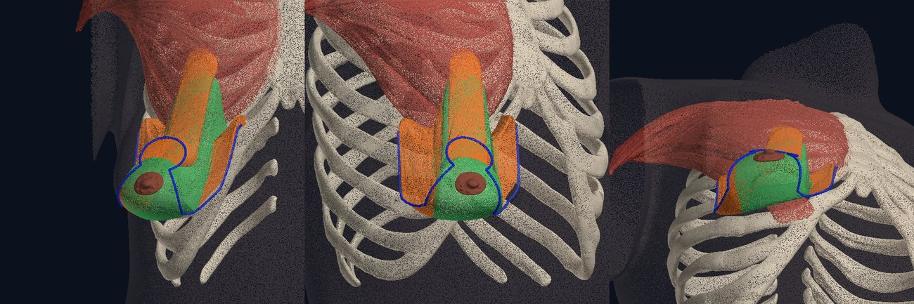
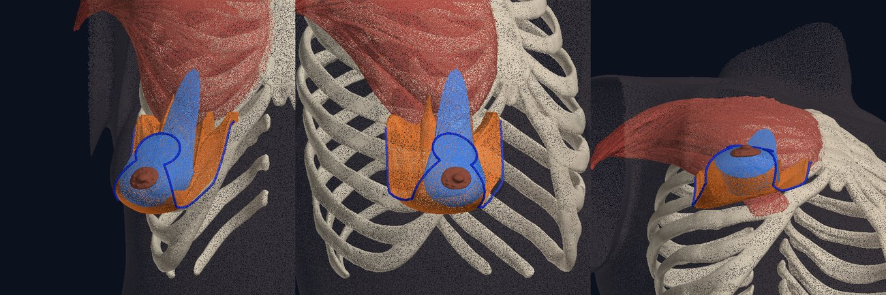

# Plano: simulação de cirurgias da mama (mamoplastia)

## Objetivo

Levar o atlas da anatomia estática para a **cirurgia da mama**: uma mama ptótica, a marcação pré-operatória, os pedículos (superior, superomedial, medial, inferior, lateral, central, bipediculado), as ressecções e o remanejamento do tecido nas técnicas de Pitanguy, Lejour e afins, com a anatomia que explica cada escolha (irrigação e inervação do complexo areolopapilar, septos e ligamentos).

Este documento avalia o aplicativo atual, define a arquitetura, lista as estruturas tridimensionais a criar e como, e acompanha o que já foi feito. A fase 1 (mama ptótica) está implementada e serve de prova de que a arquitetura funciona no app real.

> No pedido, "levou" foi lido como **Lejour** (mamoplastia vertical). Corrija se era outra técnica.

## Avaliação do aplicativo atual

### O que já existe e serve de base

| Recurso | Onde | Uso na mamoplastia |
|---|---|---|
| Mama real segmentada (Visible Human Female): pele, corpo adiposo, lobos, ductos, seios lactíferos, ligamentos de Cooper, mamilo, aréola | `torso-female-hybrid.glb` | É o material a deformar e recortar; nada precisa ser redesenhado |
| Parede torácica, peitorais, serrátil, vasos e nervos nomeados (BodyParts3D) | idem | Leito da mama e origem dos pedículos vasculares |
| Deformação por *morph targets* com animação (posições do braço) | `HybridModel.tsx`, `AnatomyViewer.tsx` | Mesmo mecanismo para os estados da mama |
| Packs e vistas declarativos, com rótulos ancorados em vértices reais que acompanham a deformação | `src/data/packs.ts`, `shared.ts` | Cada técnica vira um pack; rótulos seguem a mama |
| Corte 3D com tampas e vista 2D, já ciente de *morph targets* | `sectioning.ts`, `SectionCaps.tsx` | Corte sagital da mama ptótica, do pedículo, do resultado |
| Marcação na pele, zonas, régua em mm, mapa de distância | aba Estudo | Base da marcação pré-operatória e das medidas clínicas |
| Fichas, "modelo × literatura", revisão do especialista exportável | `anatomyDetails.ts`, `literature.ts`, `review.ts` | Fichas de pedículos e técnicas; revisão das marcações |
| PWA, modelo leve para celular, interface de celular completa | `MobileShell.tsx` | A simulação precisa caber no celular (ver "Tamanho") |

### Lacunas para a mamoplastia

| Lacuna | Evidência no modelo | Consequência |
|---|---|---|
| Uma única forma de mama, **sem ptose** | Mamilo 51 mm acima do sulco; fúrcula–mamilo 22,6 cm; mamilo–sulco 7,2 cm; projeção 55 mm; monte de ~420 mL | Não há o que operar: falta o caso |
| Forma de cadáver em decúbito | Mama lateralizada, sulco intermamário raso | O repouso do modelo se parece com a posição na mesa, não em pé |
| Mama estática | Não acompanha a gravidade nem o braço (limitação já registrada em `movimento-membro-superior.md`) | Tecido mole precisa de deformação, não de transformação rígida |
| Manipulações só rígidas | "Afastar a mama" gira o bloco inteiro | Não representam retalho, pedículo ou fechamento de pilares |
| Só os troncos vasculares | Torácica interna, torácica lateral, toracoacromial e intercostais existem; **nenhum ramo entra na mama** | Falta justamente o que diferencia os pedículos |
| Sem inervação do complexo areolopapilar | Nervos intercostais só como troncos | Falta o ramo cutâneo lateral do 4º intercostal |
| Sem sistema fascial da mama | Existem Cooper (HRA) e fáscia peitoral (Z-Anatomy) | Faltam fáscia superficial, septo horizontal de Würinger, ligamentos medial e lateral, aderência do sulco |
| Marcação só anatômica | 16 referências (linha hemiclavicular, sulco, EIC…) | Faltam pontos A–B–C–D–E, padrões de Wise, vertical e periareolar |
| Sem peças cirúrgicas | — | Pedículo, peça ressecada, pilares e retalhos de pele não existem como estruturas |
| Sem estado pós-operatório | — | Falta o resultado e as cicatrizes |

### Defeito encontrado na avaliação (corrigido)

Com o braço numa posição cirúrgica, **Resetar câmera** (ou **Centro**, no celular) fazia o modelo desaparecer: o reset remonta o canvas, as geometrias (compartilhadas com o cache do glTF) continuavam com *morph targets* e as malhas novas não tinham influências. Agora a cena nova começa limpa e o visualizador recoloca a posição do braço e o estado da mama na hora.

## Princípios

1. **Deformar e recortar o real, não redesenhar.** A mama ptótica, o pedículo e a peça ressecada são a mama do modelo deformada ou dividida. Continua valendo a regra do projeto: nenhuma estrutura anatômica é desenhada à mão.
2. **Técnica = padrão de pele × pedículo × ressecção.** São três escolhas independentes. Cada técnica nomeada (Pitanguy, Lejour, Hall-Findlay, Robbins…) é uma combinação predefinida das três, o que permite compará-las mudando uma coisa de cada vez.
3. **Uma carta, um mapa.** Tudo é definido em coordenadas próprias da mama, no repouso do modelo. Um único mapa leva pele, glândula, rótulos, marcações e peças a qualquer estado (ptose, intraoperatório, resultado).
4. **Procedência visível.** Três níveis, sempre indicados: *real* (malha segmentada), *calculado* (derivado das malhas, com método) e *esquemático* (posicionado pela literatura, com referência). Perfurantes e septos entram no terceiro nível até existir fonte segmentada.
5. **Medir tudo.** Cada estado traz as medidas clínicas tiradas no próprio modelo deformado, e cada ressecção trará volume e peso estimado.
6. **Revisão do especialista** antes de chamar de material de ensino: marcações e peças entram no modo de revisão que já existe.

## Arquitetura

### Carta da mama

Coordenadas cilíndricas em torno de um eixo vertical do tronco, uma carta por lado (`scripts/hybrid/build_breast.py`):

- `u`: arco em torno do tórax (lateral +), `v`: altura em relação ao mamilo, `r`: raio.
- **Superfície-base B(u, v)**: o tronco sem o monte mamário. Fora da pegada do corpo adiposo é a própria pele; dentro, sua continuação harmônica (membrana).
- **Profundidade** `d = r − B`: distância à frente dessa parede. Tecido atrás de B nunca se move.
- **Sulco inframamário**: maior concavidade vertical da pele junto ao limite inferior do corpo adiposo, coluna a coluna.

O eixo sai dos marcos do esterno e a carta é toda medida nas malhas publicadas; não há parâmetro desenhado.

### Estados da mama como mapas avaliados no aparelho

Um estado é um mapa `repouso → estado`. O pipeline mede a carta e escolhe os parâmetros; o app avalia o mapa em cada vértice (`src/lib/breastMap.ts`) e anexa o resultado como *morph targets*.

| | Deltas por vértice (como as posições do braço) | Mapa paramétrico (adotado) |
|---|---|---|
| Tamanho da ptose (3 graus, 2 mamas) | ≈ 8,6 MB (estimado: desktop + celular) | 76 kB no total |
| Cada técnica nova | ≈ +1,7 MB por estado | alguns kB |
| Rótulos, marcações, peças | exigiriam dados próprios por estado | passam pela mesma função |
| Custo | download | cálculo uma vez por sessão: o mapa leva ≈ 1 s no modelo de desktop (386 mil vértices) e ≈ 0,4 s no de celular (136 mil), medidos em Node; somam-se as normais |

As duas implementações (Python e TypeScript) são comparadas por vetores de teste gravados pelo pipeline (`scripts/hybrid/breast-test-vectors.json`): `npm run check:breast` (erro máximo atual: 0,001 mm).

### Ptose

Mapa de fluxo de um campo de velocidade **incompressível e preso à parede**, no semiplano (altura `a` acima do sulco, profundidade `d`) de cada meridiano, com função de corrente `ψ = −S·W(d)·L(a)`:

- o tecido desce, e quanto mais fundo, menos (camada de cisalhamento de 18 mm junto à parede: é o deslizamento no espaço retromamário);
- afina onde a descida acelera (polo superior) e se acumula onde ela freia (abaixo do sulco): o monte esvazia para uma bolsa pendente;
- por ser um fluxo, o mapa preserva o volume na carta e **não pode dobrar a malha nem atravessar a parede** (von Funck et al., 2006).

A ptose acentuada soma um giro polar em torno do sulco: a bolsa encosta na parede abdominal e o mamilo chega ao contorno mais baixo. Os graus não são escolhidos pelo nome: o pipeline mede o resultado (mamilo em relação ao sulco e ao contorno inferior) e classifica.

### Peças cirúrgicas (a criar)

Pedículos, peças ressecadas, pilares e retalhos de pele são **volumes fechados gerados na carta**: uma região 2D do padrão de pele (em `u, v`) vezes uma faixa de profundidade (da pele até a espessura do retalho, ou até a parede). O repouso do modelo é a forma em decúbito, parecida com a da mesa: cortar "reto até a parede" é seguir a direção de profundidade da carta.

- A superfície externa da peça coincide com a pele real; a interna, com o plano de dissecção (fáscia peitoral ou espessura do retalho).
- As estruturas reais (lobos, ductos, gordura) são coloridas por peça com o mecanismo de cor por vértice que já existe no mapa de distância: glândula ressecada × preservada.
- Volume da peça × densidade (≈ 0,9–1,0 g/mL) = peso estimado da ressecção, mostrado na ficha.
- Formato: como `anatomy-layers.bin` (malhas quantizadas em repouso); o mapa do estado as leva à mama ptótica ou ao resultado.

### Marcação pré-operatória (a criar)

Curvas sobre a pele em coordenadas da carta. As distâncias são resolvidas **no estado ptótico**, como na paciente em pé (ex.: o ponto A é o ponto da pele, no meridiano, cuja altura deformada iguala a do sulco). Cada ponto guarda sua pré-imagem em repouso, então a mesma marcação aparece em qualquer estado e as linhas de incisão viram as cicatrizes do resultado.

### Resultado (a criar)

O pós-operatório é outro mapa: **fechamento da ressecção** (as regiões retiradas colapsam sobre a linha de sutura e os pilares se aproximam) seguido de **reforma** (base mais estreita, cone, polo inferior curto). Na carta em repouso o complexo areolopapilar praticamente "volta para casa", porque o repouso do modelo já é uma mama sem ptose. As etapas intermediárias (pele incisada, peça removida, pedículo exposto) são mostradas sobre a mama ptótica com as peças afastadas, sem novo mapa.

Se a revisão pedir mais realismo de forma, o passo seguinte é trocar o mapa cinemático por um modelo físico simples (bolsa de pele inextensível com conteúdo incompressível sob gravidade), sem mudar nada no app: ele só consome mapas.

## Fases e situação

| # | Fase | Entrega | Situação |
|---|---|---|---|
| 0 | Avaliação do app e do modelo | Este documento; medidas da mama; correção do reset de câmera | feito |
| 1 | **Mama ptótica** | Carta dos dois lados; ptose graus I–III; seletor **Forma da mama**; pack **Ptose mamária** (7 vistas); medidas clínicas; marcações e zonas acompanham a mama | feito |
| 2 | **Marcação pré-operatória** | Linha média, meridiano, sulco, ponto A; padrões: T invertido (Wise/Pitanguy), vertical (Lejour/Lassus/Hall-Findlay), periareolar; pontos B, C, D, E; medidas na ficha | piloto fora do app (Wise) |
| 3 | **Pedículos e ressecções em 3D** | Volumes de pedículo (7 tipos) e de ressecção por técnica; cor por peça na glândula real; peso estimado; ficha de cada pedículo | piloto fora do app (6 pedículos, 2 ressecções) |
| 4 | **Remanejamento e resultado** | Sequência por etapas (marcação → desepitelização → ressecção → transposição → fechamento dos pilares → pele); mapa do pós-operatório; cicatrizes | planejado |
| 5 | **Enriquecimento anatômico** | Camada esquemática: perfurantes da torácica interna (2º–4º EIC), ramos da torácica lateral, perfurantes intercostais anteriores (4º–6º), ramo da toracoacromial; septo de Würinger e ligamentos; ramo cutâneo lateral do 4º intercostal; zonas de segurança por pedículo | planejado |
| 6 | **Oncoplastia** | Tumor por quadrante → padrão de ressecção e pedículo (níveis de Clough); mamoplastia terapêutica; simetrização | planejado |
| 7 | Validação | Revisão do especialista sobre marcações, peças e resultado; comparação das medidas com a literatura | pendente |

## Fase 1: o que foi feito

- `scripts/hybrid/build_breast.py` (`npm run breast:hybrid`): carta, superfície-base, sulco, parâmetros dos estados, medidas e vetores de teste → `src/data/breastModel.json` (8 kB) e `public/models/hybrid/breast-chart.bin` (68 kB).
- `src/lib/breastMap.ts`: o mapa, sem dependências; `src/lib/breastStates.ts`: carga e utilidades; `scripts/hybrid/check_breast_map.mjs`: confere TypeScript × Python.
- `HybridModel.tsx`: canal de *morph targets* da mama, independente do canal do braço; guardado por geometria (volta na hora após um reset de câmera).
- `src/lib/subdivide.ts`: no modelo de celular, a pele sobre a mama (triângulos de ~7 mm) é refinada antes do cálculo, porque a ptose estica o polo superior até três vezes.
- Interface: seletor **Forma da mama** (botão **Mama** no trilho do celular; cartão ao lado da posição do braço no desktop), com as medidas do estado; campo `breast` nas vistas; vistas de superfície com pele opaca (`solid`) e perfil na altura dos olhos com câmera fixa (`profile`, `follow: false`).
- Rótulos, pinos, zonas, marcação na pele, corte 3D e seleção funcionam em qualquer estado.

### Medidas no modelo (mama operada; a contralateral difere em até 1 cm)

| Estado | Mamilo × sulco | Contorno inferior × sulco | Fúrcula–mamilo | Mamilo–sulco (pele) | Classificação medida |
|---|---|---|---|---|---|
| Sem ptose | 51 mm acima | 0 | 22,6 cm | 7,2 cm | sem ptose |
| Ptose I | 1 mm acima | 37 mm abaixo | 27,3 cm | 9,6 cm | grau I |
| Ptose II | 26 mm abaixo | 58 mm abaixo | 30,7 cm | 11,7 cm | grau II |
| Ptose III | 86 mm abaixo | 99 mm abaixo | 35,4 cm | 12,6 cm | grau III |

Critério usado (Regnault, 1976): grau I, mamilo na altura do sulco (±1 cm); grau II, abaixo do sulco e acima do contorno inferior; grau III, abaixo do sulco e no contorno mais baixo (até 2 cm dele).


*Perfis no app (pack Ptose mamária), com a câmera fixa: o sulco não se move e o mamilo desce.*

## Piloto das fases 2 e 3

`scripts/hybrid/pilot_mammaplasty.py` gera, a partir da carta, a marcação e as peças sobre a mama com ptose grau II. É um piloto: roda fora do app, serve para provar que as estruturas podem ser criadas e medi-las, e todas as dimensões são propostas.

**Como.** A pele da mama em pé é desenrolada numa carta (X através da mama, s ao longo do meridiano a partir do ponto A). As linhas são traçadas sobre a pele com comprimento verdadeiro (a linha mais reta a partir de um ponto, com um rumo e um comprimento). Cada peça é o tecido sob uma região de pele, entre duas superfícies de profundidade da carta em repouso, fechada como malha.



*Marcação (render do piloto, fora do app): fechadura no ponto A, ramos de 5 cm, ramos horizontais até os extremos do sulco (em vermelho, oculto sob a mama) e meridiano.*

| Medida no piloto (ptose II, ramos a 90°) | Valor |
|---|---|
| Fúrcula → ponto A (reta) | 25,8 cm |
| Ponto A → mamilo atual (sobre a pele) | 3,6 cm |
| Abertura da fechadura (aréola de 42 mm) | 10,0 cm de arco |
| Ramos medial e lateral | 5,0 cm cada |
| Distância B–C | 6,1 cm |
| Ramos horizontais medial + lateral | 11,1 + 10,5 cm |
| Incisão no sulco (D–E) | 15,2 cm |

| Peça | Região na pele | Profundidade | Volume | Peso estimado |
|---|---|---|---|---|
| Pedículo inferior | Aréola + 1 cm até 8 cm de base no sulco | até a parede | 155 mL | 148 g |
| Pedículo superior | Da fechadura à aréola + 1 cm | 25 mm | 70 mL | 66 g |
| Pedículo superomedial | Metade medial da fechadura e início do ramo medial até a aréola | até a parede | 131 mL | 124 g |
| Pedículo medial | Ramo medial até a aréola | até a parede | 113 mL | 107 g |
| Pedículo lateral | Ramo lateral até a aréola | até a parede | 126 mL | 120 g |
| Pedículo central | Aréola + 1 cm, sem ponte dérmica | até a parede | 112 mL | 107 g |
| Ressecção em ferradura (com pedículo inferior) | Padrão de Wise menos o pedículo | deixa 5 mm sobre a fáscia | 41 mL | 39 g |
| Ressecção central inferior (com pedículo superior) | Padrão de Wise menos o pedículo | deixa 5 mm sobre a fáscia | 57 mL | 54 g |





*Peças (render do piloto): pele translúcida, costelas e peitoral maior do modelo como contexto.*

### O que o piloto mostrou

1. **Funciona.** Marcação com comprimentos verdadeiros sobre a pele ptótica e volumes fechados com peso saem da carta em ~20 s, e cada ponto guarda a pré-imagem em repouso (pode ir a qualquer estado pelo mapa do app).
2. **O plano de deslizamento precisa ir para a fáscia antes da fase 3.** Hoje o tecido atrás da superfície-base não se move e há 18 mm de cisalhamento à frente dela. Para pele, gordura e glândula inteiras o resultado convence; numa peça, a face profunda fica acima da pele que a cobre (até 6 cm no pedículo superior de 25 mm, 6–8 cm no inferior) e as peças aparecem como lâminas inclinadas (visível nas figuras). A correção é medir a profundidade a partir da face posterior do corpo adiposo (fáscia peitoral) dentro da pegada, com camada de cisalhamento fina, e recalibrar os graus.
3. **Em pé ou na mesa?** As peças são cortadas na forma em decúbito (repouso do modelo). Falta decidir se são mostradas na mama em pé, na posição da mesa, ou nas duas.
4. **O sulco deste corpo é curto e baixo.** Os ramos horizontais somam 21,7 cm para 15,2 cm de sulco, e o ponto A fica a 25,8 cm da fúrcula (a regra dos 19–23 cm daria um ponto mais alto). São os números de que o especialista precisa para fixar as regras: ângulo dos ramos, extremos D e E, e qual referência manda na posição do novo mamilo.
5. **As ressecções são pequenas** (40–60 g): a mama do modelo não é hipertrófica. Uma mamoplastia redutora de ensino pede o parâmetro de hipertrofia.

## Especificação proposta (para o especialista confirmar antes das fases 2–4)

### Técnicas como combinações

| Técnica | Padrão de pele | Pedículo | Ressecção | Cicatriz |
|---|---|---|---|---|
| Pitanguy | Marcação livre por pinçamento (A–B–C–D–E) | Superior | Em quilha, polo inferior e base central | T invertido |
| Wise + pedículo inferior (Robbins; Courtiss e Goldwyn) | Wise (buraco de fechadura) | Inferior | Cunhas medial e lateral e crescente superior | T invertido |
| McKissock | Wise | Bipediculado vertical | Medial, lateral e sob a ponte | T invertido |
| Lejour | Vertical (cúpula) | Superior | Central inferior, com lipoaspiração e descolamento da pele inferior | Vertical |
| Lassus | Vertical | Superior | Central inferior, sem descolamento | Vertical |
| Hall-Findlay | Vertical | Medial ou superomedial, espessura total | Inferior e lateral | Vertical |
| Orlando e Guthrie | Wise | Superomedial | Inferior e lateral | T invertido |
| Skoog | Wise | Lateral | Medial e inferior | T invertido |
| Hester | Wise ou vertical | Central (monte glandular, sem ponte dérmica) | Periférica | Conforme a pele |
| Benelli | Periareolar (*round block*) | Central ou superior | Variável | Periareolar |

### Pedículos como estruturas 3D

| Pedículo | Base (região na pele) | Espessura | Irrigação dominante a mostrar | Observação |
|---|---|---|---|---|
| Superior | Borda superior da nova aréola | Dermoglandular, afinado | Perfurantes da torácica interna do 2º EIC; ramos da toracoacromial | Dobra-se para subir: limite na subida longa |
| Superomedial | Quadrante superomedial da fechadura | Total | Perfurantes da torácica interna do 2º–3º EIC | Gira até a nova posição |
| Medial | Ramo vertical medial | Total | Perfurantes do 3º–4º EIC | Preserva ramos cutâneos anteriores |
| Inferior | 6–8 cm sobre o sulco, no meridiano | Total até a parede | Perfurantes intercostais anteriores do 4º–6º EIC, pelo septo de Würinger | Preserva o ramo profundo do 4º intercostal |
| Lateral | Ramo vertical lateral | Total | Ramo superficial da torácica lateral | Preserva o ramo cutâneo lateral |
| Central | Sem ponte dérmica; base na parede | Monte glandular | Perfurantes musculares (toracoacromial, intercostais) | Retalhos de pele finos em volta |
| Bipediculado | Superior + inferior | Dérmico com glândula | Soma dos dois | Ponte vertical |

Larguras de base, comprimento das hastes (5–7 cm no Wise), diâmetro da aréola (38–45 mm) e posição do novo mamilo em relação ao ponto A são parâmetros do pipeline: a proposta é fixá-los com o especialista e expor os principais na ficha.

## Limitações

- **Modelo geométrico, não físico.** A forma ptótica é um arquétipo didático obtido por um fluxo incompressível; não é a resposta de um tecido a uma carga. Serve para topografia e raciocínio cirúrgico, não para previsão de resultado.
- **Uma paciente só.** Mama adiposa de ~420–500 mL, de uma mulher de 59 anos, com pouca glândula. Hipertrofia (aumento de volume) ainda não é um parâmetro.
- **Ptose em pé sobre um corpo em decúbito.** A parede e o abdome são os do exame; a mama ptótica pende sobre eles como estão.
- **Grau III** é uma mama longa e achatada (fúrcula–mamilo de 35 cm): um dos fenótipos possíveis.
- **Pele do modelo de celular**: refinada sobre a mama, mas ainda mais grossa que a do desktop; restam facetas discretas no grau III.
- **Braço e mama** são independentes: a mama não sobe com a abdução.
- **Plano de deslizamento**: fica a cerca de 2 cm da superfície-base, e não na fáscia peitoral (ver o piloto). Não afeta a forma externa; afeta as peças cirúrgicas.
- **Literatura**: as referências abaixo foram conferidas por título, autores e paginação em índices e fontes secundárias, não no texto completo.

## Decisões que dependem de você

1. **Lejour** era mesmo a técnica do pedido?
2. Quais combinações entram primeiro? Sugestão: Pitanguy (superior + T invertido), Wise com pedículo inferior e vertical com pedículo superomedial, que cobrem os três pedículos do pedido.
3. **Caso-padrão**: ptose grau II sem hipertrofia, ou incluir um caso de hipertrofia para a mamoplastia redutora?
4. **Convenção do ponto A** e da posição do novo mamilo (no ponto A, ou 1–2 cm abaixo nas técnicas verticais).
5. As estruturas **esquemáticas** (perfurantes, septo de Würinger, nervo do 4º intercostal) podem entrar com rótulo de procedência, ou só com fonte segmentada?
6. Marcação e peças **bilaterais**, ou só no lado operado como o resto do atlas?
7. As peças devem aparecer na mama **em pé**, na **posição da mesa**, ou nas duas?

## Reprodução

```bash
pip install -r scripts/hybrid/requirements.txt
npm run breast:hybrid      # decodifica o modelo, mede a carta, grava JSON e binário, confere o mapa do app
python3 scripts/hybrid/build_breast.py --figures saida/   # perfis de cada estado, para revisão (requer matplotlib)
python3 scripts/hybrid/pilot_mammaplasty.py --figures saida/   # piloto das fases 2-3: medidas, volumes e figuras (requer shapely e matplotlib)
```

## Referências

- Regnault P. Breast ptosis: definition and treatment. *Clin Plast Surg* 1976;3(2):193–203.
- Wise RJ. A preliminary report on a method of planning the mammaplasty. *Plast Reconstr Surg* 1956;17(5):367–375.
- Pitanguy I. Surgical treatment of breast hypertrophy. *Br J Plast Surg* 1967;20(1):78–85.
- McKissock PK. Reduction mammaplasty with a vertical dermal flap. *Plast Reconstr Surg* 1972;49(3):245–252.
- Orlando JC, Guthrie RH. The superomedial dermal pedicle for nipple transposition. *Br J Plast Surg* 1975;28(1):42–45.
- Robbins TH. A reduction mammaplasty with the areola-nipple based on an inferior dermal pedicle. *Plast Reconstr Surg* 1977;59(1):64–67.
- Courtiss EH, Goldwyn RM. Reduction mammaplasty by the inferior pedicle technique. *Plast Reconstr Surg* 1977;59(4):500–507.
- Lejour M. Vertical mammaplasty and liposuction of the breast. *Plast Reconstr Surg* 1994;94(1):100–114.
- Hall-Findlay EJ. A simplified vertical reduction mammaplasty: shortening the learning curve. *Plast Reconstr Surg* 1999;104(3):748–759.
- Würinger E, Mader N, Posch E, Holle J. Nerve and vessel supplying ligamentous suspension of the mammary gland. *Plast Reconstr Surg* 1998;101(6):1486–1493.
- Schlenz I, Kuzbari R, Gruber H, Holle J. The sensitivity of the nipple-areola complex: an anatomic study. *Plast Reconstr Surg* 2000;105(3):905–909.
- van Deventer PV. The blood supply to the nipple-areola complex of the human mammary gland. *Aesthetic Plast Surg* 2004;28(6):393–398.
- Clough KB, Kaufman GJ, Nos C, Buccimazza I, Sarfati IM. Improving breast cancer surgery: a classification and quadrant per quadrant atlas for oncoplastic surgery. *Ann Surg Oncol* 2010;17(5):1375–1391.
- von Funck W, Theisel H, Seidel H-P. Vector field based shape deformations. *ACM Trans Graph* 2006;25(3):1118–1125 (deformação por campo de divergência nula: volume preservado, sem autointerseção).
- Citadas de memória, a conferir: Lassus (1996), Skoog (1963), Strömbeck (1960), Hester et al. (1985), Benelli (1990), Ribeiro (1975), Peixoto (1980).
