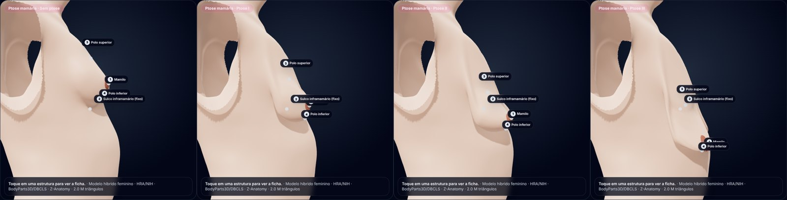
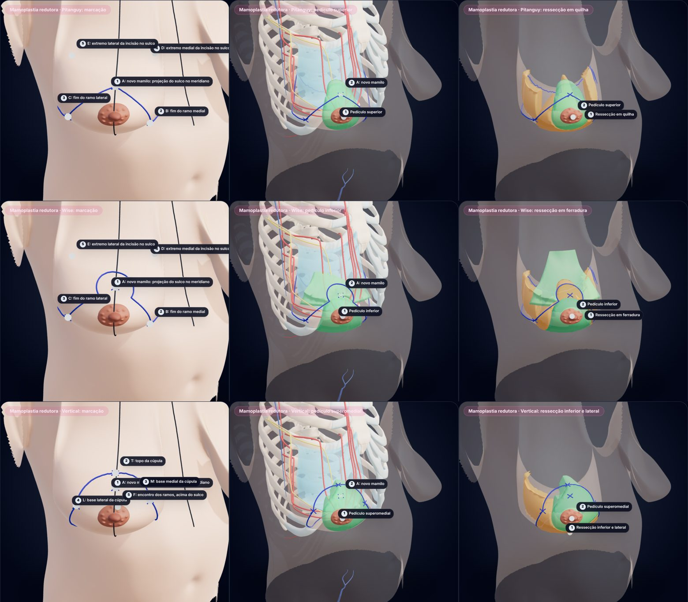
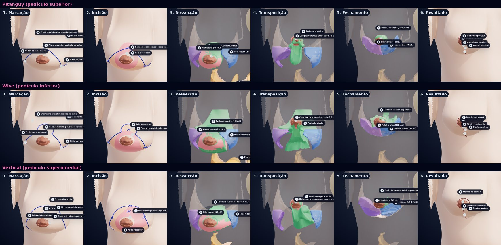
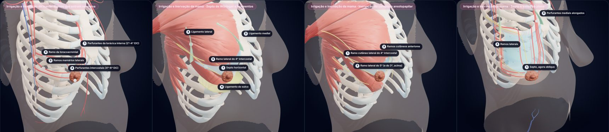

# Plano: simulação de cirurgias da mama (mamoplastia)

## Objetivo

Levar o atlas da anatomia estática para a **cirurgia da mama**: uma mama ptótica, a marcação pré-operatória, os pedículos (superior, superomedial, medial, inferior, lateral, central, bipediculado), as ressecções e o remanejamento do tecido nas técnicas de Pitanguy, Lejour e afins, com a anatomia que explica cada escolha (irrigação e inervação do complexo areolopapilar, septos e ligamentos).

Este documento avalia o aplicativo atual, define a arquitetura, lista as estruturas tridimensionais a criar e como, e acompanha o que já foi feito. Estão no app: a mama ptótica com hipertrofia (fase 1), a marcação, o pedículo e a ressecção de três técnicas (fases 2 e 3), o remanejamento passo a passo com o resultado esperado (fase 4) e a anatomia esquemática que explica os pedículos (fase 5).

> No pedido, "levou" foi lido como **Lejour** (mamoplastia vertical). Corrija se era outra técnica.

## Avaliação do aplicativo atual

### O que já existe e serve de base

| Recurso | Onde | Uso na mamoplastia |
|---|---|---|
| Mama real segmentada (Visible Human Female): pele, corpo adiposo, lobos, ductos, seios lactíferos, ligamentos de Cooper, mamilo, aréola | `torso-female-hybrid.glb` | É o material a deformar e recortar; nada precisa ser redesenhado |
| Parede torácica, peitorais, serrátil, vasos e nervos nomeados (BodyParts3D) | idem | Leito da mama e origem dos pedículos vasculares |
| Deformação por *morph targets* com animação (posições do braço) | `HybridModel.tsx`, `AnatomyViewer.tsx` | Mesmo mecanismo para os estados da mama |
| Packs e vistas declarativos, com rótulos ancorados em vértices reais que acompanham a deformação | `src/data/packs.ts`, `shared.ts` | Cada técnica vira um pack; rótulos seguem a mama |
| Corte 3D com tampas e vista 2D, já ciente de *morph targets* | `sectioning.ts`, `SectionCaps.tsx` | Corte sagital da mama ptótica, do pedículo, do resultado |
| Marcação na pele, zonas, régua em mm, mapa de distância | aba Estudo | Base da marcação pré-operatória e das medidas clínicas |
| Fichas, "modelo × literatura", revisão do especialista exportável | `anatomyDetails.ts`, `literature.ts`, `review.ts` | Fichas de pedículos e técnicas; revisão das marcações |
| PWA, modelo leve para celular, interface de celular completa | `MobileShell.tsx` | A simulação precisa caber no celular (ver "Tamanho") |

### Lacunas para a mamoplastia

| Lacuna | Evidência no modelo | Consequência | Situação |
|---|---|---|---|
| Uma única forma de mama, **sem ptose** | Mamilo 51 mm acima do sulco; fúrcula–mamilo 22,6 cm; mamilo–sulco 7,2 cm; projeção 55 mm; monte de ~430 mL | Não há o que operar: falta o caso | resolvida: ptose I–III com hipertrofia |
| Forma de cadáver em decúbito | Mama lateralizada, sulco intermamário raso | O repouso do modelo se parece com a posição na mesa, não em pé | permanece no repouso |
| Mama estática | Não acompanha a gravidade nem o braço (limitação já registrada em `movimento-membro-superior.md`) | Tecido mole precisa de deformação, não de transformação rígida | resolvida para a gravidade; o braço não |
| Manipulações só rígidas | "Afastar a mama" gira o bloco inteiro | Não representam retalho, pedículo ou fechamento de pilares | pedículo e ressecção existem; fechamento não |
| Só os troncos vasculares | Torácica interna, torácica lateral, toracoacromial e intercostais existem; **nenhum ramo entra na mama** | Falta justamente o que diferencia os pedículos | resolvida, em camada esquemática |
| Sem inervação do complexo areolopapilar | Nervos intercostais só como troncos | Falta o ramo cutâneo lateral do 4º intercostal | resolvida, em camada esquemática |
| Sem sistema fascial da mama | Existem Cooper (HRA) e fáscia peitoral (Z-Anatomy) | Faltam fáscia superficial, septo horizontal de Würinger, ligamentos medial e lateral, aderência do sulco | septo, ligamentos e sulco: sim; fáscia superficial: não |
| Marcação só anatômica | 16 referências (linha hemiclavicular, sulco, EIC…) | Faltam pontos A–B–C–D–E, padrões de Wise, vertical e periareolar | T invertido (Pitanguy, Wise) e vertical: sim; periareolar: não |
| Sem peças cirúrgicas | — | Pedículo, peça ressecada, pilares e retalhos de pele não existem como estruturas | três pedículos e três ressecções |
| Sem estado pós-operatório | — | Falta o resultado e as cicatrizes | resultado esperado e cicatrizes das três técnicas, com os passos animados (fase 4) |

### Defeito encontrado na avaliação (corrigido)

Com o braço numa posição cirúrgica, **Resetar câmera** (ou **Centro**, no celular) fazia o modelo desaparecer: o reset remonta o canvas, as geometrias (compartilhadas com o cache do glTF) continuavam com *morph targets* e as malhas novas não tinham influências. Agora a cena nova começa limpa e o visualizador recoloca a posição do braço e o estado da mama na hora.

## Princípios

1. **Deformar e recortar o real, não redesenhar.** A mama ptótica, o pedículo e a peça ressecada são a mama do modelo deformada ou dividida. O que as fontes não trazem (ramos que entram na mama, septo, nervos do complexo areolopapilar) entra numa camada à parte, traçada pela literatura sobre marcos das malhas reais e sempre identificada como esquemática.
2. **Técnica = padrão de pele × pedículo × ressecção.** São três escolhas independentes. Cada técnica nomeada (Pitanguy, Lejour, Hall-Findlay, Robbins…) é uma combinação predefinida das três, o que permite compará-las mudando uma coisa de cada vez.
3. **Uma carta, um mapa.** Tudo é definido em coordenadas próprias da mama, no repouso do modelo. Um único mapa leva pele, glândula, rótulos, marcações e peças a qualquer estado (ptose, intraoperatório, resultado).
4. **Procedência visível.** Quatro níveis, sempre indicados: *real* (malha segmentada), *calculado* (derivado das malhas, com método), *esquemático* (traçado pela literatura, com referência) e *plano cirúrgico* (marcação e peças, com dimensões propostas). No app, os dois últimos têm selo na lista de estruturas e aviso na ficha.
5. **Medir tudo.** Cada estado traz as medidas clínicas tiradas no próprio modelo deformado, e cada ressecção trará volume e peso estimado.
6. **Revisão do especialista** antes de chamar de material de ensino: marcações e peças entram no modo de revisão que já existe.

## Arquitetura

### Carta da mama

Coordenadas cilíndricas em torno de um eixo vertical do tronco, uma carta por lado (`scripts/hybrid/build_breast.py`):

- `u`: arco em torno do tórax (lateral +), `v`: altura em relação ao mamilo, `r`: raio.
- **Superfície-base B(u, v)**: o tronco sem o monte mamário. Fora da pegada do corpo adiposo é a própria pele; dentro, sua continuação harmônica (membrana).
- **Profundidade** `d = r − B`: distância à frente dessa parede. Tecido atrás de B nunca se move.
- **Sulco inframamário**: maior concavidade vertical da pele junto ao limite inferior do corpo adiposo, coluna a coluna.

O eixo sai dos marcos do esterno e a carta é toda medida nas malhas publicadas; não há parâmetro desenhado.

### Estados da mama como mapas avaliados no aparelho

Um estado é um mapa `repouso → estado`. O pipeline mede a carta e escolhe os parâmetros; o app avalia o mapa em cada vértice (`src/lib/breastMap.ts`) e anexa o resultado como *morph targets*.

| | Deltas por vértice (como as posições do braço) | Mapa paramétrico (adotado) |
|---|---|---|
| Tamanho da ptose (3 graus, 2 mamas) | ≈ 8,6 MB (estimado: desktop + celular) | 87 kB no total |
| Cada técnica nova | ≈ +1,7 MB por estado | alguns kB |
| Rótulos, marcações, peças | exigiriam dados próprios por estado | passam pela mesma função |
| Custo | download | cálculo uma vez por sessão: o mapa leva ≈ 1 s no modelo de desktop (386 mil vértices) e ≈ 0,4 s no de celular (136 mil), medidos em Node; somam-se as normais |

As duas implementações (Python e TypeScript) são comparadas por vetores de teste gravados pelo pipeline (`scripts/hybrid/breast-test-vectors.json`): `npm run check:breast` (erro máximo atual: 0,001 mm).

### Ptose

Mapa de fluxo de um campo de velocidade **incompressível e preso à parede**, no semiplano (altura `a` acima do sulco, profundidade `d`) de cada meridiano, com função de corrente `ψ = −S·W(d)·L(a)`:

- o tecido desce, e quanto mais fundo, menos. A camada de cisalhamento junto à parede é fina sobre a fáscia (7 mm: o monte desliza inteiro no espaço retromamário) e espessa junto ao sulco (20 mm: ali o tecido é preso e o polo inferior estica aos poucos);
- afina onde a descida acelera (polo superior) e se acumula onde ela freia (abaixo do sulco): o monte esvazia para uma bolsa pendente;
- por ser um fluxo, o mapa preserva a área na carta e **não pode dobrar a malha nem atravessar a parede** (von Funck et al., 2006).

A ptose acentuada soma um segundo fluxo do mesmo tipo, a **inclinação**: abaixo do sulco, o tecido desce tanto mais quanto mais longe está da parede (o polo inferior é preso ao sulco e o resto da bolsa o ultrapassa). O eixo da mama passa a apontar para baixo e o mamilo chega ao contorno mais baixo. Os graus não são escolhidos pelo nome: o pipeline mede o resultado (mamilo em relação ao sulco e ao contorno inferior) e classifica.

### Hipertrofia

Ptose quase nunca vem sozinha: cada grau traz a hipertrofia que costuma acompanhá-lo (leve, moderada, acentuada). É um crescimento aplicado depois dos fluxos, com quatro fatores por estado: espessura (`depth`), largura em torno do meridiano do mamilo (`width`), comprimento abaixo do sulco (`length`) e o quanto a bolsa afina ao pender (`hang`: a mama pendente fica junto à parede abdominal em vez de se projetar). O volume de cada estado é **medido** pelo jacobiano do mapa inteiro, sobre o monte à frente da superfície-base, e aparece no seletor e nas vistas.

Duas escolhas ficaram registradas no caminho: a parede do fluxo é a superfície-base (o tronco sem o monte), não a fáscia, porque com a parede na fáscia o polo superior afundava até o músculo e deixava um degrau em volta da mama; e a inclinação substituiu tanto o giro polar em torno do sulco (que espremia tecido parede abaixo) quanto um rolamento do conteúdo da bolsa (que criava um degrau no topo).

### Marcação pré-operatória

Curvas sobre a pele da mama **em pé** (ptose grau II com hipertrofia moderada), traçadas numa carta da pele desenrolada (X através da mama, s ao longo do meridiano a partir do ponto A) com comprimento verdadeiro: a linha mais reta a partir de um ponto, com um rumo e um comprimento. O ponto A, nova posição do mamilo, é a projeção do sulco inframamário sobre o meridiano da mama. Cada ponto guarda sua pré-imagem em repouso; o app recebe as linhas em repouso e o mapa da mama as leva à mama em pé. São linhas de caneta: tubos reconstruídos em cada estado, com cruzes nos pontos nomeados.

### Peças cirúrgicas

Um pedículo ou uma ressecção é **o tecido atrás de uma região da mama vista de frente**, da pele reto em direção ao tórax, como nos esquemas dos livros. O limite profundo é a parede (face posterior do corpo adiposo, que não se move), a pele da face inferior onde a mama pende abaixo do sulco, ou a espessura de um retalho. São malhas fechadas, construídas na mama em pé e trazidas ao repouso pela inversão do mapa da mama (Newton; ida e volta com erro abaixo de 0,001 mm). Volume × densidade (0,95 g/mL) = peso estimado.

Três ajustes vieram dos testes:

- sob os retalhos de pele medial e lateral do T invertido, as cunhas são retiradas abaixo da espessura do retalho;
- o pedículo inferior mantém a **raiz na parede**, acima do sulco, sob um plano oblíquo que vai do mamilo à altura da 5ª costela: é o plano do septo horizontal, que leva seus vasos;
- na silhueta da mama, onde a pele é vista de perfil, as peças terminam em bisel.

### O que cada técnica conserva e secciona

Os vasos e nervos da camada esquemática são seguidos da origem ao mamilo. Um ramo é contado como seccionado quando passa por dentro da peça ressecada, ou quando cruza a linha da marcação ainda superficial (dentro da espessura do retalho), a não ser que cruze pela base do pedículo, que é só desepitelizada. O resultado aparece nas vistas e nas fichas de cada pedículo.

### Resultado

O pós-operatório é feito em duas partes, como planejado: o **fechamento** (a pele que fica é levada às linhas de sutura na carta em repouso, e o pedículo e os pilares a acompanham) e a **reforma** (um estado novo da mesma família de mapas: o mamilo 2 cm acima do sulco e o volume que restou). Na carta em repouso o complexo areolopapilar praticamente "volta para casa", porque o repouso do modelo já é uma mama sem ptose. As etapas intermediárias são quadros-chave entre a mama marcada e o resultado; o app interpola entre eles. Detalhes na fase 4.

Se a revisão pedir mais realismo de forma, o passo seguinte é trocar o mapa cinemático por um modelo físico simples (bolsa de pele inextensível com conteúdo incompressível sob gravidade), sem mudar nada no app: ele só consome posições.

## Fases e situação

| # | Fase | Entrega | Situação |
|---|---|---|---|
| 0 | Avaliação do app e do modelo | Este documento; medidas da mama; correção do reset de câmera | feito |
| 1 | **Mama ptótica** | Carta dos dois lados; ptose graus I–III com hipertrofia leve, moderada e acentuada; seletor **Forma da mama**; pack **Ptose mamária** (7 vistas); medidas clínicas; marcações e zonas acompanham a mama | feito |
| 2 | **Marcação pré-operatória** | Linha média, meridiano, sulco, ponto A pela projeção do sulco; padrões: T invertido de Pitanguy (A–B–C–D–E), Wise (fechadura) e vertical com cúpula; medidas nas vistas e nas fichas | feito para os três padrões; periareolar pendente |
| 3 | **Pedículos e ressecções em 3D** | Pedículos superior, inferior e superomedial e as ressecções em quilha, em ferradura e inferior-lateral; volume e peso estimados; o que cada técnica conserva e secciona | feito para três técnicas; medial, lateral, central e bipediculado pendentes |
| 4 | **Remanejamento e resultado** | Sequência por etapas (marcação → incisão e desepitelização → ressecção → transposição → fechamento → resultado), animada entre os passos; resultado esperado em pé; cicatrizes; medidas antes e depois | feito para as três técnicas |
| 5 | **Enriquecimento anatômico** | Camada esquemática: perfurantes da torácica interna (2º–4º EIC), ramos da torácica lateral, perfurantes intercostais anteriores (4º–6º), ramo da toracoacromial; septo de Würinger e ligamentos; ligamento do sulco; ramos cutâneos dos intercostais para o complexo areolopapilar | feito (10 estruturas); zonas de segurança por pedículo pendentes |
| 6 | **Oncoplastia** | Tumor por quadrante → padrão de ressecção e pedículo (níveis de Clough); mamoplastia terapêutica; simetrização | planejado |
| 7 | Validação | Revisão do especialista sobre marcações, peças e resultado; comparação das medidas com a literatura | pendente |

## Fase 1: o que foi feito

- `scripts/hybrid/build_breast.py` (`npm run breast:hybrid`): carta, superfície-base, sulco, parâmetros dos estados, medidas e vetores de teste → `src/data/breastModel.json` (9 kB) e `public/models/hybrid/breast-chart.bin` (78 kB).
- `src/lib/breastMap.ts`: o mapa, sem dependências; `src/lib/breastStates.ts`: carga e utilidades; `scripts/hybrid/check_breast_map.mjs`: confere TypeScript × Python.
- `HybridModel.tsx`: canal de *morph targets* da mama, independente do canal do braço; guardado por geometria (volta na hora após um reset de câmera).
- `src/lib/subdivide.ts`: no modelo de celular, a pele sobre a mama (triângulos de ~7 mm) é refinada antes do cálculo, porque a ptose estica o polo superior até três vezes.
- Interface: seletor **Forma da mama** (botão **Mama** no trilho do celular; cartão ao lado da posição do braço no desktop), com as medidas do estado; campo `breast` nas vistas; vistas de superfície com pele opaca (`solid`) e perfil na altura dos olhos com câmera fixa (`profile`, `follow: false`).
- Rótulos, pinos, zonas, marcação na pele, corte 3D e seleção funcionam em qualquer estado.

### Medidas no modelo (mama operada; a contralateral difere em até 1 cm)

| Estado | Mamilo × sulco | Contorno inferior × sulco | Fúrcula–mamilo | Mamilo–sulco (pele) | Projeção | Volume do monte | Classificação medida |
|---|---|---|---|---|---|---|---|
| Sem ptose | 51 mm acima | 0 | 22,6 cm | 7,2 cm | 55 mm | 430 mL | sem ptose |
| Ptose I, hipertrofia leve | 1 mm acima | 38 mm abaixo | 28,3 cm | 10,5 cm | 68 mm | 530 mL (+24%) | grau I |
| Ptose II, hipertrofia moderada | 26 mm abaixo | 62 mm abaixo | 32,1 cm | 13,6 cm | 84 mm | 650 mL (+52%) | grau II |
| Ptose III, hipertrofia acentuada | 89 mm abaixo | 101 mm abaixo | 37,0 cm | 14,5 cm | 60 mm | 890 mL (+110%) | grau III |

Critério usado (Regnault, 1976): grau I, mamilo na altura do sulco (±1 cm); grau II, abaixo do sulco e acima do contorno inferior; grau III, abaixo do sulco e no contorno mais baixo (até 2 cm dele).



*Perfis no app (pack Ptose mamária), com a câmera fixa: o sulco não se move e o mamilo desce.*

## Fases 2 e 3: três técnicas no app

Pack **Mamoplastia redutora** (grupo Mama), nove vistas: para Pitanguy, Wise com pedículo inferior e vertical com pedículo superomedial, a **marcação** na pele, o **pedículo** com os vasos que conserva e a **ressecção**. Tudo sobre a mama com ptose grau II e hipertrofia moderada (647 mL), em pé. `scripts/hybrid/build_mammaplasty.py` gera `src/data/mammaplasty.json` (55 kB: linhas, pontos, medidas, textos) e `public/models/hybrid/mammaplasty.bin` (177 kB: as seis peças); `src/data/mammaplasty.ts` monta o pack e as fichas a partir desses dados.



*No app: Pitanguy, Wise com pedículo inferior e vertical com pedículo superomedial (linhas); marcação, pedículo e ressecção (colunas). Pedículo em verde, peça ressecada em laranja.*

### Marcação (medidas sobre a pele, em pé)

| Técnica | Fúrcula–ponto A | Subida do complexo areolopapilar | Linhas |
|---|---|---|---|
| Pitanguy | 27,2 cm | 3,6 cm | ramos A–B e A–C 7,1 cm; B–C 9,6 cm; até D e E 11,3 e 11,7 cm; sulco 15,0 cm |
| Wise com pedículo inferior | 27,2 cm | 3,6 cm | fechadura 8,8 cm; ramos verticais 5,0 cm; B–C 9,6 cm; até D e E 11,3 e 11,7 cm; sulco 15,0 cm |
| Vertical com pedículo superomedial | 27,2 cm | 3,6 cm | cúpula 12,1 cm; ramos 10,7 e 12,0 cm; sem incisão no sulco |

Nos padrões em T, os ramos horizontais somam 23,0 cm para 15,0 cm de incisão no sulco: a diferença de 8,0 cm é o que se compensa no fechamento.

### Peças (volume medido na mama em pé)

| Técnica | Pedículo | Ressecção |
|---|---|---|
| Pitanguy | superior: 70 mL ≈ 66 g | em quilha: 182 mL ≈ 173 g (28% do monte) |
| Wise com pedículo inferior | inferior: 251 mL ≈ 238 g | em ferradura: 111 mL ≈ 105 g (17% do monte) |
| Vertical com pedículo superomedial | superomedial: 175 mL ≈ 166 g | inferior e lateral: 107 mL ≈ 101 g (16% do monte) |

Dimensões usadas, todas propostas e escritas no topo do script: aréola de 42 mm, ramos verticais de 5 cm, 120° entre os ramos do T, colar de 10 mm em volta da aréola, base de 8 cm para os pedículos inferior e superomedial, pedículo superior com 25 mm de espessura, retalhos de pele de 15 mm, 5 mm de tecido deixados sobre a fáscia.

### O que cada pedículo conserva (no modelo)

| | Artérias que chegam ao complexo areolopapilar | Artérias seccionadas | Nervos conservados | Nervos seccionados |
|---|---|---|---|---|
| Pedículo superior | torácica interna 2º EIC; torácica interna 3º EIC | intercostal 4º EIC; intercostal 5º EIC; intercostal 6º EIC; torácica interna 4º EIC; torácica lateral superior; torácica lateral inferior; toracoacromial | anterior do 3º; lateral do 3º | anterior do 4º; anterior do 5º; 4º profundo; 4º superficial; lateral do 5º |
| Pedículo inferior | intercostal 4º EIC; intercostal 5º EIC; intercostal 6º EIC; toracoacromial | torácica interna 2º EIC; torácica interna 3º EIC; torácica interna 4º EIC; torácica lateral superior; torácica lateral inferior | anterior do 3º; 4º profundo; lateral do 3º | anterior do 4º; anterior do 5º; 4º superficial; lateral do 5º |
| Pedículo superomedial | intercostal 4º EIC; intercostal 5º EIC; intercostal 6º EIC; torácica interna 2º EIC; torácica interna 3º EIC; torácica interna 4º EIC; toracoacromial | torácica lateral superior; torácica lateral inferior | anterior do 3º; anterior do 4º; anterior do 5º; 4º profundo; lateral do 3º | 4º superficial; lateral do 5º |

O quadro é coerente com o que a literatura descreve: o pedículo superior vive dos perfurantes altos da torácica interna e perde os ramos profundos; o inferior conserva os perfurantes intercostais, o ramo da toracoacromial e o ramo profundo do 4º intercostal, que sobem pelo septo, e perde os ramos superficiais; o superomedial de espessura total conserva os perfurantes mediais e os profundos e perde os laterais. Vale como raciocínio sobre trajetos típicos, não como previsão para um caso.

### O que os testes ensinaram

1. **Peças "em pé", por prismas frontais.** O piloto cortava as peças na carta em repouso e as levava à mama em pé: a face profunda ficava centímetros acima da pele e as peças viravam lâminas inclinadas. Desenhar a peça na mama em pé e invertê-la para o repouso resolveu sem mexer no mapa.
2. **A mama pendente não tem "parede" atrás.** Abaixo do sulco, a coluna de tecido atrás da pele termina na pele da face inferior. O pedículo inferior só se liga à parede pela raiz, acima do sulco.
3. **Incisão não é ressecção.** Sem contar as incisões, os perfurantes mediais apareciam como conservados pelo pedículo inferior, porque entravam direto no colar da aréola. A regra das incisões corrigiu.
4. **O pedículo inferior de espessura total é volumoso** (251 mL neste corpo), e a ressecção em ferradura, pequena (17% do monte). Afinar o pedículo e abrir os ramos são os parâmetros que mudam isso: ficam para a revisão do especialista.
5. **O sulco deste corpo fica baixo** (6º espaço intercostal, 7ª costela): o mamilo sem ptose projeta-se sobre a 5ª costela. As estruturas esquemáticas usam as costelas reais para as origens e os marcos da mama para os destinos.

## Fase 4: remanejamento e resultado

No app, um pack por técnica no grupo Mama: **Pitanguy: passo a passo**, **Wise com pedículo inferior: passo a passo** e **Vertical com pedículo superomedial: passo a passo**, com a paciente em pé e a mama com ptose grau II. Seis vistas em cada:

| Vista | O que mostra | O que se move ao chegar nela |
|---|---|---|
| 1. Marcação | A marcação da fase 2 sobre a pele | — |
| 2. Incisão | A pele a ressecar em laranja e a derme desepitelizada do pedículo em rosa | — (só as cores) |
| 3. Ressecção | Pele translúcida, pedículo (verde), pilares ou retalhos (azul e roxo) | A pele do padrão e a peça ressecada saem juntas, em bloco, e vão para baixo e para o lado medial |
| 4. Transposição | Pedículo e complexo areolopapilar | O complexo areolopapilar sobe com o pedículo até o ponto A; a derme do pedículo o acompanha |
| 5. Fechamento | Pilares ou retalhos, pedículo, pele | Os pilares (ou retalhos) vão ao centro, a pele se fecha nas linhas de sutura e o pedículo fica sepultado |
| 6. Resultado esperado | Pele opaca, mamilo e cicatrizes; medidas antes e depois | — (a vista 5 já chega ao resultado; esta mostra só a superfície) |



Passar de uma vista à seguinte anima o tecido do quadro-chave anterior ao novo (1,5 s por passo, até 4,5 s ao pular vários); o botão **Rever** repete a animação do passo. As vistas de uma técnica compartilham a câmera: quem gira o modelo para ver o pedículo de lado continua vendo de lado nos passos seguintes. A forma da mama fica travada em ptose grau II nessas vistas; no celular a câmera recua para caber a peça ressecada. Tocar numa peça abre a ficha dela.

### Como é calculado

`scripts/hybrid/build_mammaplasty_steps.py`, com as funções de `mammaplasty_result.py`:

1. **Pele em retalhos.** A pele da mama operada (até o sulco, os lados e o topo de cada coluna) é malhada na carta em repouso, em coordenadas isotrópicas em torno do mamilo, com as linhas da marcação como arestas obrigatórias (Delaunay conforme). Cada triângulo recebe um rótulo: pele que fica, pele ressecada, derme desepitelizada (a área do pedículo), aréola. Uma saia de 15 mm de pele do tronco fica em volta.
2. **Fechamento.** As bordas de sutura recebem destinos: as bordas dos ramos se encontram na linha vertical, os ramos horizontais vão ao sulco e a abertura da aréola se fecha em volta do ponto A. A pele que fica é resolvida como um mapa harmônico perto das bordas e um mapa polar em volta do mamilo, misturados pela distância ao mamilo (30 a 55 mm). Não sobra triângulo invertido, a não ser lascas degeneradas no próprio sulco.
3. **Forma do resultado.** A pele fechada é levada por um estado novo do mapa da mama: uma descida que põe o mamilo 2 cm acima do sulco e um crescimento que dá o volume que restou (o volume antes menos a peça). O tecido profundo (pedículo, pilares) segue a pele por um campo de deslocamento harmônico; o pedículo fica 15 mm sob a pele, menos sob a aréola. O contorno da área operada se afasta até 7,4 mm da pele em pé: a saia leva a diferença até a pele que não muda.
4. **Quadros-chave.** Marcação (a mama em pé), incisão (a mesma geometria), ressecção (pele e peça saem 30 mm para a frente, 65 mm para o lado medial e 95 mm para baixo), transposição (o complexo areolopapilar e o pedículo chegam à posição final; o pedículo gira no caminho) e fechamento, que é o resultado. As cicatrizes (periareolar, vertical e, no T invertido, a do sulco) são tubos sobre a pele do resultado.
5. **Arquivos.** `src/data/mammaplastySteps.json` (27 kB: quadros, contorno da área operada na carta, estruturas, âncoras dos rótulos, medidas) e `public/models/hybrid/mammaplasty-<técnica>.bin` (260–340 kB: posições de cada quadro em 16 bits e índices), com o hash do conteúdo no endereço para o cache do app não servir um binário antigo. O app só baixa o binário de uma técnica quando uma de suas vistas abre.
6. **No app.** As malhas dos passos começam vazias; ao abrir a técnica, `HybridModel.prepareSurgery` as preenche e anexa os quadros 1–4 como *morph targets*, e `setSurgeryLevel` interpola. A pele do tronco perde, enquanto a vista estiver aberta, os triângulos que caem inteiros dentro da área operada (o teste é feito na carta da mama) e volta inteira ao sair.

### Medidas antes e depois (no modelo, em pé)

| | Antes (ptose II) | Pitanguy | Wise | Vertical |
|---|---|---|---|---|
| Mamilo × sulco | 2,6 cm abaixo | 2,0 cm acima | 2,0 cm acima | 2,0 cm acima |
| Fúrcula–mamilo | 32,1 cm | 24,9 cm | 25,4 cm | 25,4 cm |
| Mamilo–sulco sobre a pele | 13,6 cm | 8,3 cm | 8,6 cm | 8,7 cm |
| Projeção | 8,4 cm | 6,2 cm | 6,8 cm | 6,8 cm |
| Volume | 647 mL | 465 mL | 537 mL | 541 mL |
| Pilares ou retalhos (medial / lateral) | — | 34 / 48 mL | 22 / 32 mL | 23 / 39 mL |

O mamilo 2 cm acima do sulco é a escolha do resultado (o ponto A fica na projeção do sulco e o polo superior sobe um pouco com a nova forma); fúrcula–mamilo e mamilo–sulco são medidos sobre a pele, como com a fita.

### O que os testes ensinaram

1. **Triangular a área inteira de uma vez.** Malhas feitas região por região se estrangulavam nos cantos das linhas; um Delaunay conforme sobre a área toda, com as linhas como arestas, resolveu.
2. **Malhar em repouso, não em pé.** A carta da pele em pé comprime a pele perto do sulco, e a malha invertia ali; na carta em repouso isotrópica ela fica regular.
3. **Nem só harmônico, nem só polar.** O mapa polar dobrava nos cantos do contorno; o harmônico, nos cantos reentrantes das suturas. A mistura pela distância ao mamilo não inverte.
4. **Prender o contorno faz vincos.** O resultado muda a borda da área operada em até 7 mm; uma saia de 15 mm que dissolve a diferença deu uma transição invisível.
5. **A peça não pode sair em direção à câmera.** Afastada para a frente, ela cobria a mama nas vistas frontais; para baixo e para o lado medial ela fica à vista sem esconder nada.
6. **Binários novos pedem endereço novo.** O service worker serve os modelos do cache primeiro; o hash no endereço e a versão nova do cache evitam misturar dados novos com binários antigos.

## Fase 5: anatomia esquemática da mama

`scripts/hybrid/build_breast_anatomy.py` gera `src/data/breastAnatomy.json` (67 kB): dez estruturas que as fontes não trazem. As regras de traçado, uma a uma, estão em `scripts/hybrid/README.md`; as fichas trazem trajeto, relevância para os pedículos e as referências.

| Estrutura | Grupo | Malhas |
|---|---|---:|
| Perfurantes da torácica interna (ramos mamários mediais) | Vasos | 3 |
| Ramos mamários laterais (torácica lateral) | Vasos | 2 |
| Perfurantes intercostais anteriores (4º–6º espaços) | Vasos | 3 |
| Ramo mamário da toracoacromial | Vasos | 1 |
| Septo horizontal da mama (Würinger) | Mama | 1 |
| Ligamentos medial e lateral da mama | Mama | 2 |
| Ligamento do sulco inframamário | Mama | 1 |
| Ramo cutâneo lateral do 4º nervo intercostal | Nervos | 2 |
| Ramos cutâneos laterais (3º e 5º intercostais) | Nervos | 2 |
| Ramos cutâneos anteriores (3º–5º intercostais) | Nervos | 3 |

- **Medido nas malhas**: alturas das costelas e dos espaços intercostais, troncos de origem (torácica interna, torácica lateral, ramo peitoral da toracoacromial), borda do peitoral maior, parede (envoltória externa de músculos, costelas e cartilagens), pele, aréola, mamilo, sulco, limites do corpo adiposo.
- **Valor de desenho**: profundidade no subcutâneo, calibres (ampliados 1,35× para leitura), espessura das lâminas, posição exata das perfurantes intercostais em relação ao meridiano.
- **Conferido pelo script**: todo trajeto fica sob a pele e fora dos ossos (folga mínima de 1,6 mm).
- **No app**: `src/lib/breastAnatomy.ts` constrói tubos e lâminas e os reconstrói em cada estado da mama a partir da linha de centro deformada, de modo que os vasos se alongam com a ptose sem afinar. Cinco vistas novas no pack Irrigação e inervação da mama.



*No app: ramos arteriais, septo de Würinger com os ligamentos, nervos do complexo areolopapilar e, à direita, as mesmas estruturas na ptose grau II (o septo deixa de ser horizontal).*

## Especificação proposta (o que falta e o que confirmar)

### Técnicas como combinações

As três primeiras linhas com pedículo superior, inferior e superomedial (Pitanguy, Wise com pedículo inferior, vertical no modelo de Hall-Findlay) estão no app. As demais são combinações das mesmas peças com outros pedículos ou padrões.

| Técnica | Padrão de pele | Pedículo | Ressecção | Cicatriz |
|---|---|---|---|---|
| Pitanguy | Marcação livre por pinçamento (A–B–C–D–E) | Superior | Em quilha, polo inferior e base central | T invertido |
| Wise + pedículo inferior (Robbins; Courtiss e Goldwyn) | Wise (buraco de fechadura) | Inferior | Cunhas medial e lateral e crescente superior | T invertido |
| McKissock | Wise | Bipediculado vertical | Medial, lateral e sob a ponte | T invertido |
| Lejour | Vertical (cúpula) | Superior | Central inferior, com lipoaspiração e descolamento da pele inferior | Vertical |
| Lassus | Vertical | Superior | Central inferior, sem descolamento | Vertical |
| Hall-Findlay | Vertical | Medial ou superomedial, espessura total | Inferior e lateral | Vertical |
| Orlando e Guthrie | Wise | Superomedial | Inferior e lateral | T invertido |
| Skoog | Wise | Lateral | Medial e inferior | T invertido |
| Hester | Wise ou vertical | Central (monte glandular, sem ponte dérmica) | Periférica | Conforme a pele |
| Benelli | Periareolar (*round block*) | Central ou superior | Variável | Periareolar |

### Pedículos como estruturas 3D

| Pedículo | Base (região na pele) | Espessura | Irrigação dominante a mostrar | Observação |
|---|---|---|---|---|
| Superior | Borda superior da nova aréola | Dermoglandular, afinado | Perfurantes da torácica interna do 2º EIC; ramos da toracoacromial | Dobra-se para subir: limite na subida longa |
| Superomedial | Quadrante superomedial da fechadura | Total | Perfurantes da torácica interna do 2º–3º EIC | Gira até a nova posição |
| Medial | Ramo vertical medial | Total | Perfurantes do 3º–4º EIC | Preserva ramos cutâneos anteriores |
| Inferior | 6–8 cm sobre o sulco, no meridiano | Total até a parede | Perfurantes intercostais anteriores do 4º–6º EIC, pelo septo de Würinger | Preserva o ramo profundo do 4º intercostal |
| Lateral | Ramo vertical lateral | Total | Ramo superficial da torácica lateral | Preserva o ramo cutâneo lateral |
| Central | Sem ponte dérmica; base na parede | Monte glandular | Perfurantes musculares (toracoacromial, intercostais) | Retalhos de pele finos em volta |
| Bipediculado | Superior + inferior | Dérmico com glândula | Soma dos dois | Ponte vertical |

Larguras de base, comprimento das hastes (5–7 cm no Wise), diâmetro da aréola (38–45 mm) e posição do novo mamilo em relação ao ponto A são parâmetros do pipeline: a proposta é fixá-los com o especialista e expor os principais na ficha.

## Limitações

- **Modelo geométrico, não físico.** A forma ptótica é um arquétipo didático obtido por um fluxo incompressível mais um crescimento; não é a resposta de um tecido a uma carga. Serve para topografia e raciocínio cirúrgico, não para previsão de resultado.
- **Uma paciente só.** Mama adiposa de ~430 mL, de uma mulher de 59 anos, com pouca glândula. A hipertrofia é um crescimento geométrico do mesmo monte: não muda a proporção entre glândula e gordura.
- **Ptose em pé sobre um corpo em decúbito.** A parede e o abdome são os do exame; a mama ptótica pende sobre eles como estão. A mama pendente não encosta no abdome: fica uma fenda entre a face inferior e a parede.
- **Grau III** é uma mama longa, larga e pendente (fúrcula–mamilo de 37 cm, 890 mL): um dos fenótipos possíveis.
- **Peças.** São cortes retos de frente para trás na mama em pé. A cirurgia corta em decúbito, com a mama em outra forma; a correspondência é aproximada. Não há afinamento do pedículo, descolamento de retalhos nem lipoaspiração. Os pesos dependem das dimensões propostas.
- **Resultado esperado, não previsão.** O fechamento é resolvido na pele, sem tensão, sem orelhas de cachorro e sem o franzido no fim da cicatriz vertical; a forma é a da mama em pé logo depois, sem edema, sem acomodação do polo inferior nas semanas seguintes. A transposição é uma interpolação entre a posição inicial e a final (o pedículo gira no caminho), não a dobra física do tecido. A peça ressecada é afastada para baixo e para o lado só para ser vista.
- **Só a ptose grau II** tem os passos; a forma da mama fica travada nessas vistas.
- **Camada esquemática.** Mostra trajetos típicos. A irrigação do complexo areolopapilar varia muito entre pessoas (a própria literatura diverge sobre a ordem das fontes), e o ligamento do sulco é contestado. O quadro "conserva × secciona" herda essas simplificações.
- **Só o lado operado** tem marcação, peças e camada esquemática.
- **Pele do modelo de celular**: refinada sobre a mama, mas ainda mais grossa que a do desktop; restam facetas discretas no grau III.
- **Braço e mama** são independentes: a mama, suas marcações e seus vasos não sobem com a abdução.
- **Literatura**: as referências abaixo foram conferidas por título, autores e paginação em índices e resumos, não no texto completo.

## Decisões tomadas

| Pergunta | Resposta | Como entrou |
|---|---|---|
| Quais técnicas primeiro? | As sugeridas | Pitanguy (pedículo superior, T invertido), Wise com pedículo inferior, vertical com pedículo superomedial |
| Ptose com ou sem hipertrofia? | Com hipertrofia condizente com cada grau | Leve (+24%), moderada (+52%) e acentuada (+110%); as técnicas usam o grau II |
| Convenção do ponto A | Projeção do sulco | Ponto A = projeção do sulco inframamário no meridiano = nova posição do mamilo |
| Estruturas esquemáticas | Criar pela literatura, enriquecendo o modelo | Dez estruturas, com selo e aviso de procedência |
| Peças em pé ou na mesa? | Manter a paciente em pé | Marcação, peças, passos e resultado em pé |
| Dimensões das marcações e das peças | Adequadas | Mantidas: aréola de 42 mm, ramos de 5 cm, 120° entre os ramos do T, bases de 8 cm, pedículo superior de 25 mm, retalhos de 15 mm, 5 mm sobre a fáscia |
| Pedículo inferior volumoso (251 mL)? | "Costuma ser maior mesmo" | Mantido de espessura total |
| Próxima fase | Remanejamento com o resultado esperado, o que vai para cada lugar, com animações entre os passos | Fase 4: três packs "passo a passo" |

## Decisões que dependem de você

1. **Resultado.** O mamilo ficou 2 cm acima do sulco e a projeção cai de 8,4 para 6,2–6,8 cm. É o resultado que se espera ensinar, ou o caso deve mostrar também a acomodação das semanas seguintes (polo inferior que desce, mamilo que sobe em relação ao sulco)?
2. **Padrão vertical**: a cúpula e a largura dos ramos são desenho meu; como o especialista os marca neste caso?
3. **Próxima fase**: mais pedículos (medial, lateral, central, bipediculado), a oncoplastia, ou o padrão periareolar?
4. **"Lejour"** continua lido como a mamoplastia vertical; a vertical que entrou é com pedículo superomedial (modelo de Hall-Findlay). Entra também a de Lejour, com pedículo superior?
5. Marcação, peças e passos **bilaterais** (simetrização), ou só no lado operado como o resto do atlas?

## Reprodução

```bash
pip install -r scripts/hybrid/requirements.txt
npm run breast:hybrid        # decodifica o modelo, mede a carta, grava JSON e binário, confere o mapa do app
npm run anatomy:breast       # camada esquemática: src/data/breastAnatomy.json
npm run mammaplasty:hybrid   # marcações, peças e passos das três técnicas: mammaplasty.json/.bin e mammaplastySteps.json/mammaplasty-<técnica>.bin
python3 scripts/hybrid/build_breast.py --figures saida/           # perfis de cada estado, para revisão (requer matplotlib)
python3 scripts/hybrid/build_breast_anatomy.py --figures saida/   # renders da camada esquemática, em repouso e na ptose
python3 scripts/hybrid/build_mammaplasty.py --figures saida/      # renders de marcação e peças (requer shapely)
python3 scripts/hybrid/build_mammaplasty_steps.py --figures saida/  # renders dos cinco quadros e do resultado de cada técnica
```

## Referências

- Regnault P. Breast ptosis: definition and treatment. *Clin Plast Surg* 1976;3(2):193–203.
- Wise RJ. A preliminary report on a method of planning the mammaplasty. *Plast Reconstr Surg* 1956;17(5):367–375.
- Pitanguy I. Surgical treatment of breast hypertrophy. *Br J Plast Surg* 1967;20(1):78–85.
- McKissock PK. Reduction mammaplasty with a vertical dermal flap. *Plast Reconstr Surg* 1972;49(3):245–252.
- Orlando JC, Guthrie RH. The superomedial dermal pedicle for nipple transposition. *Br J Plast Surg* 1975;28(1):42–45.
- Robbins TH. A reduction mammaplasty with the areola-nipple based on an inferior dermal pedicle. *Plast Reconstr Surg* 1977;59(1):64–67.
- Courtiss EH, Goldwyn RM. Reduction mammaplasty by the inferior pedicle technique. *Plast Reconstr Surg* 1977;59(4):500–507.
- Lejour M. Vertical mammaplasty and liposuction of the breast. *Plast Reconstr Surg* 1994;94(1):100–114.
- Hall-Findlay EJ. A simplified vertical reduction mammaplasty: shortening the learning curve. *Plast Reconstr Surg* 1999;104(3):748–759.
- Würinger E, Mader N, Posch E, Holle J. Nerve and vessel supplying ligamentous suspension of the mammary gland. *Plast Reconstr Surg* 1998;101(6):1486–1493.
- Schlenz I, Kuzbari R, Gruber H, Holle J. The sensitivity of the nipple-areola complex: an anatomic study. *Plast Reconstr Surg* 2000;105(3):905–909.
- van Deventer PV. The blood supply to the nipple-areola complex of the human mammary gland. *Aesthetic Plast Surg* 2004;28(6):393–398.
- O'Dey DM, Prescher A, Pallua N. Vascular reliability of nipple-areola complex-bearing pedicles: an anatomical microdissection study. *Plast Reconstr Surg* 2007;119(4):1167–1177.
- Bayati S, Seckel BR. Inframammary crease ligament. *Plast Reconstr Surg* 1995;95(3):501–508.
- Clough KB, Kaufman GJ, Nos C, Buccimazza I, Sarfati IM. Improving breast cancer surgery: a classification and quadrant per quadrant atlas for oncoplastic surgery. *Ann Surg Oncol* 2010;17(5):1375–1391.
- von Funck W, Theisel H, Seidel H-P. Vector field based shape deformations. *ACM Trans Graph* 2006;25(3):1118–1125 (deformação por campo de divergência nula: volume preservado, sem autointerseção).
- Citadas de memória, a conferir: Lassus (1996), Skoog (1963), Strömbeck (1960), Hester et al. (1985), Benelli (1990), Ribeiro (1975), Peixoto (1980).
