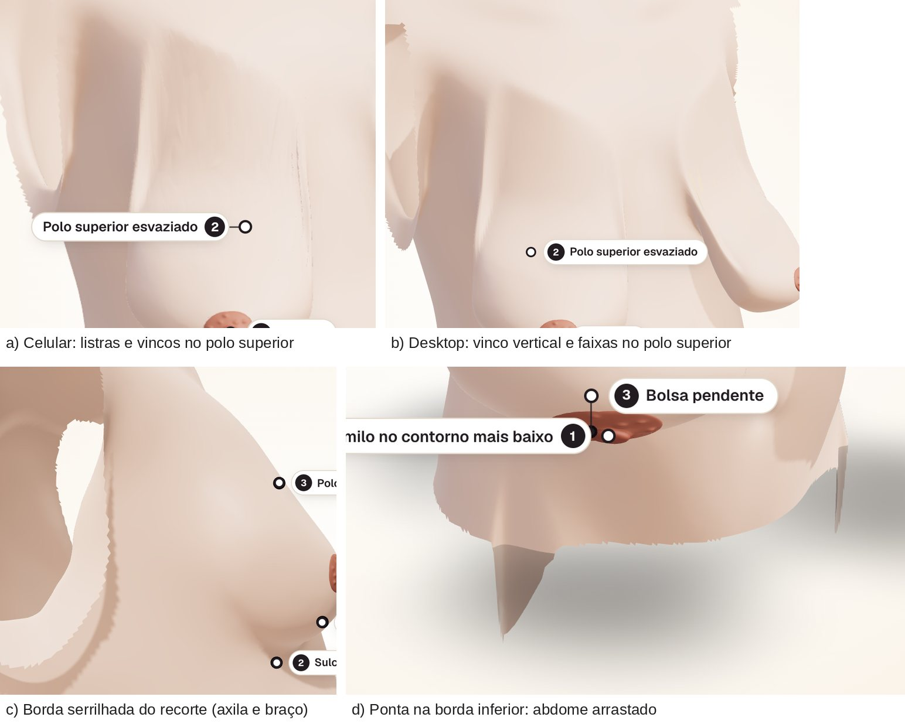
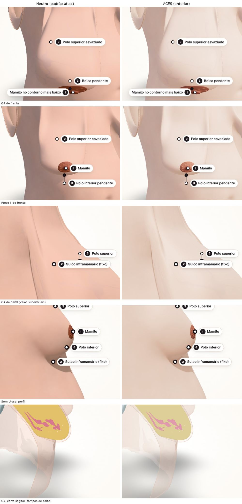

# Pele sem aspecto quadriculado, hábito obeso nas mamas grandes e vasos e nervos que acompanham braço, mama e hábito

## Objetivo e situação

Quatro objetivos, pedidos juntos:

1. **Pele e mama com acabamento profissional.** Tirar o aspecto quadriculado (facetas, listras, vincos e bordas serrilhadas) e dar à pele e aos tecidos da mama uma aparência bonita, sem perder a exatidão técnica: forma, volumes, medidas e marcos.
2. **Hábito obeso nas formas grandes.** Ptoses e hipertrofias grandes costumam vir com obesidade. O tronco do modelo deve acompanhar o grau.
3. **Vasos e nervos no movimento do braço.** Hoje, partes deles ficam paradas enquanto o resto acompanha o braço, e esticam. Verificar e corrigir.
4. **Vasos e nervos em todas as variações.** Revisar como vasos e nervos seguem as formas da mama, as posições do braço e, agora, o hábito, e mudá-los onde estiverem representados.

**Situação: implementado** (fases A a J), com as decisões da seção 6: o hábito acompanha o grau, nos níveis propostos, e os dois extras foram feitos. O mapeamento de tons ficou no neutro por padrão; o ACES anterior aparece com `?tm=aces` no endereço, até a escolha pelas capturas lado a lado. Os números depois da implementação estão em "Resultado medido", logo abaixo. As diferenças em relação ao planejado estão em "O que mudou em relação ao plano". Os números do diagnóstico (seções 1 e 2) são os do estado anterior (`main` em `45e18a3`).

## Resultado medido

Medido com as conferências da fase A (`npm run check:skin`, `npm run check:poses`, `python3 scripts/hybrid/check_habitus.py`) e `npm run check:breast`.

| Item | Antes | Meta | Depois |
|---|---|---|---|
| Vincos do mapa (todos os estados, as duas mamas) | até 50° (G4) | ≤ 8° | ≤ 5,9° |
| Pele movida fora da mama (y < −200 mm) | 425 vértices, até 90 mm | 0 | 0 |
| Maior aresta deformada da pele, após o refinamento | ≈ 19 mm (desktop), ≈ 25 mm (celular) | ≤ 5 / ≤ 7 mm | 5,1 / 7,0 mm |
| Erro das normais (p95) | 6,8° (desktop) e 18,7° (celular), G4 | ≤ 1° | 1,1–1,6° (desktop) e 1,3–2,1° (celular) |
| Erro das normais (máximo) | 31° (desktop) e 89° (celular) | ≤ 3° | 13–32°, em vértices isolados do sulco inframamário, onde a pele já faz a dobra em repouso |
| Bordas (comprimento ÷ suavizado; dente de serra p95) | ×1,25–1,47; 2,6–5,2 mm | ≤ ×1,05; ≤ 0,5 mm | ×1,002–1,006; 0,12–0,18 mm |
| Pele no celular | 18.506 vértices | a do desktop | 54.899, a mesma do desktop (o recorte liso acrescenta vértices na borda) |
| Volumes (mL) | 527 / 641 / 866 / 1.684 / 2.105 (operada); 533 / 643 / 863 / 1.670 / 2.085 (contralateral) | ±2% | 527 / 641 / 866 / 1.684 / 2.105 nas duas |
| Graus e mamilo | — | graus iguais; mamilo a ±3 mm | graus de Regnault e Berrocal iguais; altura do mamilo em relação ao sulco a ±1,5 mm; projeção 2 a 13 mm maior (ptose I a G4) |
| Hábito: cintura (y = −240 mm) | 935 mm em todos | +30 / +100 / +180 mm (±10) | +30 / +100 / +180 mm |
| Contato bolsa–abdome | — | folga ≥ 1 mm | folga de 1,7 a 2,7 mm |
| Braço: estiramento de vasos e nervos (p99 / máx.) | até ×40,7 / ×193 | ≤ ×1,6 / ≤ ×4 | pior ×2,2 / ×4,2 (abdução a 90°), ×2,1 / ×5,3 (flexão a 90°), ×3,6 / ×6,4 (mão na nuca); mediana ×1,06–1,09; dentro da meta: 76, 78 e 70 das 86 estruturas |
| Braço: trechos além do cotovelo parados | ≈ 100% | 0 | 0 |
| Ramos esquemáticos: raiz ao vaso de origem | até 16,9 mm | ≤ 1 mm | 1,0–2,1 mm |
| Comprimento dos ramos esquemáticos por estado | — | ±2% | mediana 1,6%, p90 7,5%; os ramos cutâneos anteriores do 3º e do 5º ficaram 19–22% mais curtos em ptose III a G4: a faixa medial mais larga move menos o tecido junto ao esterno, onde a pele é aderida |
| Vasos e nervos com o hábito | — | ≥ 1 mm da pele; nada dentro de músculo | nenhum vértice fora da pele; só estruturas do tronco se movem (fáscias do dorso até 14 mm, fáscia peitoral até 8 mm, veia torácica lateral até 5 mm) |
| Preparo da pele (refinamento, medido em Node) | — | ≤ +30% | 1,4–1,6 s no desktop (+67 mil vértices), 0,6–0,7 s no celular (+20 mil) |
| Quadros por segundo | — | queda ≤ 10% | não medido: o ambiente de teste só renderiza por software (SwiftShader); fica para conferir num aparelho |
| Tamanho | GLB do celular 2,93 MB | ≤ 3,4 MB | 3,37 MB; desktop 8,93 MB (era 8,91); `habitus.bin` 0,2 MB |

Três metas não foram atingidas por inteiro:

- **Normais.** O p95 ficou entre 1,1° e 2,1°, acima de 1°. O máximo fica em poucos vértices do sulco inframamário, onde a pele em repouso já tem a dobra. Na tela, isso não aparece como faceta.
- **Estiramento no braço.** Os trechos parados e os rasgos acabaram, mas de 8 a 16 das 86 estruturas passam de ×1,6 (p99) em alguma posição: as que cruzam a axila (toracodorsal, torácica lateral, escapular dorsal e os nervos do braço junto à axila), que alongam ao ir do tórax ao braço. Sem deslizamento entre os tecidos, o modelo distribui esse alongamento ao longo da estrutura, mas não o elimina. A conferência (`check:poses`) usa ×4 (p99) e ×8 (máximo) como trava contra regressões.
- **Projeção do mamilo.** As faixas de transição mais largas tiram crescimento das bordas do monte. Para manter o volume, o centro cresce mais, e a mama projeta 5 a 13 mm a mais de ptose II a G4. A altura do mamilo e os graus não mudaram.

## O que mudou em relação ao plano

- **C2, faixas de transição.** Ficaram com 50 mm (lateral) e 55 mm (medial), em vez de 40 mm. Com 40 mm sobravam vincos junto ao esterno e à axila, e a parede medial das mamas grandes dobrava em G4. Cada mama escala as faixas pela largura do próprio sulco: a contralateral é 11% mais estreita. Ela também tem fatores de profundidade próprios (`SIDE_DEPTH`), 1% a 3% maiores, para os dois lados terem o mesmo volume, com projeções a até 5 mm uma da outra.
- **C4, altura da pele.** Só é suavizada de 10 mm acima do sulco para cima, com 20 mm de transição. Abaixo dele, a bolsa pende sobre a base e herdava os vincos.
- **Ajustes do mapa fora do plano.**
  - O crescimento em profundidade se apaga onde o monte tem menos de 8 mm em repouso. Assim, a borda sai da base com a inclinação de repouso, sem vinco.
  - As transições de velocidade dos fluxos passaram a C².
- **D, hábito.**
  - A cintura é medida em y = −240 mm, abaixo da bolsa: em y = −180 mm, a bolsa do G4 se apoia no abdome.
  - A máscara dos montes é suavizada (σ = 15 mm), e as aberturas dos braços têm máscara própria.
  - Vasos braquiais, nervos do braço e circunflexos do úmero não recebem o hábito. Ficam com a forma deles e com as posições do braço.
- **F2, normais pelo mapa.** Não foi aplicada. Com as arestas a 5 e 7 mm, as normais das facetas ficam a p95 ≤ 2,1° das exatas, e as quatro avaliações extras do mapa por vértice dobrariam o tempo de preparo. O refinamento faz até 4 passadas, e não 3.
- **H, vasos e nervos no braço.** Depois das mudanças H1–H3, ainda havia rasgos locais (p99 até ×9). Eles tinham três causas, cada uma com sua correção:
  - **Empurrão para fora dos ossos e deslizamento sobre o tórax.** Eram aplicados vértice a vértice: a metade do tubo dentro da clavícula saía, e a outra ficava. Agora são tomados por secção transversal e espalhados ao longo do vaso (`CorrectionSpread`). Sobram até ≈ 5 mm de vaso dentro de osso em poucos pontos, sob a clavícula na abdução.
  - **Pesos diferentes entre os dois lados de cada tubo.** Os pesos passam por uma difusão de calor na superfície de cada malha (10 mm).
  - **Braço e antebraço herdando peso do tórax e da escápula.** Por proximidade, porque o braço pende junto ao tórax. As estruturas do membro passam ao úmero entre 20 e 120 mm abaixo do centro da cabeça do úmero.
- **Tecidos internos da mama atrás da pele opaca.** Gordura, glândula, ductos e ligamentos ficam ocultos quando a pele está opaca e sem corte nem janela. Nas formas grandes, só a pele é refinada, e os triângulos longos desses tecidos atravessavam a pele nas regiões côncavas, perto da axila, como estrias amarelas. Com a pele translúcida, a janela ou a ferramenta **Corte**, eles voltam.
- **Pele de dupla face.** Onde a mama deformada fica quase de perfil para a câmera (a parede medial e o sulco), triângulos finos se invertiam na tela. O renderizador os tratava como a face interna, com a normal virada para dentro, e eles apareciam como uma linha pontilhada escura. Na pele, um fragmento só conta como face interna quando a normal também aponta para longe da câmera. A face interna vista pelas bordas do recorte continua correta.
- **Extras (decisão 4).**
  - As veias superficiais dilatadas aparecem na pele entre G3 e G4.
  - As tampas de corte pintam o interior cortado de músculos, ossos, cartilagens, gordura, glândula, ductos, vasos, nervos e linfonodos com a cor do tecido, um pouco mais escura, quando a ferramenta **Corte** está ativa.

> **Leitura do pedido.** "Poses maiores" foi lido como **ptoses maiores**, isto é, os estados grandes da mama: ptose III, G3 e G4. No quarto item, "poses" foi lido nos dois sentidos que o app tem: as **formas da mama** e as **posições do braço**. "Texturas" foi lido como a **aparência da superfície** da pele e dos tecidos da mama (malha, sombreamento, material e cor). Hoje nenhum desses tecidos usa imagem de textura.

*Estado atual. a) Celular, mama com ptose: listras e vincos no polo superior. b) Desktop: vinco vertical na borda medial da mama e faixas no polo superior. c) Bordas serrilhadas no recorte da pele, na axila e no braço. d) Mama grande: pontas na borda inferior do tronco, porque a pele do abdome é arrastada pelo mapa da mama (defeito D2).*

## Resumo

| Problema | Causa medida | Correção | Onde |
|---|---|---|---|
| Listras e vincos no polo superior | Degraus de inclinação no próprio mapa da mama. A pele do polo superior fica a 0–2 mm da superfície de base e a cruza. As faixas de transição são estreitas e a base é bilinear | Mapa suave: faixa de transição mais larga e C², base bicúbica, altura da pele sobre a base suavizada, curvas suaves | `build_breast.py`, `breastMap.ts` |
| Pontas na borda inferior do tronco | A pele do abdome fora da janela do mapa é deslocada até 90 mm | Mapa nulo fora da janela e abaixo da bolsa | idem |
| Facetas compridas | Pele esticada até ×9,7 e refinamento fixo | Refinamento pelas arestas deformadas, com pontos médios na superfície curva | `subdivide.ts`, `HybridModel.tsx` |
| Sombreamento em facetas | Normais recalculadas nas facetas deformadas (erro de até 31° no desktop e 89° no celular) | Normais levadas pela derivada do mapa | `HybridModel.tsx` |
| Malha grosseira no celular | `gltfpack -si 0.35` simplifica também a pele | Simplificação por tecido no pipeline, com a pele inteira | `build_hybrid_model.py`, `package.json` |
| Bordas serrilhadas | Recorte da pele pelo centro dos triângulos | Corte por uma superfície lisa e aro de espessura | `build_hybrid_model.py` |
| Pele "de plástico" | Cor única, sem microdetalhe; o ACES clareia e dessatura; o viés da sombra apaga as sombras de contato | Material de pele (luz que contorna o terminador, microrrelevo e manchas sutis presos ao tecido), gordura em lóbulos, mapeamento de tons neutro, sombra ajustada | `skinShader.ts` (novo), `HybridModel.tsx`, `AnatomyViewer.tsx` |
| Tronco igual em todos os graus | Os estados mudam só a mama | Campo de hábito por estado (abdome, flancos, rolos lateral e dorsal), com contato da bolsa sobre o abdome | `build_habitus.py`, `habitusMap.ts` (novos) |
| Vasos e nervos parados no braço | Sem portador além do cotovelo, ficam presos ao tórax; pesos misturados entre estruturas; ramos esquemáticos fora das poses | Pesos continuados ao longo da estrutura, vasos presos às costelas, mistura só dentro de cada família, ramos esquemáticos presos ao vaso de origem | `build_poses.py`, `build_breast_anatomy.py`, `HybridModel.tsx` |
| Vasos e nervos não seguem o hábito | O hábito não existe hoje | Seguem o hábito pela fração de profundidade na tela subcutânea | `habitusMap.ts`, `breastStates.ts` |

## 1. Diagnóstico

### 1.1 Pele "quadriculada"

São oito causas, da mais visível para a menos visível. As duas primeiras estão no mapa da mama, não na malha. Por isso nenhum refinamento de malha as resolve sozinho.

**D1. Vincos do próprio mapa da mama: listras no polo superior.** O mapa (`breastMap.ts`, espelho de `build_breast.py`) desloca cada ponto conforme a profundidade `d` em relação à superfície de base B, que é o tronco sem o monte da mama. Pontos com `d ≤ 0` não se movem. Medido numa linha lisa de pele, em repouso, levada ao estado G4. A métrica é o ângulo que a linha dobra concentrado em 0,25 mm, descontado o de repouso:

- **Pele rente à base.** No polo superior, a pele fica 0 a 2 mm à frente de B e cruza a base: numa linha horizontal 110 mm acima do mamilo, `d` troca de sinal 26 vezes. Um ponto com `d = 2 mm` desce cerca de 6 mm em G4, e o vizinho com `d ≤ 0` fica parado. Resultado: **dobras de até 50° em 0,25 mm** (p99,5: 40°). São as listras de a) e b).
- **Faixas de transição estreitas.** A descida e o alargamento se apagam nas bordas medial e lateral numa faixa de 28 mm (`TAPER_MM`, `smoothstep`, C¹), contra uma descida de até 84 mm e uma largura ×2,0. Isso dobra a pele em até 17° em u ≈ 56 mm (borda medial) e u ≈ 166 mm (borda lateral): 16,8° na ptose III e 15,6° em G4. É o vinco vertical junto ao esterno de b).
- **Base bilinear.** B é interpolada bilinearmente numa grade de 2 mm. A inclinação salta nas linhas da grade (3° a 5° por linha em G4). Com malha densa, isso aparece como linhas finas e regulares.

Correções testadas na mesma métrica (G4, lado operado):

| Linha (acima do mamilo) | Hoje | Faixa C² de 40 mm | + base bicúbica | Só altura da pele suavizada (σ 4 mm) |
|---|---|---|---|---|
| −20 mm | 5,9° | 4,5° | **3,5°** | 4,5° |
| +30 mm | 9,7° | **3,1°** | 3,1° | 9,7° |
| +70 mm | 16,3° | **6,9°** | 6,9° | 14,6° |
| +110 mm | 50,3° (p99,5 40,1°) | 50,3° | 52,3° (p99,5 39,3°) | 52,0° (**p99,5 16,8°**) |
| +130 mm | 15,7° | — | — | **0,2°** |

Cada correção resolve uma parte. O resíduo de +110 mm fica num ponto só, no limite superolateral (u ≈ 174–176 mm), onde se encontram a linha superior do fluxo, a faixa lateral e o alargamento (item C5). A faixa de 40 mm reduz o volume dos estados de 1,3% (ptose I) a 6,6% (G4: 2.105 → 1.967 mL), o que pede um reajuste (item C6).

**D2. Defeito: a pele do abdome inferior é arrastada.** A base só existe numa janela da carta (v de −230 a +170 mm em relação ao mamilo) e é estendida com o valor da borda (`mode="nearest"`). Abaixo da janela, a pele do abdome fica com `d > 0`, e a descida conserva 70% da força abaixo do sulco (`lmin = 0,7`). Em G4, **203 vértices do lado operado e 222 do contralateral com y < −250 mm se movem mais de 2 mm, até 89 e 90 mm**. São as pontas de d).

**D3. Facetas esticadas.** Malhas enviadas ao app, antes do refinamento feito no aparelho. Valores por estado, para a pele sobre a mama:

| Estado | Desktop: aresta mediana / p95 / máx | Estiramento p95 / máx | Celular: aresta mediana / p95 / máx |
|---|---|---|---|
| Repouso | 3,5 / 4,6 / — mm | — | 4,3 / 10,7 / — mm |
| Ptose I | 4,2 / 10,1 / 18,7 mm | ×2,7 / ×4,0 | 5,6 / 17,1 / 56,7 mm |
| Ptose II | 4,7 / 15,3 / 28,7 mm | ×4,1 / ×6,5 | 6,5 / 22,6 / 81,6 mm |
| Ptose III | 5,5 / 17,9 / 34,7 mm | ×4,6 / ×8,5 | 7,7 / 26,7 / 88,4 mm |
| G3 | 6,9 / 18,9 / 35,1 mm | ×4,9 / ×8,7 | 9,6 / 30,0 / 93,6 mm |
| G4 | 7,4 / 20,2 / 37,7 mm | ×5,2 / ×9,7 | 10,0 / 32,7 / 99,2 mm |

O app refina a pele (`HybridModel.tsx:457–476`). No desktop não há nível geral, porque a aresta média sobre a mama (3,5 mm) fica abaixo do limiar de 4,5 mm. Há só mais um nível onde G4 estica uma aresta além de 12 mm (`STRETCHED_EDGE_MM`). No celular há um nível geral mais esse. Pela regra atual, a maior aresta deformada fica em **≈ 19 mm no desktop e ≈ 25 mm no celular** (estimativa). Além disso, os pontos novos ficam no meio das arestas, sobre o triângulo plano (`subdivide.ts`, `refineOnce`). O facetamento da pele em repouso é levado junto e ampliado pelo estiramento.

**D4. Normais recalculadas nas facetas.** `setMorphTargets` (`HybridModel.tsx:80`) recalcula, em cada estado, as normais das facetas deformadas. A tabela compara essas normais com a da superfície lisa levada pelo mapa, calculada por diferenças finitas:

| Estado | Desktop: p95 / máx | Celular: p95 / máx |
|---|---|---|
| Ptose I | 3,3° / 14° | 9,4° / 54° |
| Ptose II | 4,7° / 19° | 12,8° / 64° |
| Ptose III | 5,4° / 20° | 14,1° / 79° |
| G3 | 6,5° / 27° | 18,1° / 83° |
| G4 | 6,8° / 31° | 18,7° / 89° |

Um erro de mais de 10° muda o brilho de uma faceta para a vizinha de forma visível, o que dá o aspecto de facetas e faixas.

**D5. Malha do celular.** `pack:hybrid` (`package.json:19`) simplifica o modelo inteiro do celular com `-si 0.35`, e a pele vai junto: 18.506 vértices em vez de 52.128 (−64%). Em repouso, a aresta do tronco tem mediana de 5,7 mm e p95 de 13,9 mm (desktop: 3,6 e 4,9 mm). As normais são quantizadas em 8 bits (`-vn 8`).

**D6. Bordas serrilhadas.** A pele é recortada pelo centro dos triângulos (`build_hybrid_model.py:361`). Há quatro contornos: inferior, pescoço e um em cada braço. Eles são 25% a 47% mais longos que o mesmo contorno suavizado. O dente de serra tem p95 de 2,6 a 3,6 mm (máximo de 6,5 mm) no desktop e de 3,3 a 5,2 mm (máximo de 9,3 mm) no celular. Os cortes dos braços também deixam abas da pele do ombro do HRA, cujos braços estão abduzidos.

**D7. Material e luz.** A pele é um `MeshPhysicalMaterial` de cor única (`#e7b8a0`, rugosidade 0,5) com brilho aveludado claro (`sheen` 0,45, `#ffd9c7`). Sem microdetalhe, parece plástico. A pele do HRA não tem coordenadas de textura, então não há imagem de textura a aplicar. O mapeamento de tons ACES com exposição 1,05 (`AnatomyViewer.tsx:821`) clareia e dessatura os tons claros. A luz de hemisfério (0,4) e o ambiente (0,55) achatam o volume. Gordura (`#f1cf7c`) e glândula (`#e8879f`) aparecem em cor chapada nas vistas translúcidas e de corte.

**D8. Viés da sombra.** A luz principal usa a câmera de sombra padrão do three (ortográfica, alcance de 499,5 unidades). Com isso, o viés de −0,0004 equivale a ≈ 0,2 unidade, isto é, **≈ 29 mm**. Não há acne de sombra, mas as sombras de contato desaparecem (sulco, bolsa sobre o abdome). Isso foi calculado a partir dos padrões do three e será conferido nas capturas da fase G.

### 1.2 Hábito corporal

**Literatura.**

- Pacientes de mamoplastia redutora estão, em média, com sobrepeso ou obesidade: IMC médio de 28,9 numa coorte de 453 pacientes (Tampere) e de **34,1** (21,3 a 53,6) numa série de 182 mamoplastias bilaterais, com ressecção média de 736 g (Hinson et al., 2022).
- O IMC é o fator que mais se relaciona com o volume da mama: **r = 0,834** em ressonância de 400 mulheres (Estler et al., 2023).
- O IMC também está entre os fatores de risco de ptose, ao lado de idade, número de gestações, tamanho do sutiã antes da gestação e tabagismo (Rinker et al., 2008).
- Abdome: gordura subcutânea de cerca de 23 a 24 mm na altura do umbigo, em TC de 545 mulheres (Kim et al., 2012). Num estudo por ultrassom, a espessura sobe de 20,8 mm no sobrepeso para 23,3 mm na obesidade (amostra mista). A parede torácica também engrossa com o IMC (TC).
- Cintura: o limiar da OMS para risco substancialmente aumentado em mulheres é 88 cm. Lean et al. (1995) associam 80 cm a IMC ≈ 25 e 88 cm a IMC ≈ 30, cerca de 1,6 cm por unidade de IMC.

**O modelo.** A pele é a do Visible Human Female (mulher de 59 anos). O perímetro foi medido pela casca convexa do corte, como faria uma fita:

| Altura (y) | Perímetro |
|---|---|
| −240 mm (crista ilíaca) | 933 mm |
| −180 mm | 950 mm |
| −120 mm | 959 mm |
| −90 mm | 965 mm |
| −60 mm (sulco) | 1.020 mm |

A cintura não é marcada: o perímetro fica entre **93 e 97 cm** da crista ilíaca ao sulco, acima dos 88 cm da OMS. Pela cintura, o modelo já é de uma mulher com sobrepeso ou obesidade leve. O IMC da doadora não vem no modelo.

Espessura subcutânea no lado operado (pele até o músculo, osso ou cartilagem mais próximo; mediana e intervalo interquartil):

| Região | Espessura |
|---|---|
| Tórax lateral | 13 mm (10–17) |
| Infraclavicular | 13 mm (11–16) |
| Subescapular | 25 mm (21–33) |
| Flanco | 38 mm (25–52) |

O abdome não pode ser medido: o modelo não tem os músculos da parede abdominal (reto, oblíquo interno, transverso).

**Os estados não mudam o tronco.** Uma mama de 2.105 mL (G4) fica sobre o mesmo tronco da mama de 426 mL. Em G4, o ponto mais baixo da bolsa fica 12 cm abaixo do sulco (y = −183 mm), e a folga até a pele do abdome é de **6 a 8 mm no mínimo** (p5 ≈ 20 mm). Qualquer espessamento do abdome sob a bolsa precisa, portanto, de tratamento de contato.

### 1.3 Vasos e nervos no movimento do braço

Das 223 malhas, 115 recebem deslocamentos de pose (`armPoses.ts`). Vasos e nervos seguem os músculos e ossos a até 40 mm (k = 12, inverso do quadrado). Os pesos são suavizados num campo comum a todos os seguidores, em voxels de 4 mm com raio de 16 mm (`build_poses.py:413–487`). Medido na abdução de 90°; "parado" é o vértice que se move menos de 0,5 mm:

| Estrutura | Parado | Deslocamento máx. | Estiramento p99 | Estiramento máx. |
|---|---|---|---|---|
| Veia cefálica | 25% | 480 mm | ×24,8 | **×171,7** |
| Veia basílica | 26% | 426 mm | ×29,4 | ×113,7 |
| Nervo musculocutâneo | 15% | 452 mm | ×17,5 | ×108,1 |
| Nervo ulnar | 22% | 421 mm | ×15,0 | ×91,5 |
| Nervo mediano | 14% | 442 mm | ×15,7 | ×84,0 |
| Nervo radial | 23% | 464 mm | ×20,5 | ×66,4 |
| Tronco de C5 | 0% | 39 mm | ×5,2 | ×71,9 |
| Veias intercostais anteriores (conjunto) | 70% | 25 mm | ×2,4 | ×52,8 |
| Nervo peitoral medial | 34% | 28 mm | ×2,9 | ×36,3 |
| Artérias intercostais posteriores (conjunto) | 80% | 26 mm | ×2,0 | ×28,8 |
| Artéria dorsal da escápula | 0% | 52 mm | ×3,3 | ×23,6 |
| Artéria e veia supraescapulares | 0–3% | 22–24 mm | ×3,6–3,8 | ×17,8–18,4 |
| Nervo toracodorsal | 10% | 36 mm | ×2,8 | ×17,4 |
| Artéria axilar | 0% | 63 mm | ×7,9 | ×15,7 |

Na flexão de 90°, o pior caso chega a ×193 (veia cefálica) e o p99 a ×40,7 (nervo radial). Há quatro causas:

1. **Nada carrega o antebraço.** O modelo não tem ossos nem músculos do antebraço. Os trechos parados ficam de 340 a 551 mm da articulação glenoumeral, ao longo do eixo do úmero (o cotovelo fica a 268 mm). Sem portador a 40 mm, esses vértices recebem o peso do tórax (`build_poses.py:483`) e ficam parados, enquanto o braço gira.
2. **Vasos da parede misturados com o braço.** Os conjuntos intercostais correm entre as costelas, que não se movem nestas poses. Mesmo assim, pegam pesos de músculos vizinhos que se movem e do campo comum, que mistura estruturas diferentes. Ficam 70% a 80% parados, e o resto é arrastado.
3. **Transições bruscas no plexo.** O tronco de C5 não tem trecho parado, mas estica ×72 onde vértices vizinhos recebem pesos de portadores diferentes. A suavização ao longo da malha (10 iterações) alcança só alguns milímetros.
4. **Estruturas esquemáticas fora das poses.** As 20 malhas esquemáticas da mama (`lit_*`) não recebem pose. As raízes dos ramos se soltam do vaso real de onde saem:

| Ramo esquemático | Vaso de origem | Abdução 90° | Flexão 90° | Abdução 130° |
|---|---|---|---|---|
| Ramo peitoral → mama | Ramo peitoral da toracoacromial | 10,2 mm | **16,9 mm** | 9,6 mm |
| Mamário lateral 1 | Torácica lateral | 6,2 mm | 10,8 mm | 7,0 mm |
| Mamário lateral 2 | Torácica lateral | 2,4 mm | 3,3 mm | 3,7 mm |
| Perfurantes da torácica interna | Torácica interna | 0 | 0 | 0 |

### 1.4 Vasos e nervos com as formas da mama e o hábito

- **Formas da mama.** As malhas da mama do HRA e as 10 estruturas esquemáticas (20 malhas) seguem o mapa. Tubos e septos são refeitos em volta da linha central, mantendo calibre e espessura. Onde o estado grande afina a camada sobre um ramo superficial, o ramo é empurrado para dentro (`clearance`). Os vasos e nervos reais (BodyParts3D) ficam na parede torácica (`d ≤ 0`) e não se movem, o que está correto. Depois da fase C, comprimentos e empurrões precisam ser recalculados.
- **Braço.** Ver 1.3. A pele e a mama não se movem com o braço. É uma limitação conhecida (`docs/movimento-membro-superior.md`) e continua fora do escopo.
- **Hábito.** Não existe hoje. Quando existir, as estruturas superficiais precisam acompanhar a pele: sem isso, um nervo cutâneo que termina na derme ficaria 5 a 40 mm abaixo dela em G4. Entram aqui o nervo supraclavicular, os ramos cutâneos anteriores e laterais dos intercostais, o nervo intercostobraquial, os linfonodos axilares e o trecho dos ramos esquemáticos fora do monte.
- **Uma malha, um conjunto de morphs.** `setMorphTargets` troca o conjunto inteiro. Uma malha não pode ter, ao mesmo tempo, os estados da mama e uma pose. Os ramos esquemáticos (estado + pose) e as estruturas superficiais (hábito + pose) precisam dos dois.

## 2. Metas e critérios de aceite

| Item | Medida | Hoje | Meta |
|---|---|---|---|
| Vincos do mapa | ângulo concentrado em 0,25 mm, todos os estados | até 50° (G4) | ≤ 8° |
| Pele movida fora da mama | vértices com y < −200 mm movidos > 0,5 mm | 425 (até 90 mm) | 0 |
| Facetas | maior aresta deformada sobre a mama, após o refinamento do app | ≈ 19 mm (desktop), ≈ 25 mm (celular) | ≤ 5 mm (desktop), ≤ 7 mm (celular) |
| Normais | erro em relação à superfície lisa, G4 (p95 / máx.) | 6,8° / 31° (desktop); 18,7° / 89° (celular) | ≤ 1° / ≤ 3° |
| Bordas | comprimento ÷ suavizado; dente de serra p95 | ×1,25–1,47; 2,6–5,2 mm | ≤ ×1,05; ≤ 0,5 mm |
| Pele no celular | vértices | 18.506 | 52.128 (a do desktop) |
| Volumes dos estados | mL do monte | 527 / 641 / 866 / 1.684 / 2.105 | ±2% |
| Graus e mamilo | Regnault, Berrocal, posição do mamilo | — | iguais; mamilo a ±3 mm |
| Hábito | perímetro em y = −180 mm (ptose III / G3 / G4) | 950 mm em todos | +30 / +100 / +180 mm (±10) |
| Contato bolsa–abdome | interpenetração | — | nenhuma (folga ≥ 1 mm) |
| Braço | estiramento de vasos e nervos (p99 / máx.), todas as poses | até ×40,7 / ×193 | ≤ ×1,6 / ≤ ×4 |
| Braço | trechos além do cotovelo parados | ≈ 100% | 0 |
| Ramos esquemáticos | distância da raiz ao vaso de origem na pose | até 16,9 mm | ≤ 1 mm |
| Vasos e nervos com hábito | distância à pele; posição em relação ao músculo | — | ≥ 1 mm da pele; nenhum dentro do músculo |
| Desempenho | tempo de preparo da mama no aparelho; FPS | medir na fase A | ≤ +30%; queda máxima de 10% |
| Tamanho | GLB do celular | 2,93 MB | ≤ 3,4 MB |

## 3. Mudanças por fase

### Fase A — Conferências automáticas, antes de mudar qualquer coisa

Os scripts de medida usados neste plano viram conferências do pipeline. Cada uma grava em `assets/build/checks/*.json`, imprime um resumo e falha quando uma meta da seção 2 não é cumprida (as metas entram em vigor quando a fase correspondente terminar).

- `scripts/hybrid/check_skin.py`:
  - vincos do mapa em linhas lisas a −20, +30, +70, +110 e +130 mm do mamilo, em todos os estados;
  - pele movida fora da mama;
  - arestas e estiramento por estado;
  - bordas: comprimento sobre o suavizado e dente de serra.
- `scripts/hybrid/check_skin_app.mjs` (Node, como `check_breast_map.mjs`): roda na pele decodificada (desktop e celular) o mesmo refinamento e as mesmas normais do app (`subdivide.ts`, `breastMap.ts` e, depois, `habitusMap.ts`). Mede a maior aresta deformada, o erro de normal por estado e o tempo.
- `scripts/hybrid/check_pose_followers.py`: por pose e por estrutura do lado operado, mede a fração parada, o deslocamento máximo, o estiramento (p99 e máximo) e a distância da raiz de cada ramo esquemático ao vaso de origem.
- `scripts/hybrid/check_habitus.py` (fase D): perímetros por estado (y = −240, −180, −120 e −90 mm), espessuras por região, folga entre bolsa e abdome, e distância de vasos e nervos à pele e ao músculo.
- `package.json`: comandos `check:skin`, `check:poses` e `check:habitus`.

**Aceite:** as conferências reproduzem os números deste documento, que são a linha de base.

### Fase B — Modelo-base: recorte limpo e malha do celular

Arquivos: `scripts/hybrid/build_hybrid_model.py`, `package.json`.

- **B1. Recorte por uma superfície lisa.** Hoje, o recorte em `load_hra` (`build_hybrid_model.py:361`) escolhe triângulos inteiros pelo centro. O novo recorte corta os triângulos pela linha de nível zero de uma função lisa, interpolando ao longo das arestas, e mantém a mesma cobertura (em mm, no referencial do HRA):
  - `s = smax(870 − z, z − 1415, |x| − L(z))`;
  - `L(z) = 178 + 37·smootherstep((z − 1290)/80)`, a passagem suave de 178 para 215 mm no ombro;
  - `smax` é um máximo suave (log-soma-exp, k = 6 mm), que arredonda os cantos.

  A região da mama não muda. Os braços continuam fora, porque os do HRA estão abduzidos e não coincidem com os do BodyParts3D.
- **B2. Aro de espessura.** Cada contorno é estendido 3 mm para dentro, ao longo da normal, numa faixa de triângulos da própria malha da pele, para que ela se deforme junto. O shader da fase G escurece o aro pela distância à borda, calculada no app. Não há atributo novo no GLB, que o `gltfpack` descartaria sem `-kv`.
- **B3. Celular sem simplificar a pele.** `write_glb` grava também `assets/build/hybrid-torso-mobile.raw.glb`, com simplificação por tecido. A função `decimate` (`build_hybrid_model.py:184`) já existe. A fração de cada tecido que fica:

  | Tecidos | Fica |
  |---|---|
  | Pele, aréola, mamilo | 100% |
  | Gordura | 60% |
  | Glândula, ductos, ligamentos, linfonodos | 50% |
  | Artérias, veias, nervos | 45% |
  | Fáscias | 35% |
  | Músculos, ossos, cartilagens | 30% |

  Em `pack:hybrid`, a versão do celular passa a ler esse arquivo, sai o `-si 0.35` e `-vn 8` vira `-vn 10`.

**Aceite:** as bordas cumprem as metas; os cortes do tronco ficam fechados do contorno inferior até a altura do sulco; nenhum ponto do BodyParts3D passa a ficar fora da pele além do que já fica hoje (0,06%, até 8,45 mm, `hybridTorsoManifest.json`); GLB do celular ≤ 3,4 MB.

### Fase C — Mapa da mama: defeito do abdome e suavidade

Arquivos: `scripts/hybrid/build_breast.py`, `src/lib/breastMap.ts`, `src/data/breastModel.json` com `breast-chart.bin`, `scripts/hybrid/breast-test-vectors.json` e `check_breast_map.mjs`, `docs/plano-mamoplastia.md`. As duas implementações mudam juntas, e os vetores de teste garantem que continuam iguais.

- **C1. Janela e corte inferior (defeito D2).**
  - Um ponto fora da janela da base não se move. Nos 10 mm junto à borda da janela, o deslocamento se apaga com `smootherstep`.
  - Toda a amplitude passa a ser multiplicada por `gate(a) = smootherstep((a + 120)/40)`, com `a` = altura do ponto de repouso em relação à dobradiça. Tecido mais de 120 mm abaixo da dobradiça (y ≈ −170 mm) nunca se move. Nenhum tecido do monte, em repouso, fica abaixo do sulco (y = −64 mm).
  - Meta: nenhum vértice com y < −200 mm movido mais de 0,5 mm.
- **C2. Faixa de transição.** `taper` passa de `smoothstep` para `smootherstep` (C²), e `TAPER_MM` (`build_breast.py:82`; `taperMm` no JSON) passa de **28 para 40 mm**. Medido: −68% no vinco a +30 mm e −58% a +70 mm (tabela de D1).
- **C3. Base bicúbica.** A base passa a ser interpolada por Catmull–Rom: C¹, sem pré-filtro e idêntica em Python e TypeScript. Substitui `map_coordinates(order=1)` em `Breast.base` (`build_breast.py:299`) e `baseAt` (`breastMap.ts:95`). Tira as linhas da grade de 2 mm.
- **C4. Altura da pele sobre a base suavizada.** Na construção de B (`build_breast.py:265`, depois de `membrane_fill`), onde a pele fica a menos de 8 mm da base:
  - `B' = w·(RS − Hs) + (1 − w)·B`;
  - `H = max(RS − B, 0)`, `Hs` = H suavizada por gaussiana de σ = 4 mm e `w = 1 − smootherstep(H/8)`.

  A altura da pele sobre a base fica lisa, e o tecido mais fundo que 8 mm não muda. Medido só na pele: o vinco a +130 mm cai de 15,7° para 0,2°, e o p99,5 a +110 mm cai de 37° para 17°.
- **C5. Curvas e limite superior.** As curvas do sulco, da dobradiça e do topo (`curve()` nos dois arquivos, lineares por trechos de 2 mm) passam a Catmull–Rom. O alargamento (`gu` em `growthVelocity`) passa a se apagar acima da linha do topo, pelo mesmo fator `up` da descida. É a hipótese para o resíduo de 52° em u ≈ 174–176 mm e v ≈ +110 mm. Se a conferência não a confirmar, o item é refeito antes de seguir.
- **C6. Volumes.** Por bisseção, ajustar `growth.depth` de cada estado em `STATES` (`build_breast.py:88`) e, se preciso, `growth.width`, até o volume do monte voltar a ±2% do atual: 527, 641, 866, 1.684 e 2.105 mL. Os graus de Regnault e Berrocal ficam iguais, o mamilo a ±3 mm e o jacobiano mínimo ≥ 0,1. Por fim, regravar as medidas no JSON e os vetores de teste.

**Aceite:** `check_skin.py` (vincos ≤ 8° em todas as linhas e estados, nenhum vértice movido fora da mama), volumes a ±2% e `npm run check:breast` passando.

### Fase D — Hábito corporal ligado ao grau

Arquivos novos: `scripts/hybrid/build_habitus.py`, `src/lib/habitusMap.ts`, `src/data/habitusModel.json` com `public/models/hybrid/habitus.bin`, `scripts/hybrid/check_habitus.py` e vetores de teste para `habitusMap.ts`. Arquivos alterados: `src/lib/breastStates.ts`, `src/components/viewer/HybridModel.tsx`, `build_mammaplasty.py`, `build_mammaplasty_steps.py`, `build_breast_anatomy.py`, `build_breast.py` (textos dos estados).

**D1. O campo (pipeline).**

- **Carta.** Carta cilíndrica em volta do eixo do tronco (`trunk_axis()`: x = 35,8 mm, z = −20,3 mm). θ é o ângulo a partir da linha média anterior e y a altura. Grade de 3° × 5 mm, com y de −330 a +240 mm.
- **Dados por célula.** Para cada célula:
  - raio da pele em repouso R_s;
  - espessura subcutânea t₀, da pele até o músculo, osso ou cartilagem mais próximo; onde não há parede a menos de 80 mm (o abdome), o valor nominal é de 25 mm (Kim et al., 2012);
  - normal da pele suavizada.
- **Deslocamento.** Para fora, `Δt(θ, y, estado) = ΔC/(2π) · W(θ, y) · (1 − M)`:
  - ΔC é o aumento de cintura do estado; como o tronco não é um círculo, a escala é calibrada para que o perímetro medido chegue ao alvo;
  - W é o mapa de pesos por região, suavizado por gaussiana de 25 mm;
  - M é a máscara dos dois montes: `taper(u)`, a janela em v e `smootherstep(H/6 mm)`, alargada em 30 mm com borda C². Dentro do monte, quem manda é o mapa da mama.
- **Pesos por região.** Normalizados para que a média em volta da cintura seja 1:

  | Região | Peso |
  |---|---|
  | Abdome anterior | 1,45 |
  | Flancos | 1,10 |
  | Rolo lateral do tórax (θ ≈ 70–110°, y de −60 a +40 mm) | 0,80 |
  | Dorso na linha do sutiã (\|θ\| > 120°, y de −80 a 0 mm) | 0,60 |
  | Dorso lombar | 0,55 |
  | Axila | 0,40 |
  | Infraclavicular | 0,15 |
  | Ombros e pescoço | 0,10 |
  | Cotos dos braços | 0, para não errar a direção nas poses |

- **Níveis propostos (decisão 2).** Aumentos de cintura sobre o modelo, com a espessura resultante por região:

  | Estado | Cintura | ≈ IMC sobre o modelo (Lean) | Abdome | Flanco | Dorso lombar | Rolo lateral | Linha do sutiã | Infraclavicular |
  |---|---|---|---|---|---|---|---|---|
  | Repouso, ptose I, ptose II | 0 | 0 | 0 | 0 | 0 | 0 | 0 | 0 |
  | Ptose III | +3 cm | +2 | 7 mm | 5 mm | 3 mm | 4 mm | 3 mm | 1 mm |
  | G3 | +10 cm | +6 | 23 mm | 17 mm | 9 mm | 13 mm | 10 mm | 2 mm |
  | G4 | +18 cm | +11 | 41 mm | 31 mm | 16 mm | 23 mm | 17 mm | 4 mm |

- **Contato.** Em cada estado, a face de trás da bolsa (a pele que o mapa leva abaixo do sulco) é rasterizada na grade. O abdome é limitado para ficar pelo menos 1 mm atrás dela, e o limite é suavizado com σ = 10 mm. O resultado é o sulco de contato sob a mama, como na paciente obesa em pé.
- **Saída.** `habitusModel.json` (grade, níveis, pesos e parâmetros) e `habitus.bin`: deslocamentos em int16 com passo de 0,05 mm, R_s e t₀ em uint16 e a normal em três int8. São ≈ 0,2 MB.

**D2. No app.**

- **`habitusMap.ts`.** Sem imports, como `breastMap.ts`, e com interpolação bicúbica na grade. A função `displacements(positions)` devolve um deslocamento por estado, zero nos estados sem hábito.
- **Fração de profundidade.** `f = clamp(1 − (R_s − r)/t₀, 0, 1)`: a pele recebe o deslocamento inteiro, a fáscia profunda nada e uma estrutura no meio da gordura metade. Um ponto fora da pele recebe 1.
- **Integração.**
  - `breastDisplacements` (`breastStates.ts:81`) soma o hábito ao mapa da mama. Assim, malhas, tubos, septos, marcações e âncoras (`displacePoints`) recebem a mesma função.
  - Em `prepareBreast` (`HybridModel.tsx:399`), a lista de malhas passa a incluir pele, vasos, nervos, linfonodos e fáscias (pelo tecido no manifesto), com `which = []` fora das mamas.
  - Músculos, ossos e cartilagens ficam de fora (f = 0).

**D3. No pipeline.**

- `build_mammaplasty.py` e `build_mammaplasty_steps.py` somam `habitus.displacement(pontos, estado)` onde levam pontos de repouso a um estado: peças, malhas do passo a passo, marcações e rótulos. O resultado da cirurgia mantém o hábito do caso.
- `build_breast_anatomy.py` passa a conferir a folga sob a pele de cada estado (`SKIN_CLEARANCE`) com o hábito incluído.

**D4. Textos.** A descrição dos estados em `build_breast.py` (`STATES`) e o seletor **Forma da mama** mostram o hábito, por exemplo: "Hábito: obesidade (cintura +18 cm)".

**Aceite:** `check_habitus.py`: perímetros nas metas, nenhuma interpenetração entre bolsa e abdome, nenhum vaso ou nervo a menos de 1 mm da pele nem dentro de músculo, campo sem vincos acima de 8° e app igual ao pipeline nos vetores (≤ 0,01 mm).

### Fase E — Regenerar o que depende do modelo e do mapa

Uma só regeneração, depois de B, C e D:

1. `npm run build:hybrid`
2. `npm run layers:hybrid`
3. `npm run breast:hybrid`
4. `python3 scripts/hybrid/build_habitus.py`
5. `npm run mammaplasty:hybrid` (anatomia esquemática e todos os casos)

As poses são regeneradas na fase H, e as capas na fase J. A tabela de peças e volumes de `docs/plano-mamoplastia-tecnicas.md` é refeita e comparada com a atual.

### Fase F — Malha e normais da pele no app

Arquivos: `src/lib/subdivide.ts`, `src/components/viewer/HybridModel.tsx`.

- **F1. Refinamento pelas arestas deformadas.**
  - A nova função `refineEdges(geometry, split, { smooth })` divide cada aresta cujo comprimento deformado passe do limite em algum estado (mama + hábito). Usa os mesmos padrões sem rachaduras de `refineOnce` (1→2, 1→3, 1→4).
  - Os pontos médios ficam na superfície curva (PN): `m = (a+b)/2 − [((b−a)·nₐ)nₐ + ((a−b)·n_b)n_b]/8`. Nas arestas de 3,5 mm, isso muda o repouso em centésimos de milímetro.
  - Os estados são levados como atributos e recalculados pelo mapa a cada passada.
  - Parâmetros: `SKIN_EDGE_MM` = 5 (desktop) e 7 (celular); `MAX_PASSES` = 3; orçamento de +80.000 vértices (desktop) e +30.000 (celular).
  - Substitui `STRETCHED_EDGE_MM` (`HybridModel.tsx:136`) e os níveis fixos (`HybridModel.tsx:457–476`).
- **F2. Normais levadas pelo mapa.** Vale para as superfícies: pele, gordura, glândula, aréola, mamilo e ligamentos.
  - Em cada estado, `n_k = normalize(∂p_k/∂t₁ × ∂p_k/∂t₂)`, com t₁ e t₂ tangentes à normal de repouso e diferenças centrais de h = 0,5 mm. São quatro avaliações extras do mapa (mama + hábito) por vértice.
  - A normal do morph passa a ser `n_k − n_repouso`.
  - `setMorphTargets` (`HybridModel.tsx:80`) ganha a opção `normals`; quando ela vem, não recalcula pelas facetas. Tubos e septos mantêm as normais das facetas, porque são refeitos.
- **F3. Tempo.** Medir `prepareBreast` com `performance.now()` contra a linha de base da fase A.

**Aceite:** `check_skin_app.mjs`: maior aresta deformada ≤ 5 mm (desktop) e ≤ 7 mm (celular) em todos os estados, erro de normal com p95 ≤ 1° e máximo ≤ 3°, nenhuma rachadura e tempo dentro do orçamento.

### Fase G — Material, textura e luz

Arquivos: `src/lib/skinShader.ts` (novo); `src/components/viewer/HybridModel.tsx` (`makeMaterial`, linhas 226–270); `src/components/AnatomyViewer.tsx` (linhas 134 e 819–832); `src/lib/modelConfig.ts`, se alguma cor precisar de ajuste.

- **G1. Pele no desktop.** `MeshPhysicalMaterial` com `onBeforeCompile`:
  - **Luz que contorna o terminador**, uma aproximação do espalhamento sob a pele: o difuso passa a `(N·L + w)/(1 + w)`, com w = 0,30, e o terminador ganha um tom avermelhado (`#d9776a`, mistura de 0,35).
  - **Microrrelevo.** Ruído 3D de gradiente sobre a posição de repouso, em mm. É o atributo `position`, anterior aos morphs, então o desenho fica preso ao tecido em todos os estados e poses. Duas oitavas (2,5 mm e 0,9 mm), com inclinação da normal de 2° e 1°, apagadas pela derivada de tela (`fwidth`) para não criar moiré.
  - **Manchas sutis.** Ruído de baixa frequência (35 mm): ±4% de luminância e ±3% para o vermelho. Rugosidade de 0,55 ± 0,05.
  - **Brilho.** `specularIntensity` de 1 para 0,7 (F0 ≈ 0,028, o da pele); `sheen` de 0,45 para 0,20; rugosidade de 0,5 para 0,55.
  - **Aro (B2)** 25% mais escuro.
- **G2. Pele no celular e pele fantasma.** No celular (`MeshStandardMaterial`), só a luz que contorna e as manchas. Na pele fantasma (`ghostly`), mantém o Fresnel e só as manchas.
- **G3. Tecidos da mama no desktop.** Gordura em lóbulos: ruído celular sobre a posição de repouso, células de 7 mm, septos 8% mais claros. Glândula com manchas de 3 mm (±6%). No celular, cor lisa.
- **G4. Tons e luz.**
  - `ACESFilmicToneMapping` passa a `NeutralToneMapping` (three r171), com exposição 1,0.
  - Hemisfério de 0,4 para 0,30; `environmentIntensity` de 0,55 para 0,45; luz principal de 2,1 para 2,3; luz de preenchimento azulada de 0,9 para 0,7.
  - Os valores são ajustados em capturas A/B, com o parâmetro `?tm=aces` durante a revisão (decisão 3).
- **G5. Sombra.** A câmera de sombra passa a ser ajustada ao modelo: ±2,4 unidades, near 1 e far 20. Com bias de −0,0002 e normalBias de 0,01, as sombras de contato do sulco e da bolsa sobre o abdome voltam.

**Aceite:**

- Capturas antes e depois (`docs/img/pele-antes-depois.jpg`) nas vistas de frente, a 45°, de lado e de perto no polo superior, em repouso, ptose III e G4, no desktop e no celular.
- Nenhuma faceta ou listra visível em 1× e 2×, e as cores dos tecidos continuam reconhecíveis pela legenda.
- Queda de FPS de no máximo 10% no desktop, e shaders compilando no WebGL2 (inclusive SwiftShader).

### Fase H — Vasos e nervos no movimento do braço

Arquivos: `scripts/hybrid/build_poses.py`, `scripts/hybrid/build_breast_anatomy.py`, `src/data/breastAnatomy.json`, `src/components/viewer/HybridModel.tsx`, `src/lib/armPoses.ts` (tipos), `docs/movimento-membro-superior.md`.

- **H1. Vasos presos às costelas.** O novo `RIB_BOUND = {"intercostal-vessels", "internal-thoracic-vessels"}` (campo `structure` do manifesto) dá peso 1 ao tórax, fora de `follower_names` (`build_poses.py:470`). Cobre:
  - os conjuntos de veias intercostais anteriores e de artérias intercostais posteriores;
  - os vasos lombares, subcostais e intercostal superior;
  - a torácica interna, a musculofrênica e a epigástrica superior.

  A caixa torácica não se move nestas poses.
- **H2. Pesos continuados ao longo da estrutura.** Em `follower_weights` (`build_poses.py:474–487`), o vértice sem portador a 40 mm deixa de receber o tórax (linha 483). Passa a receber pesos por extensão harmônica ao longo da própria malha, a partir dos vértices com portador. A nova função `harmonic_extend(pos, idx, conhecidos, valores)` é análoga a `harmonic_weights` (linha 354). O antebraço passa a acompanhar o úmero, com o cotovelo estendido nas três poses.
- **H3. Mistura só dentro de cada família.** `FollowerField` (linha 413) passa a suavizar só dentro de cada família (`FOLLOWER_FAMILIES`):
  - **membro:** vasos axilares, braquiais, subclávios e circunflexos do úmero, nervos do braço, plexo e intercostobraquial;
  - **parede:** vasos toracodorsais, torácicos laterais, subescapulares, toracoacromiais, escapulares e cervicais, nervo torácico longo e nervos peitorais;
  - **linfonodos.**

  A suavização ao longo da malha vai de 10 para 40 iterações, cerca de quatro vezes o alcance atual.
- **H4. Limites na conferência.** Em `check_pose_followers.py`, todo vaso e nervo do lado operado, em toda pose, deve ter estiramento p99 ≤ 1,6 e máximo ≤ 4, e nenhum trecho do membro além do cotovelo parado.
- **H5. Ramos esquemáticos presos ao vaso de origem.** Em `breastAnatomy.json`, `build_breast_anatomy.py` grava `follow: {parent, fadeMm: 40}`:
  - nos mamários laterais 1 e 2 (torácica lateral, `bp43_FJ1976`);
  - no ramo do peitoral da toracoacromial (`bp43_FJ2330`);
  - nas perfurantes da torácica interna (`bp43_FJ1972`, que fica parada).

  No app, em `preparePose` (`HybridModel.tsx:342–375`), cada ramo com `follow` pega o deslocamento, quadro a quadro, do vértice do vaso de origem mais próximo da raiz. Aplica esse deslocamento à linha central com peso `1 − smootherstep(s/40 mm)`, sendo s o comprimento a partir da raiz, e refaz o tubo (`tubeVertices`).
- **H6. Conjunto de morphs composto.**
  - `setMorphTargets` aceita blocos `{ state, pose }`: `morphAttributes = [...state, ...pose]`, com os limites em `mesh.userData.morphBlocks`.
  - `setBreastLevel` (linha 388) e `setPoseFraction` (linha 378) escrevem só o próprio bloco. `clearPose` devolve o bloco de estados (`breastMorphs`).
  - Isso serve aos ramos esquemáticos (estado + pose) e às estruturas superficiais reais (hábito + pose).

A limitação de 1.4 continua: pele e mama não se movem com o braço.

**Aceite:** `check_pose_followers.py` passa, a raiz dos ramos fica a ≤ 1 mm do vaso de origem e a inspeção visual das três poses, em **Camadas → Vasos e nervos**, não mostra trechos parados.

### Fase I — Vasos e nervos com as formas da mama e o hábito

- **I1. Formas da mama.** O comportamento não muda: continuam seguindo o mapa, com comprimento e folga por estado. Depois da fase C, `build_breast_anatomy.py` recalcula comprimentos e empurrões. A diferença em relação aos atuais (`lengthsMm` em `breastAnatomy.json`) deve ficar em ±2%.
- **I2. Hábito.** Pela fração de profundidade (D2), todo vaso, nervo, linfonodo e fáscia recebe o hábito. A conferir em `check_habitus.py`:
  - o nervo supraclavicular e os ramos cutâneos anteriores de T1 e T2 sobem quase o deslocamento da pele infraclavicular (≤ 4 mm em G4);
  - o intercostobraquial e os linfonodos axilares sobem uma parte, com a gordura axilar;
  - a torácica lateral, o toracodorsal e os nervos peitorais, sobre o músculo, quase não se movem.

  Os ramos esquemáticos fora do monte seguem a mesma regra: os ramos cutâneos laterais e anteriores de T3 a T5 e o trajeto dos mamários laterais até a borda da mama. Dentro do monte, continuam seguindo o mapa.
- **I3. Calibre.** Não muda: o levantamento não achou dado confiável para isso. Como opção (decisão 4), veias superficiais dilatadas sob a pele em G4, como desenho sutil no shader da pele.

**Aceite:** `check_habitus.py` (≥ 1 mm da pele, nada dentro de músculo) e inspeção em **Camadas** com G3 e G4.

### Fase J — Validação, documentação e publicação

- Rodar todas as conferências, `npm run lint` e `npm run build`. Fazer capturas no desktop e no celular, em repouso, ptose III, G3 e G4, com e sem pose do braço. Refazer as capas que mostram pele.
- Atualizar a documentação:
  - este plano, com a situação atualizada;
  - `docs/plano-mamoplastia.md`: janela, faixa, base e altura suavizada do mapa;
  - `docs/plano-mamoplastia-g3-g4.md` e `docs/plano-mamoplastia-tecnicas.md`: volumes e peças depois do reajuste;
  - `docs/movimento-membro-superior.md`: os seguidores;
  - `scripts/hybrid/README.md`: os scripts novos e a ordem.
- `public/sw.js`: `CACHE` de `anatomia-v11` para `anatomia-v12`.
- Commit e push em `claude/lucid-noether-qyni68`. PR só quando você pedir.

## 4. Ordem e dependências

A → B → C → D → E → H, com F e G em paralelo:

- **A** dá a linha de base.
- **B** muda as malhas, e tudo depende delas.
- **C** e **D** mudam as funções que levam os pontos aos estados, e **E** regenera uma vez só.
- **F** e **G** são só do app e podem correr em paralelo com C–E.
- **H** regenera as poses (≈ 15 min) depois de B.
- **I** é conferência sobre D e H.
- **J** fecha.

O que é regenerado: os GLBs (desktop e celular), as malhas decodificadas, as camadas, a carta da mama, o hábito, a anatomia esquemática, todos os casos de mamoplastia (cinco estados × técnicas), as poses e as capas.

## 5. Riscos e como contorná-los

1. **O mapa muda todos os casos cirúrgicos.** Cada caso é regenerado e comparado, tabela por tabela, com a documentação atual. O reajuste mantém os volumes a ±2%, mas as peças podem mudar alguns por cento, e a documentação é atualizada.
2. **O mapeamento de tons muda a cor aparente de tudo.** Decidir com capturas A/B. Se o neutro não passar, fica o ACES, com só os ajustes de luz.
3. **Custo no aparelho** (refinamento e normais). Há orçamento de vértices e, no celular, um modo de reserva: 2 passadas e limite de 8 mm.
4. **Lado contralateral com poucos músculos no modelo** (só os peitorais à direita). t₀ do lado operado é espelhado para o contralateral.
5. **Hábito perto do braço.** Os cotos ficam com 0, e a transição fica na axila. Assim, uma estrutura posada não recebe deslocamento na direção errada.
6. **Aberturas dos braços.** O tórax lateral fica aberto acima da altura do mamilo (y > −20 mm). O rolo lateral é centrado abaixo disso.
7. **Tamanho.** O GLB do celular cresce de 0,3 a 0,5 MB, e o `habitus.bin` tem ≈ 0,2 MB.
8. **C4 mexe na base junto à pele.** Pontos a menos de 8 mm mudam de profundidade em até 2 mm. Volumes e jacobiano são conferidos.

## 6. Decisões

Respondidas antes da implementação:

1. **Hábito ligado ao grau.** Decidido: acompanha o grau automaticamente, como em "ptoses maiores, obesidade maior". A alternativa era um controle separado: "Hábito: acompanha o grau / sem obesidade / obeso".
2. **Níveis.** Decidido: a intensidade sugerida, isto é, ptose III com +3 cm de cintura, G3 com +10 cm e G4 com +18 cm sobre o modelo (≈ +2, +6 e +11 de IMC). A alternativa mais contida era +0, +6 e +12 cm.
3. **Mapeamento de tons neutro.** Muda a cor aparente de todos os tecidos. Decidido: avaliar com capturas lado a lado. Até a escolha, o neutro é o padrão e o ACES aparece com `?tm=aces`. Para voltar ao ACES, basta trocar o padrão em `lookOf` (`src/components/AnatomyViewer.tsx`) e refazer as capas.

   
4. **Extras opcionais.** Decidido: sim, os dois:
   - tampas de corte preenchidas na ferramenta **Corte** (a gordura da mama já é fechada: nenhuma aresta de borda e 67 arestas não-manifold);
   - veias superficiais dilatadas em G4.

## 7. Reprodução das medidas

As medidas deste plano vieram de scripts de rascunho da sessão, que viram as conferências da fase A:

| Script | O que mede |
|---|---|
| `skin_mesh.py` | arestas, estiramento e erro de normal por estado |
| `map_creases.py`, `map_variants.py`, `map_smoothdepth.py`, `map_fade.py`, `map_top.py` | vincos do mapa e correções testadas |
| `low_movers.py` | pele movida fora da mama |
| `skin_border.py` | bordas |
| `habitus.py`, `habitus_op.py` | perímetros e espessuras |
| `gap_abdomen.py` | folga entre bolsa e abdome |
| `pose_vessels.py`, `pose_static.py` | estiramento e trechos parados nas poses |
| `lit_detach.py` | raízes dos ramos esquemáticos |

Todos leem `assets/build/model-meshes(-mobile)` (`node scripts/hybrid/decode_model.mjs [--mobile]`) e as funções de `build_breast.py`.

## Referências

- Hinson et al. Obesity and complications in mammoplasty: a retrospective review in an obese patient population. *Plast Reconstr Surg Glob Open*. 2022. [PMC9742115](https://pmc.ncbi.nlm.nih.gov/articles/PMC9742115) — 182 mamoplastias, IMC médio de 34,1 (21,3–53,6), ressecção média de 736 g.
- Coorte de Tampere (453 pacientes), IMC médio de 28,9: [trepo.tuni.fi](https://trepo.tuni.fi/bitstream/10024/119544/2/overweight_is_associated_2018.pdf).
- Estler et al. Quantification of breast volume according to age and BMI: a three-dimensional MRI analysis of 400 women. *Aesthetic Plast Surg*. 2023;47:1713–1724. [doi:10.1007/s00266-022-03167-0](https://doi.org/10.1007/S00266-022-03167-0) — r = 0,834 entre volume e IMC.
- Rinker et al. The effect of breastfeeding on breast aesthetics. *Aesthet Surg J*. 2008 — fatores de risco de ptose: idade, IMC, gestações, tamanho do sutiã e tabagismo. Resumo secundário em [Ptosis (breasts)](https://en.wikipedia.org/wiki/Ptosis_(breasts)).
- Kim et al. *Arch Plast Surg*. 2012 — gordura subcutânea abdominal em TC de 545 mulheres: [PMC3474411](https://pmc.ncbi.nlm.nih.gov/articles/PMC3474411).
- Espessura da gordura abdominal por categoria de IMC (ultrassom): [JCDR](https://www.jcdr.net/ReadXMLFile.aspx?id=11254).
- Espessura da parede torácica por IMC (TC, 650 exames, 268 de mulheres): [PMC7609141](https://www.ncbi.nlm.nih.gov/pmc/articles/PMC7609141/).
- Lean MEJ, Han TS, Morrison CE. Waist circumference as a measure for indicating need for weight management. *BMJ*. 1995;311:158–161. [doi:10.1136/bmj.311.6998.158](https://doi.org/10.1136/bmj.311.6998.158).
- World Health Organization. *Waist circumference and waist–hip ratio: report of a WHO expert consultation*. Genebra, 2008 (publicado em 2011).
