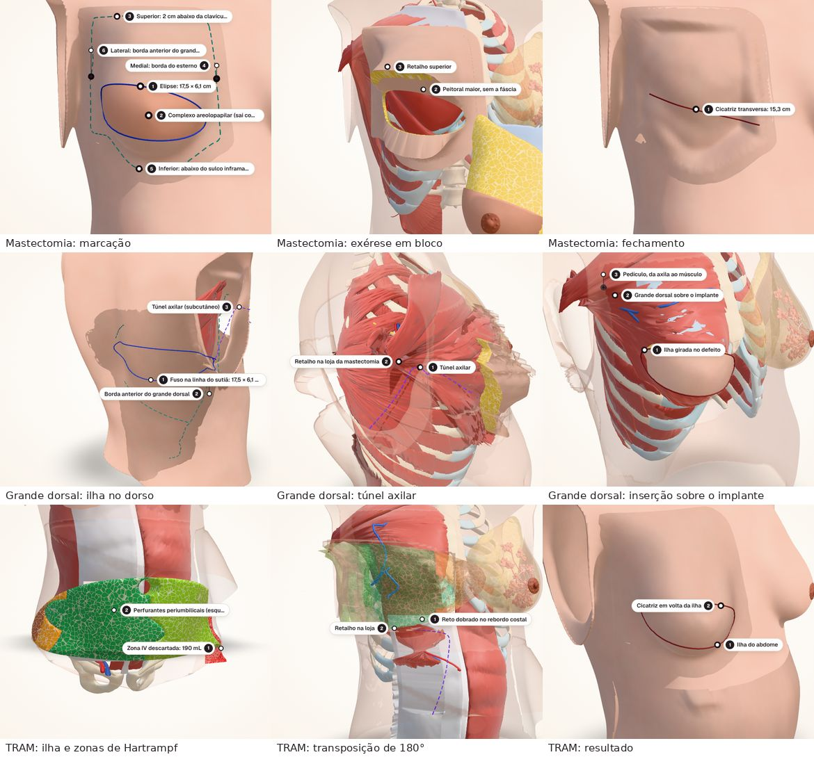

# Mastectomia e reconstrução com retalhos miocutâneos: grande dorsal e TRAM

## Objetivo

Simular uma paciente submetida a mastectomia e a reconstrução imediata da mama com os dois retalhos miocutâneos pediculados clássicos:

- o **grande dorsal** (GD), com ilha cutânea e implante;
- o **TRAM** pediculado (retalho transverso do reto do abdome).

O usuário deve ver, passo a passo, o que se marca, o que se corta, o que sai, o que fica e por onde passa cada tecido. Também deve ver as estruturas usadas (músculo, pedículo, ilha cutânea, zonas de perfusão) e os números de cada etapa.

Os músculos e o subcutâneo são remodelados com a mesma maquinaria da mama (carta da mama, superfície de base e mapas). A forma final da mama reconstruída é o envelope cutâneo da própria mama, preenchido pelo retalho.

**Situação:** implementado. Os números medidos estão em "Resultado medido" (seção 6) e o que mudou durante a implementação, em "O que mudou em relação ao plano" (seção 7).

## 1. A paciente simulada

- **Mama operada.** É a mama do modelo como escaneada (estado "sem ptose"):
  - 427 mL;
  - mamilo 51 mm acima do sulco;
  - fúrcula–mamilo 22,6 cm;
  - projeção 55 mm.
- **Mama contralateral.** Fica intacta (433 mL) e serve de referência de simetria.
- **Hábito.** É o do modelo em repouso.
- **Lado.** O lado operado é o mesmo da mamoplastia. As estruturas usadas são as do lado de origem esquerdo do BodyParts3D, apresentado como direito.
- **Cirurgia oncológica.** A paciente faz mastectomia total (simples) com incisão elíptica transversa (tipo Stewart), englobando o complexo areolopapilar.
- **Reconstrução.** É imediata, no mesmo tempo. A pele que a elipse tira é reposta pela ilha cutânea do retalho.
- **Abordagem da axila.** A biópsia do linfonodo sentinela ou o esvaziamento ficam fora da simulação.

Por que esse cenário:

- Ele mostra a mastectomia por inteiro: marcação, retalhos, peça e leito.
- Ele exige um retalho com pele. Nos dois retalhos, a ilha cutânea entra exatamente no defeito da elipse.

As variantes (poupadora de pele, poupadora do complexo areolopapilar, reconstrução tardia) são citadas nos textos, mas não são modeladas.

## 2. Técnica e anatomia

### 2.1 Mastectomia total com incisão elíptica

1. **Marcação**, com a paciente sentada.
   - **Elipse transversa.** É levemente oblíqua para a axila e centrada no complexo areolopapilar. O comprimento tem cerca de 3 vezes a altura. A altura é escolhida pelo pinçamento, para os retalhos fecharem sem tensão.
   - **Limites da dissecção:**
     - superior: 2 cm abaixo da clavícula;
     - medial: borda lateral do esterno;
     - inferior: sulco inframamário (até a bainha do reto);
     - lateral: borda anterior do grande dorsal.
2. **Incisão** da pele na elipse.
3. **Retalhos cutâneos**, superior e inferior. São levantados no plano entre o subcutâneo e a glândula (fáscia superficial, quando existe), com espessura uniforme.
   - A literatura mostra retalhos de 4 a mais de 20 mm, conforme a paciente. Não há espessura universal.
   - Retalhos finos demais aumentam a necrose sem ganho oncológico.
   - O modelo usa 6 mm.
4. **Exérese em bloco.** A glândula sai com a fáscia do peitoral maior, a pele da elipse, o complexo areolopapilar e a cauda axilar (de Spence).
   - A dissecção vai de medial para lateral.
   - São ligadas as perfurantes da torácica interna (2º a 4º espaços) e os ramos da torácica lateral.
   - O peitoral maior fica (na radical de Halsted, ele sairia).
5. **Leito.** O peitoral maior fica exposto. Os retalhos caem sobre a parede: o contorno fica plano ou côncavo, sem o monte e sem o coxim retromamário.
6. **Sem reconstrução,** os retalhos são aproximados sobre dreno aspirativo, com cicatriz transversa.

### 2.2 Retalho miocutâneo do grande dorsal pediculado, com implante

**Anatomia**

- **Origem.** Processos espinhosos de T7 a L5 e sacro (pela fáscia toracolombar), crista ilíaca posterior, 3 ou 4 últimas costelas e, com frequência, o ângulo inferior da escápula.
- **Inserção.** Assoalho do sulco intertubercular do úmero. O tendão gira em volta do redondo maior.
- **Irrigação.** Tipo V de Mathes–Nahai: um pedículo dominante, o toracodorsal, e pedículos segmentares secundários (perfurantes das intercostais posteriores e lombares).
- **Artéria toracodorsal.**
  - É o ramo terminal da subescapular, que nasce da 3ª porção da axilar, depois da saída da circunflexa da escápula.
  - Desce na face profunda do músculo, dá o ramo do serrátil e entra no hilo cerca de 8 a 10 cm abaixo da axilar, 2 a 3 cm medial à borda anterior.
  - Divide-se em ramo lateral (descendente, a cerca de 2 cm da borda anterior) e ramo medial (transverso, ao longo da borda superior).
  - A artéria tem 1,5 a 3 mm, a veia 3 a 4 mm. O pedículo mede 8 a 10 cm, mais se dissecado até a subescapular.
  - O ramo do serrátil permite fluxo retrógrado se a toracodorsal for ligada acima dele.
- **Nervo toracodorsal** (C6–C8, fascículo posterior). Acompanha os vasos.
- **Ilha cutânea.** É um retalho miocutâneo: a pele, a derme e a gordura da ilha valem tanto quanto o músculo, porque repõem a pele que a mastectomia tirou.
  - Fica toda sobre o músculo e é nutrida por perfurantes musculocutâneas, que entram pela sua parte central.
  - O desenho mais usado é o fuso transverso na linha do sutiã, logo abaixo da ponta da escápula: a cicatriz do dorso fica horizontal, escondida. Há também a oblíqua e a vertical; a escolha depende do defeito e de onde a paciente prefere a cicatriz.
  - A largura vai até 8 a 10 cm para fechamento primário (teste do pinçamento); o comprimento é cerca de 3 vezes a largura, com pontas afiladas.
  - A ilha tem dois arcos de rotação: o do retalho, em volta da axila, e o dela sobre o músculo, em volta das perfurantes. Ao passar para a frente, o fuso transverso chega à mama inclinado; descolar até um terço de cada ponta deixa deitá-lo na horizontal.

**Técnica**

1. **Decúbito lateral,** com o braço fletido a 90° sobre o apoio. No modelo, os passos ficam na posição anatômica; a vista "Decúbito lateral" do pack do grande dorsal mostra a posição.
2. **Incisão da ilha e descolamento** da pele do dorso acima da fáscia do músculo, até os limites:
   - borda superior (ponta da escápula, sob o trapézio);
   - borda anterior;
   - crista ilíaca;
   - linha das espinhosas.
3. **Liberação do músculo.**
   - As origens são seccionadas de distal para proximal: fáscia toracolombar, crista ilíaca, costelas inferiores e ponta da escápula.
   - O músculo é separado do serrátil e do redondo maior.
4. **Pedículo.**
   - O músculo é rebatido e mostra o pedículo na face profunda.
   - O ramo do serrátil é ligado.
   - O nervo toracodorsal é seccionado (conduta frequente, não universal: reduz a contração do retalho sobre o implante).
   - O tendão é liberado em parte, o que aumenta o arco e evita o volume na axila.
5. **Túnel subcutâneo alto na axila,** largo o bastante para não comprimir o pedículo. O retalho passa do dorso para a loja da mastectomia.
6. **Fechamento do dorso,** ainda em decúbito lateral.
   - Drenos e pontos de adesão (quilting): num ensaio randomizado de 108 mulheres, o seroma caiu de 96% para 83%.
   - Fechamento por planos e cicatriz na linha do sutiã.
7. **Decúbito dorsal: implante.** O implante vai na loja, coberto pelo grande dorsal. No modelo, o implante fica sobre o peitoral maior, sob o próprio grande dorsal. A variante subpeitoral, com o grande dorsal completando o polo inferior, é citada no texto.
8. **Inserção.**
   - O músculo é suturado ao sulco inframamário, à borda esternal e ao peitoral maior acima.
   - As pontas do fuso (um terço de cada) são descoladas do músculo e a ilha é girada sobre ele, presa pelo centro, até deitar no defeito transverso; então é suturada.
   - O excesso distal do músculo é acomodado no contorno (na prática, pregueado ou aparado).
9. **Resultado.** Mama com ilha cutânea do dorso e cicatriz no dorso.
   - Complicações: seroma (a mais comum), necrose parcial, contratura capsular, animação e perda de força pequena.

### 2.3 TRAM pediculado (Hartrampf, 1982)

**Anatomia**

- **Reto do abdome.**
  - Vai do púbis (crista e sínfise) às 5ª a 7ª cartilagens costais e ao processo xifoide.
  - Tem três interseções tendíneas (uma na altura do umbigo).
- **Bainha.**
  - Acima da linha arqueada, a aponeurose do oblíquo interno se divide em lâminas anterior e posterior. A posição da linha varia: os textos a põem de um terço à metade do caminho entre o púbis e o umbigo; num estudo de cadáveres ela ficou, em média, a 70% da distância da sínfise ao umbigo (Loukas, 2008).
  - Abaixo dela, todas as aponeuroses passam à frente; atrás do músculo fica só a fáscia transversal.
- **Irrigação.** Tipo III de Mathes–Nahai: dois pedículos dominantes.
  - **Epigástrica superior.** É a continuação da torácica interna e entra na bainha atrás da 7ª cartilagem.
  - **Epigástrica inferior profunda (AEIP).** Nasce da ilíaca externa, sobe medial ao anel inguinal profundo e entra na bainha perto da linha arqueada.
  - As duas se ligam por vasos de choke acima do umbigo. A AEIP é a dominante da pele do abdome inferior, por perfurantes periumbilicais em fileiras medial e lateral.
  - O TRAM pediculado vive da epigástrica superior, a menos dominante. Por isso as zonas distantes perfundem mal.
- **Inervação.** Nervos segmentares T7 a T12. Entram pela borda lateral e são seccionados.
- **Zonas de Hartrampf.**
  - I: sobre o reto do pedículo;
  - II: sobre o reto contralateral, além da linha média;
  - III: lateral ao lado do pedículo;
  - IV: lateral contralateral, a pior perfundida e descartada.
  - Scheflan e Dinner (1983), e Holm (2006) para a AEIP, trocam a ordem de II e III. A angiografia com fluorescência mostra o padrão de Hartrampf quando o fluxo vem da epigástrica superior.

**Técnica**

1. **Marcação.**
   - Elipse do abdome inferior: borda superior 1 a 2 cm acima do umbigo, inferior na prega suprapúbica, lateral até as espinhas ilíacas ântero-superiores.
   - Marcam-se também o umbigo, o contorno do reto, o rebordo costal, as zonas e o trajeto do túnel.
   - O fechamento é avaliado pelo pinçamento.
2. **Incisões** da elipse e periumbilical.
   - O retalho abdominal superior é descolado até o rebordo costal e o xifoide, como na abdominoplastia.
   - Faz-se o túnel subcutâneo epigástrico até a loja, pelo sulco inframamário medial. As aderências laterais do sulco são preservadas.
3. **Ilha.**
   - É levantada de lateral para medial, acima da aponeurose do oblíquo externo: até a fileira lateral de perfurantes no lado do pedículo e até a linha média no lado oposto.
   - A zona IV e a ponta da III são descartadas.
4. **Bainha e vasos inferiores.**
   - A bainha anterior é incisada em volta das perfurantes; uma faixa de bainha fica com o músculo.
   - O reto é seccionado abaixo da ilha, com ligadura dos vasos epigástricos inferiores profundos.
5. **Músculo.** O reto é levantado da bainha posterior até o rebordo costal, com os vasos epigástricos superiores na face profunda.
6. **Túnel e rotação.**
   - O retalho passa pelo túnel.
   - Com pedículo ipsilateral, faz uma transposição direta de 180° no plano sobre o rebordo costal: a borda do umbigo fica embaixo, junto ao sulco, e a zona III, lateral no abdome, fica medial na mama.
   - O pedículo contralateral é a alternativa, com arco mais suave do músculo.
7. **Inserção.**
   - Desepiteliza-se tudo, exceto a ilha que repõe a pele do defeito.
   - A mama é moldada: preenchimento do polo inferior, cone e sulco.
8. **Fechamento abdominal.**
   - **Bainha anterior** suturada, ou reforçada com tela. Abaixo da linha arqueada, o reparo é obrigatório, pelo risco de hérnia.
   - **Pele e umbigo.** O retalho superior é avançado até a incisão suprapúbica e o umbigo é exteriorizado (onfaloplastia), sobre drenos.
9. **Resultado.** Mama com a ilha do abdome, cicatriz abdominal transversa e periumbilical.
   - **Complicações:** necrose gordurosa (5 a 20%), necrose parcial (zonas III e IV), abaulamento ou hérnia, seroma.
   - **Contraindicações relativas:** tabagismo, obesidade grave e cicatrizes que cortam os vasos (subcostal).
   - **Evoluções:** "delay" (ligadura prévia da AEIP), TRAM bipediculado, TRAM livre, DIEP.

## 3. Como o modelo simula

### 3.1 Cartas

- **Carta do tronco.** São coordenadas cilíndricas em volta do eixo vertical do tronco, as mesmas da carta da mama (`bb.Chart`):
  - u = 170 mm × ângulo (lateral +);
  - v = altura acima do mamilo;
  - r = raio.
  - A faixa é estendida para cobrir o dorso do lado operado (até a linha das espinhosas) e o abdome dos dois lados, até o púbis.
- **Campos de raio (grade de 2 mm):**
  - **pele:** a do tronco e o abdome inferior do HRA;
  - **parede:** costelas, cartilagens, intercostais, serrátil, peitoral maior, oblíquo externo, redondo maior, reto do abdome e fáscias, sem o grande dorsal e o trapézio;
  - **faces do grande dorsal:** a profunda e a superficial;
  - **bainha do reto:** o plano da aponeurose.
- **Plano desenrolado** (σ, τ). σ é o comprimento de arco ao longo de cada linha da parede (∫√(r² + r_θ²) dθ) e τ = v. Nele, uma rotação no plano é aproximadamente uma isometria da superfície. Os movimentos dos retalhos são descritos ali e levados de volta ao espaço do modelo pela parede, mais a altura de cada ponto sobre ela.

### 3.2 Mastectomia

- **Malha da pele.** A pele da mama operada e a região descolada formam uma malha triangulada na carta (Delaunay conforme, como na mamoplastia). A elipse e os limites estão entre as arestas da malha.
- **Pele que vai à peça e retalhos.** A pele da elipse e o complexo areolopapilar vão com a peça. O resto são os retalhos, uma casca de pele com 6 mm de subcutâneo.
  - Na face interna, que aparece ao levantar o retalho, o subcutâneo é amarelo.
- **Retalhos levantados.** Giram em volta da linha de base, nos limites. Ficam erguidos como por afastadores, mostrando a glândula.
- **Peça.**
  - É formada pelas malhas da mama do modelo (glândula, ductos, gordura, ligamentos e complexo areolopapilar), pela pele da elipse e pela fáscia peitoral sob a mama.
  - Sai em bloco, por um arco, para a frente e para baixo.
  - O volume da peça é medido.
- **Leito.** A pele cai na parede pós-mastectomia: R = parede + 6 mm onde estava o monte, com transição suave até a pele intacta nas bordas.
  - Mantém o subcutâneo do esterno e do abdome.
  - Fica abaixo da superfície de base da mama: o coxim retromamário sai com a peça. É a concavidade típica da parede pós-mastectomia.
- **Fechamento sem reconstrução.** As bordas da elipse vão à linha média dela por um mapa harmônico de valor médio (`mr.mean_value_solve`, o mesmo do fechamento da mamoplastia). O resultado é uma cicatriz transversa e um tórax plano.

### 3.3 Grande dorsal

- **Músculo.** Uma cópia simplificada da malha real do grande dorsal do BodyParts3D 3.0, com cerca de 6 mil triângulos.
- **Coordenadas de cada vértice:** (σ, τ, h), com h a altura sobre a parede.
- **Ilha cutânea.** Fuso transverso na linha do sutiã: o centro 3,5 cm abaixo da ponta da escápula, a ponta lateral 1 cm por dentro da borda anterior do músculo, com o tamanho do defeito sobre a pele.
  - A transposição é uma rotação no plano em volta de um ponto fixo, mais uma translação: leva o centro da ilha ao centro do defeito, e o ângulo é escolhido para o hilo cair na direção do pivô (origem do pedículo, na axila), ao alcance do pedículo.
  - Com o giro do retalho, o fuso chega à mama inclinado. Na inserção ele gira sobre o músculo, em volta do centro, até o eixo do defeito; as pontas (um terço de cada) são descoladas e erguidas no quadro intermediário. Depois do giro, um mapa afim o leva ao defeito.
  - Perfurantes musculocutâneas esquemáticas ligam o músculo à derme no terço central da ilha.
- **Pele do dorso.** Outra malha em carta, com a ilha e a zona descolada entre as arestas, e um fechamento harmônico da área doadora.
- **Quadros do músculo:**
  - repouso;
  - liberado (cortado das origens e solto, poucos mm acima do leito);
  - rebatido em volta de uma linha distal ao hilo (dobra com raio de 20 mm, como uma página), mostrando a face profunda com o pedículo;
  - trânsito pelo túnel, em quadros intermediários: a rotação avança enquanto o retalho se recolhe em direção ao pivô, como quando é puxado pelo túnel, e a altura é limitada ao subcutâneo da axila, para passar sob a pele;
  - deitado na parede anterior;
  - sobre o implante;
  - inserido e moldado.
- **Implante.** É o espaço que sobra no envelope da mama, descontada a cobertura:
  - nos retalhos da mastectomia: espessura do grande dorsal + 6 mm;
  - na ilha: grande dorsal + ilha.
  - A forma é suavizada e o volume medido.
- **Moldagem final**, pela carta da mama.
  - O contorno do músculo transposto é levado ao contorno da loja por um mapa de placa fina no plano; a ilha segue o próprio giro, independente do músculo.
  - Cada ponto fica na fração da espessura que tinha: o músculo vai sobre o implante, a ilha fica na pele e os retalhos da mastectomia voltam ao envelope de repouso da mama.
- **Vasos e nervo.**
  - A linha central dos vasos e do nervo toracodorsais é extraída das malhas reais.
  - O trecho intramuscular segue o músculo.
  - O trecho livre, da origem ao hilo, é refeito em cada quadro: uma curva de Hermite com a tangente da origem fixa e a do hilo vinda do músculo.
  - Os ramos descendente e transverso são traçados na face profunda (camada esquemática, a partir de Tobin 1981).
  - O ramo do serrátil e a secção do nervo aparecem no quadro do pedículo.
  - A conferência mede o comprimento do pedículo em cada quadro: a distância da origem ao hilo nunca deve passar do comprimento livre.

### 3.4 TRAM

- **Estruturas novas** (só nas vistas do TRAM, sem mudar o GLB do tronco):
  - **do Z-Anatomy, pela mesma similaridade já calibrada:** retos do abdome dos dois lados, piramidais, linha alba, oblíquo interno, transverso e oblíquo externo contralateral;
  - **do BodyParts3D 4.3:** vasos epigástricos inferiores profundos e superficiais, ilíacos externos, epigástricos superiores contralaterais, osso do quadril contralateral e ligamentos inguinais;
  - **do HRA:** a pele do abdome inferior até o púbis. O tronco do modelo é recortado logo abaixo das espinhas ilíacas.
- **Retalho.**
  - É uma peça fechada na carta: pele da elipse em cima e plano da aponeurose embaixo.
  - É dividida nas quatro zonas de Hartrampf pelas bordas do reto e pela linha média.
  - Leva o segmento do reto sob a ilha, a faixa de bainha e as perfurantes periumbilicais (esquemáticas, em duas fileiras).
- **Vasos.**
  - Os epigástricos superiores seguem o músculo, que gira sobre o pivô no rebordo costal.
  - Os inferiores profundos são ligados na borda inferior. O trecho acima segue o músculo; o de baixo fica.
- **Transferência.** O retalho sobe pelo túnel do lado da mama e gira 180° no caminho, em 4 quadros intermediários. O centro segue um caminho curvo para a linha média, que cruza o rebordo no túnel, no fim medial do sulco. No meio do caminho o retalho é estreitado à metade, para passar.
  - O reto acompanha: a parte presa ao retalho gira com ele e o resto dobra-se sobre si mesmo junto ao rebordo, com meia torção, aos poucos.
  - As peles do abdome e da mama passam por cima do retalho e do músculo em cada quadro.
- **Moldagem** igual à do grande dorsal, sem implante.
  - O contorno das zonas I a III vai ao contorno da mama, a ilha à elipse e a gordura enche o monte por fração de espessura.
  - O volume que sobra (zona IV e excesso) é medido e mostrado como descartado.
- **Fechamento abdominal.** Mapa harmônico da pele: a borda superior da elipse desce até a inferior. O umbigo fica no lugar e reaparece pela abertura nova. A bainha é fechada com uma linha de sutura.

### 3.5 Formato e app

- **Dados.** Um arquivo por sequência, no mesmo formato dos passos da mamoplastia:
  - posições uint16 por quadro guardado e índices uint16;
  - `src/data/reconstructionSteps.json`;
  - `public/models/hybrid/reconstruction-<mastectomia|grande-dorsal|tram>.bin`.
  - O JSON é registrado junto dos arquivos de passos (`planCases.ts`), para malhas e estruturas entrarem no modelo como as da mamoplastia.
- **Buracos na pele do tronco.** Cada sequência abre mais de um buraco: mama, dorso e abdome. A lista `holes` diz em que carta cada um é testado. O buraco da mama mantém o filtro de profundidade.
- **Estruturas do tronco substituídas.** Nos passos, cada sequência diz quais estruturas e malhas do tronco ela substitui (`replaces`): grande dorsal, vasos e nervo toracodorsais, epigástricos superiores. Assim elas não aparecem duas vezes.
- **Packs.** Um grupo novo, "Reconstrução mamária", com:
  - "Mastectomia", com 6 passos;
  - "Grande dorsal pediculado", com 10 passos;
  - "TRAM pediculado", com 10 passos.
  - Cada passo tem texto, notas, rótulos ancorados, setas do movimento, medidas e capa.
- **Celular.** O grupo vira uma pasta com as três técnicas.

## 4. Conferências

`scripts/hybrid/check_flaps.py` (`npm run check:flaps`) lê o que o app carrega (o JSON e os binários) e falha quando um limite é passado:

- **Pedículo do grande dorsal.** A distância da origem ao hilo, em todos os quadros, é ≤ 1,01 × o comprimento livre.
- **Malhas de pele.** Triângulos invertidos em relação ao repouso, pela direção para fora do tronco, ≤ 1% de cada malha nos quadros em que a pele está deitada no corpo (os retalhos erguidos e as peças em movimento não entram).
- **Encaixe da ilha.** No resultado, a borda da ilha fica a ≤ 2 mm da borda do defeito (p95).
- **Tecido.** No resultado, nenhum vértice da gordura, do músculo ou do implante fica mais de 1,5 mm fora da pele da mama, e o implante não entra mais de 2 mm na parede.
  - O reto do TRAM, dobrado sobre o rebordo, levanta a pele: ele é conferido contra a pele como posta sobre ele (inserção, fechamento e resultado), e contra a pele do tronco onde nenhuma pele da sequência o cobre.
- **Volumes e comprimentos.** São gravados com os dados e mostrados nos textos.
- **Buracos.** Cada malha de pele passa 1,5 mm da borda do buraco aberto na pele do tronco, para não deixar frestas.

## 5. Limitações (ditas no texto)

- **Posição.** O modelo fica na posição anatômica. A coleta real do grande dorsal é feita em decúbito lateral, com o braço fletido.
- **Movimentos e forma do retalho.**
  - O trânsito pelo túnel e a moldagem são mapas suaves, não simulação de tecidos.
  - O excesso dos retalhos aparece como compressão no contorno ou como peça descartada.
  - A forma final segue o envelope da mama em repouso, o objetivo da reconstrução imediata; o resultado real varia.
- **Estruturas de outro corpo.** Reto do abdome, oblíquos e transverso vêm do Z-Anatomy, outro corpo, encaixado por similaridade. A conferência mede a folga deles para a pele HRA.
- **Esquemas.** As perfurantes e os ramos intramusculares são esquemáticos (trajetos típicos da literatura).
- **Tom da pele.** A pele das sequências tem cor própria, sem as manchas pintadas da pele do tronco. Na mama a emenda é leve; no dorso, onde o retalho de pele é maior, a diferença de tom aparece mais.

## 6. Resultado medido

Os números são do modelo, gravados em `src/data/reconstructionSteps.json`.

**Mastectomia** (6 passos, 0,9 MB de dados)

- Elipse de 17,5 × 6,1 cm, inclinada 14° para a axila; 77 cm² de pele saem com a peça.
- Peça: a mama inteira, 427 mL, com a fáscia do peitoral maior.
- Retalhos com 6 mm de subcutâneo.
- Fechamento sem reconstrução: cicatriz de 15,3 cm (a elipse mais 12 mm em cada ponta, para não deixar orelhas).

**Grande dorsal com implante** (10 passos, 1,1 MB)

- Fuso transverso do tamanho do defeito, 17,5 × 6,1 cm, na linha do sutiã: o centro 3,5 cm abaixo da ponta da escápula.
- O retalho gira 109° até a loja; o fuso chega inclinado 71° e gira 57° sobre o músculo para deitar no defeito.
- Pedículo livre de 86 mm. A maior razão entre a distância origem–hilo e o comprimento livre, em todos os quadros, foi 1,0.
- Músculo levado: 69% do grande dorsal, 535 cm², 326 mL, 6,1 mm de espessura média. O tendão fica no úmero.
- Implante: 129 mL. Gordura sob a ilha: 31 mm.
- Cicatriz do dorso: 19,9 cm, horizontal.

**TRAM pediculado** (10 passos, 3,1 MB)

- Lente de 45,4 × 14,0 cm (de espinha a espinha, medida na superfície), com 4,5 cm de gordura abaixo do umbigo.
- Retalho inteiro: 1.586 mL.
  - Zona I: 672 mL; zona II: 599 mL; zona III: 72 mL, mais a ponta de 53 mL, aparada; zona IV: 190 mL, descartada.
  - Restam 1.343 mL, cerca de 3 vezes a mama retirada.
- Reto entre o rebordo costal e a ilha: 148 mm. Transposição de 180°.
- Avanço do retalho abdominal superior: 14 cm.

**Conferências** (`npm run check:flaps`, todas passam)

| Conferência | Limite | Resultado |
|---|---|---|
| Pele invertida (pior quadro de cada malha) | ≤ 1% | mastectomia 0,16%; dorso 0,85%; ilha do GD 0,00%; abdome 0,22%; ilha do TRAM 0,11%; pele da mama 0,03% |
| Pedículo do grande dorsal | ≤ 1,01 | 1,0 |
| Borda da ilha à borda do defeito (p95) | ≤ 2 mm | GD 1,5 mm; TRAM 1,1 mm |
| Retalho fora da pele da mama, no resultado | ≤ 1,5 mm | nenhum vértice fora (GD: músculo, gordura e implante; TRAM: zonas I a III) |
| Reto do TRAM fora da pele sobre ele | ≤ 1,5 mm | 4,0 mm abaixo na inserção; 2,0 mm abaixo no fechamento e no resultado |
| Implante dentro da parede | ≤ 2 mm | não entra |

Os triângulos invertidos que sobram ficam nas pontas dos fechamentos e, no dorso, também na prega axilar, onde a pele fica quase paralela à direção radial que a conferência usa.

## 7. O que mudou em relação ao plano

- **Limite lateral da mastectomia.** Ficou em u = 246 mm na carta do tronco, um pouco antes da borda anterior do grande dorsal. Além dele, a mama lateral pende sobre a parede e a pele não se deixa planificar na carta.
- **Músculo do grande dorsal.** É levado na medida da loja, 69% do músculo, dividido distalmente. O tendão fica preso ao úmero; a liberação parcial é citada no texto.
- **Grande dorsal na região lombar.** Sob a pele do HRA, o grande dorsal do BodyParts3D atravessa a pele lombar em até 20,7 mm. Nos passos ele é recolhido para dentro dela.
- **Parede abdominal.** Os retos, os oblíquos e os vasos epigástricos vêm de corpos masculinos e ficavam cerca de 10 cm atrás da pele feminina. Um campo radial suave os traz para a frente, deixando 31 a 40 mm de subcutâneo (`CONFORM` em `build_flap_sources.py`).
- **Reto do TRAM.** O trecho entre o rebordo e a ilha (148 mm) é mais longo que o caminho até a loja. No modelo, ele fica no leito, dobra-se e volta por cima com meia torção, estreitando-se como um feixe. A pele do epigástrio e a da mama são postas sobre a dobra: é o abaulamento epigástrico do TRAM pediculado. O plano previa só a rotação no plano, que esticava as faces do músculo.
- **Vasos epigástricos.** São tubos refeitos em cada quadro ao longo da linha central das malhas do BodyParts3D. As malhas inteiras rasgavam na dobra do músculo.
- **Leito do reto.** Foram acrescentadas a bainha posterior, acima da linha arqueada, e a fáscia transversal, abaixo dela. O oblíquo externo do BodyParts3D segue sobre o reto como aponeurose; nos passos do TRAM ele é cortado na linha semilunar, e a aponeurose é a bainha anterior desenhada. Sem isso, o leito aparecia vermelho, como se ainda tivesse músculo.
- **Fechamento do abdome.** É feito coluna a coluna: o retalho superior estica até a incisão suprapúbica. O mapa harmônico de valor médio do plano invertia 763 triângulos; restam 12 lascas.
- **Volume do TRAM.** Com 4,5 cm de gordura, as zonas I a III somam mais de 3 vezes a mama. O texto diz isso. No modelo, elas são comprimidas no envelope em vez de aparadas.
- **Pele invertida.** O plano pedia nenhum triângulo invertido. Sobram até 0,85% por malha, nas pontas dos fechamentos, e a conferência só olha os quadros em que a pele está deitada no corpo.

### 7.1 Ajustes depois do primeiro teste no app

- **Grande dorsal: fuso transverso na linha do sutiã.** A primeira versão desenhava a ilha como a imagem do defeito levada de volta pelo giro do retalho; ela ficava quase vertical no dorso. A marcação usual é o fuso transverso na linha do sutiã, com cicatriz horizontal.
  - Agora o fuso fica 3,5 cm abaixo da ponta da escápula, sobre o músculo, e chega à mama inclinado 71°.
  - Na inserção ele gira 57° sobre o músculo: é o segundo arco de rotação da ilha, em volta das perfurantes, com as pontas descoladas.
  - A ilha é tratada como parte do retalho, não como acessório: tem perfurantes esquemáticas, ficha própria e rótulos.
- **TRAM: caminho do retalho.** O giro de 180° era feito em volta de um ponto entre o abdome e a mama: no meio da animação, o retalho passava por cima do lado oposto. Agora ele sobe pelo túnel do lado da mama, girando no caminho, em 4 quadros intermediários em vez de 2.
- **TRAM: o reto gira junto.** Antes, o reto ficava no leito nos quadros intermediários e aparecia dobrado só no último. Agora a parte presa ao retalho gira com ele e a dobra com meia torção se forma aos poucos; as peles passam por cima.
- **TRAM: cada passo isola o que mostra.** Bainha e elevação do músculo mostram só a zona I, o reto, a bainha e os vasos, sem as outras zonas nem a pelve. No túnel, o retalho fica translúcido para o reto e os vasos aparecerem dentro dele.

## 8. Referências

- Hartrampf CR, Scheflan M, Black PW. Breast reconstruction with a transverse abdominal island flap. *Plast Reconstr Surg* 1982;69:216–225.
- Scheflan M, Dinner MI. The transverse abdominal island flap: indications, contraindications, results, and complications. *Ann Plast Surg* 1983;10:24–35.
- Holm C et al. Perfusion zones of the DIEP flap revisited: a clinical study. *Plast Reconstr Surg* 2006;117:37–43.
- Perfusão do TRAM pediculado por fluorescência (zonas de Hartrampf com fluxo pela epigástrica superior): https://pmc.ncbi.nlm.nih.gov/articles/PMC3226762/ e https://pmc.ncbi.nlm.nih.gov/articles/PMC7544314/
- The Pedicled TRAM Flap in Breast Reconstruction. *Clin Plast Surg* 2007 (transposição ipsilateral direta de 180°): https://www.sciencedirect.com/science/article/abs/pii/S0094129806001246
- Pedículo ipsilateral como alternativa segura: https://pubmed.ncbi.nlm.nih.gov/15785271/
- Olivari N. The latissimus flap. *Br J Plast Surg* 1976;29:126–128.
- Bostwick J, Vasconez LO, Jurkiewicz MJ. Breast reconstruction after a radical mastectomy. *Plast Reconstr Surg* 1978;61:682–693.
- Tobin GR et al. The intramuscular neurovascular anatomy of the latissimus dorsi muscle. *Plast Reconstr Surg* 1981;67:637–641.
- Mathes SJ, Nahai F. Classification of the vascular anatomy of muscles. *Plast Reconstr Surg* 1981;67:177–187.
- Loukas M et al. Arcuate line of the rectus sheath: clinical approach. *Anat Sci Int* 2008: https://link.springer.com/article/10.1111/j.1447-073X.2007.00221.x
- Daltrey I et al. Randomized clinical trial of the effect of quilting latissimus dorsi flap donor site on seroma formation. *Br J Surg* 2006;93:825–830.
- Espessura dos retalhos da mastectomia: as revisões mostram grande variação entre pacientes e estudos e não recomendam uma espessura universal: https://pmc.ncbi.nlm.nih.gov/articles/PMC6382218/
- Fáscia superficial inconstante como plano: https://gs.amegroups.org/article/view/7156/html
